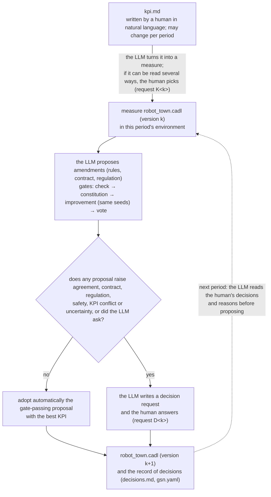
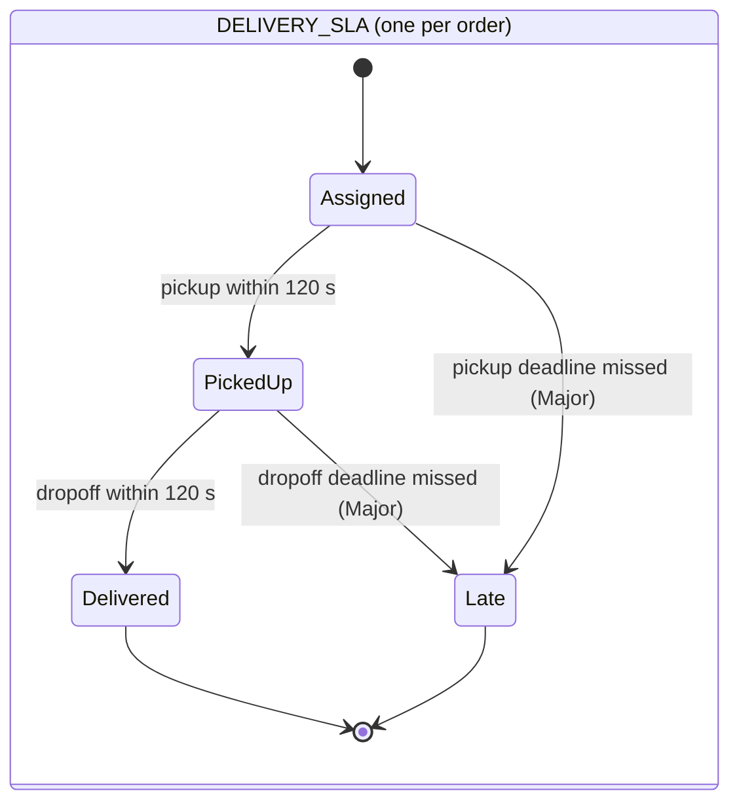
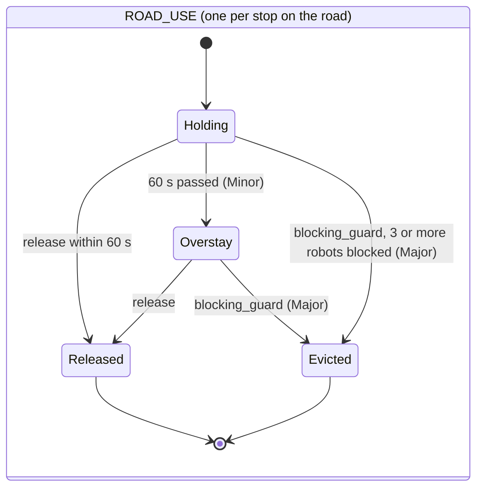
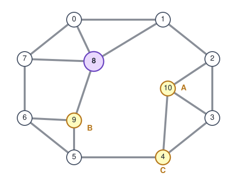
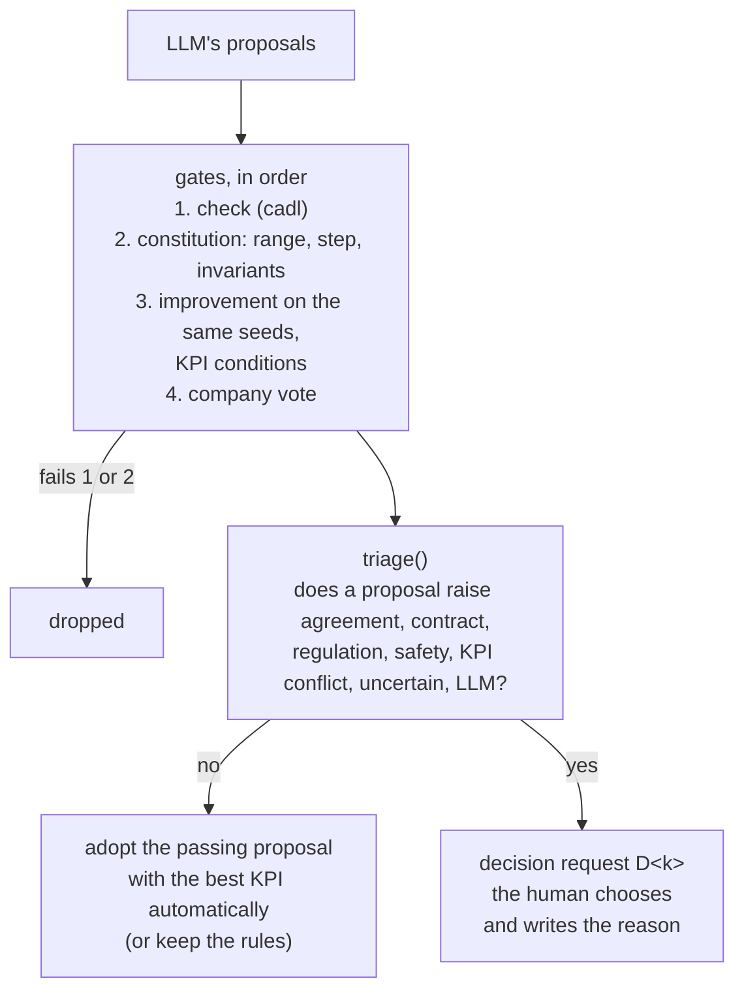
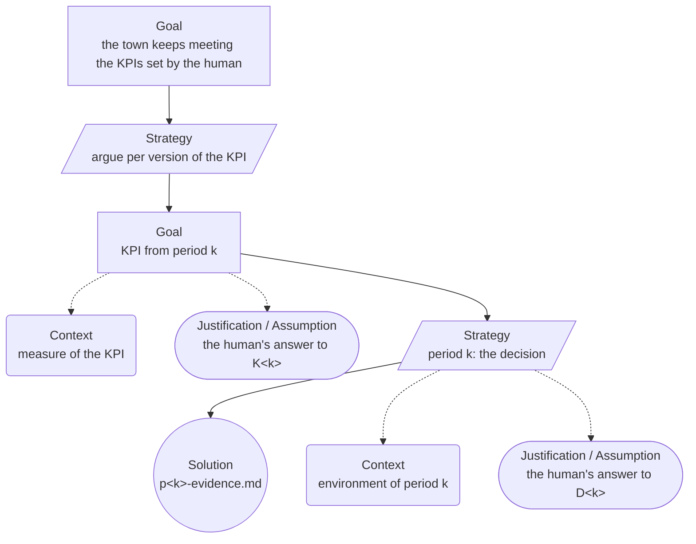
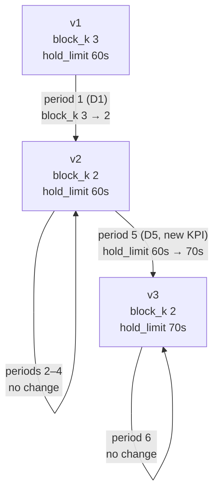
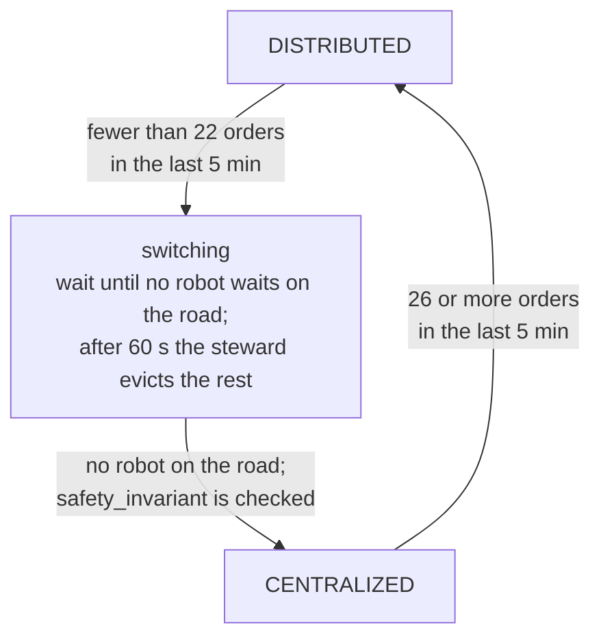

# Course D — Robot Town: Amending Rules Toward a KPI

> ⬅ Back to Course A → [Course A — Robot Delivery](../textbook/index.md)

> **Audience**: Students who have completed [Course A](../textbook/index.md) (CADL/SoS-DSL basics).
> Course B is not required.
>
> **Time**: 120–150 minutes, plus optional stretch goals.
>
> **You will leave with**: KPIs written by a human in natural language, the LLM's amendment
> proposals and decision requests, the human's decisions with their reasons (in prose and in GSN),
> and the versions of the CADL rules and of the constitution that resulted, period by period.

---

## 0. What this course demonstrates

Courses A and B write a contract once and check a simulation against it. In Course D the
contract itself changes while the system runs. Three delivery companies (A, B, C; two robots
each) share the 11-node road network of the Raspberry Pi Mouse simulator. After each simulated
hour (one period), amendments to the rules are considered.

A human, an LLM and a set of mechanical gates share the work:

| Who | Does what |
|---|---|
| Human (the service operator) | Writes the service KPIs in natural language; the KPIs may change over time. Answers the LLM's decision requests and records the reason and the outcome, in prose or in GSN |
| LLM | Turns the KPI into measurable metrics and proposes amendments to rules, regulation and contracts toward it. When a question cannot clearly be settled, or when human stakeholders must agree, it does not decide: it asks the human and supplies what the decision needs |
| Gates | Check, constitution, improvement measured on the same random seeds, and the companies' vote. The LLM's own account is never trusted; only measured values count |



The exercise lives in the public repository
[`cadl-robot-town`](https://github.com/ertlnagoya/cadl-robot-town). It needs neither Unity nor
SUMO: the town is a small Python simulation, and the norms are judged by the same reference runtime
as Course A (`contract_engine.py`, copied from `cadl-raspimouse-simulator`).

:::info[About the recorded LLM output]
§4–§8 can be followed without an API key by replaying the records in `examples/steward-d-en/`
(English) and `examples/steward-goodhart/`. They are **records of real runs** with Claude Opus 5.5 on
2026-11-18 (cadl 0.3.36); `examples/steward-d/` holds a run in Japanese with the same KPI, which
parts from the English one in period 5 (§10). The answers to the decision
requests (`answers.yaml`) were written by Claude playing the human operator when the records were
made; from §4 on, answer them yourself. Every number shown is measured by the gates and the
simulation on replay. §10 shows how to run a real LLM with your own key.
:::

---

## 1. Setup (5 min)

All you need is the CADL compiler cloned in Course A (`~/program/cadl_repo`).

```bash
cd ~/program
git clone https://github.com/ertlnagoya/cadl-robot-town
cd cadl-robot-town
python3 -m venv .venv
source .venv/bin/activate
python3 -m pip install --upgrade pip
pip install -e ~/program/cadl_repo     # the cadl command and PyYAML
```

If the install fails, see the setup troubleshooting in [Section 2.4 of the Textbook](../textbook/02-toolchain-setup.md).

Only §10 (a real LLM) needs the Anthropic SDK and an API key.

```bash
pip install anthropic
```

> `town.steward --lang en` prints English and asks the LLM to write in English. `town.period`,
> `town.council` and `town.compare` print Japanese only; each step below explains what you need
> from their output.

---

## 2. Read the rules, the contract and the regulation (15 min)

Open `cadl/robot_town.cadl`. The town has two contracts.

- **`DELIVERY_SLA`**: one instance per order. Pick up within 120 s and deliver within 120 s of
  pickup, or the order becomes `Late`. This is the promise to customers.
- **`ROAD_USE`**: one instance each time a robot stops on the road to wait for its next order.

```yaml
    - id: DELIVERY_SLA
      parties: [TOWN_STEWARD, "ROBOT[*]"]
      guarantee:
        - "pickup_time <= 120s"         # @amend:pickup_deadline
        - "dropoff_time <= 120s"        # @amend:dropoff_deadline
      lifecycle:
        ...
          - id: pickup
            from: Assigned
            to:   PickedUp
            on:   "ROBOT[i].status == PickedUp"
            deadline: 120s            # @amend:pickup_deadline
            on_violation: { transition: Late, severity: Major }
        ...
    - id: ROAD_USE
      parties: [TOWN_STEWARD, "ROBOT[*]", COUNCIL]
      authority:
        decision_holder: COUNCIL
      incentives:
        type: sanction
        lambda: 0.5                   # @amend:sanction_lambda
      lifecycle:
        states: [Holding, Overstay, Released, Evicted]
        initial: Holding
        terminal: [Released, Evicted]
        transitions:
          - id: release
            from: [Holding, Overstay]
            to:   Released
            on:   "ROBOT[i] -> TOWN_STEWARD : node_released"
            deadline: 60s             # @amend:hold_limit
            on_violation: { transition: Overstay, severity: Minor }
      monitors:
        - id: blocking_guard
          observe: "ROBOT[i].blocking"
          sampling: periodic(1000ms)
          rule: "ROBOT.blocking >= 3 AND state IN [Holding, Overstay]"  # @amend:block_k
          on_match: { transition: Evicted, severity: Major }
```

(Excerpt, simplified.)

The two lifecycles, as state machines:





A line tagged `# @amend:<name>` holds a parameter that may be amended. When several lines carry
the same name (the pickup guarantee and the pickup deadline), they must all hold the same value.
Which **layer** a parameter belongs to and how far it may move is set by `constitution.yaml`:

```yaml
amendable:
  hold_limit:       {layer: rule,     min: 10, max: 120, step: 10}   # seconds a robot may wait on the road
  block_k:          {layer: rule,     min: 1,  max: 4,   step: 1}    # robots waiting behind it before eviction
  sanction_lambda:  {layer: rule,     min: 0.0, max: 1.0, step: 0.5} # sanction points per violation (Minor 1, Major 3)
  to_central:       {layer: rule, safety: true, ...}                  # operating-mode switch (§9)
  pickup_deadline:  {layer: contract, min: 60, max: 180, step: 30}   # promised seconds to pickup
  dropoff_deadline: {layer: contract, min: 60, max: 180, step: 30}   # promised seconds to delivery
invariants:
  min_company_on_time_rate: 0.6
vote:
  quorum: 2
regulation:
  invariants.min_company_on_time_rate: {min: 0.5, max: 0.95, step: 0.05}
  vote.quorum:                         {min: 1,   max: 3,    step: 1}
```

(Excerpt, simplified.)

There are three layers of amendment:

| Layer | Covers | Who decides |
|---|---|---|
| Rule | `ROAD_USE` and the operating-mode switching conditions | adopted automatically if it passes every gate; the switching conditions (`safety: true`) are decided by the human |
| Contract | `DELIVERY_SLA` (the promise to customers) | customers have no vote, so the human decides |
| Regulation | values in the constitution (invariants, quorum) | the human decides |

The three companies behave differently (`town/policies.py`): **A** always returns to its
garage; **B** waits on the road for its next order but leaves 5 s before `hold_limit`, and does not
wait on the road at all if a single waiting robot triggers eviction (`block_k` of 1); with no
sanctions (`sanction_lambda` of 0) a violation costs it nothing, so it waits as long as C does.
**C** waits until an order comes or it is evicted; at the highest sanction weight
(`sanction_lambda` of 1.0) it leaves 15 s after the time limit. CADL's check keeps the sanction
weight between 0 and 1, and an amendment moves it in steps of 0.5; §3 shows the companies at 0.5.
A robot stopped at an intersection blocks everyone who wants to pass through it.

The road network has 11 nodes and 17 roads (`town/world.py`). The garages of A, B and C are
nodes 10, 9 and 4 (yellow). A robot that waits on the road waits at the central intersection 8
(purple), the most convenient place to wait.



### Exercise 2-1

1. Which company can never be sanctioned under the current rules, and why?
2. If the pickup promise (`pickup_deadline`) were extended to 150 s, what would you expect to happen
   to the number of on-time deliveries? And to how long customers actually wait?
3. Why must an amendment to the contract layer not be settled by the companies' vote alone?

---

## 3. Run one period (10 min)

Fix the operating mode to distributed for now (§9 explains the modes):

```bash
python -m town.period --mode DISTRIBUTED
```

```text
需要: 各社の注文の平均間隔 75 秒
運用モード: DISTRIBUTED
規則: robot_town.cadl  (hold_limit=60s, block_k=3, sanction_lambda=0.5)
  定時配達 121.8 / 注文 132.2  未配達 0.0  ふさがれた時間 2404s  （シード平均）
  会社  定時率  遅配  道路で待った回数  ふさがれた秒数  罰点   効用
   A     0.84   7.8               0.0            1352    0.0   38.4
   B     0.94   2.6              38.0             849    0.9   38.9
   C     1.00   0.0              39.6             203   14.8   28.8
  違反（原因別，シード平均）: deadline:dropoff=2.6, deadline:pickup=7.8, deadline:release=23.0, monitor:blocking_guard=2.8
  運用モード: 集中の時間 0%  切替 0.0 回（切替中の合計 0s，管理者による退去 0.0 台，安全条件の違反 0.0 回）
```

The columns are: on-time rate, late deliveries, times waited on the road, seconds blocked by
stopped robots, sanction points, and utility (on-time deliveries minus sanction points). The
numbers are averages over five random seeds.

C waits on the road, reaches every customer on time, and pays 14.8 sanction points for it; A, which
never blocks anyone, is blocked for 1352 s and loses 7.8 deliveries. Every violation in the
second-to-last line was detected by the contract runtime from the IR: `deadline:*` by lifecycle
deadlines, `monitor:blocking_guard` by the monitor.

---

## 4. Write the KPI (15 min)

The human's first job is to write the KPI. In English it goes in `kpi.en.md`:

```markdown
## From period 1

Deliver as many orders as possible across the town within the times we promised customers
(120 seconds from order to pickup, 120 seconds from pickup to delivery). No company's customers
should be kept waiting badly.

## From period 5

The quiet season begins and orders fall. On-time delivery still matters, but to keep the
companies cooperating, no single company should gain or lose because of how the road is used.
```

A `## From period k` heading says when a KPI takes effect (the Japanese file, `kpi.md`, uses
`## 第 k 期から`). The loop re-reads the file at the start of every period, so you may edit it
between periods. `--lang en` makes the loop's own text and the LLM's writing English.

A natural-language KPI cannot rank proposals by itself. The LLM rewrites it as a combination of the
metrics in `town/kpi.py` (on-time deliveries, the on-time rate, late deliveries, unfinished orders,
waiting times, blocked time, the lowest company's on-time rate, the spread of the companies'
utilities, total sanctions, and so on).
This is the **measure**: a main goal (improvement is measured by it), watched goals (the human is
told if they get worse by more than the noise) and conditions (which every amendment must keep).

Replay the record and run one period. Without `--answers`, you answer decision requests in the
terminal.

```bash
python -m town.steward --lang en --mode DISTRIBUTED --rounds 1 --name try-d-en \
    --llm replay --replay-dir examples/steward-d-en
```

```text
  KPI (from period 1): Deliver as many orders as possible across the town within the times we promised customers (120 seconds from order to pickup, 120 seconds from pickup to delivery). No company's customers should be kept waiting badly.
  LLM: replay: examples/steward-d-en/p1-kpi.json (claude-opus-5-5, input 3056 / output 2096 tokens)
  Reading: The main aim is to maximize the number of orders delivered within the promised times (pickup within 120 s of order, delivery within 120 s of pickup) across the whole town, so on_time_deliveries is the primary goal. The second sentence adds a per-company protection: no company's customers should wait badly. It can be read as a tail of waiting times per company or as each company's on-time rate. The KPI gives no level for 'badly'.
   [1] Maximize on-time deliveries; watch the worst company's waiting tail (no level set): main goal on_time_deliveries (increase), worst_company_p95_wait_s (decrease), unfinished (decrease)
   [2] Maximize on-time deliveries; worst company's p95 wait within the promised total (240 s): main goal on_time_deliveries (increase), worst_company_p95_wait_s (decrease, target <= 240), unfinished (decrease)
   [3] Maximize on-time deliveries; protect the lowest company's on-time rate: main goal on_time_deliveries (increase), min_company_on_time_rate (increase), unfinished (decrease)
   Concern: The KPI gives no level for 'kept waiting badly', so no threshold can be set without the human. Option 2 uses 240 s (the sum of the two promised legs) only as a candidate the human must confirm.
   Concern: on_time_deliveries counts only orders that meet the promise. Chasing it alone could deprioritize orders that are already late and leave them waiting very long or undelivered. This is why unfinished and a waiting-tail metric are monitored.
   Concern: Maximizing the town-wide on-time count may conflict with per-company fairness. (…)
   Concern: On-time requires each leg (pickup within 120 s, delivery within 120 s) separately. A total wait under 240 s does not guarantee on-time, so option 2's level is not the same as the promise.
  → Decision request K1 (the LLM recommends 1)
  Choose an id (1 / 2 / 3):
```

This replays what Claude Opus 5.5 actually wrote on 2026-11-18. When a KPI has a single reading and
no concern, the LLM uses its measure without asking. Here the KPI gives no level for "kept waiting
badly", and the LLM returned three measures with four concerns. Only measure 2 has a target
(a level such as "at most 240 s"), and the LLM marked it as a candidate for the human to confirm:
the request asks the LLM not to invent levels the KPI does not state. The machine checks the metric
names and the shape of every measure the LLM writes; one that uses an unknown metric is dropped
from the choices.

`worst_company_p95_wait_s` is the longest of the companies' 95th-percentile waits. A wait is the time
from order to delivery; an order still undelivered at the end of the period counts up to the end of
the period. `python -m town.kpi` lists every metric.

After you pick a number you are asked for a reason and for assumptions (GSN Assumptions; any
number of lines, an empty line ends). The recorded answers (`examples/steward-d-en/answers.yaml`)
were written by Claude playing the operator when the record was made:

```yaml
K1:
  choice: "1"
  reason: Follow the order of the KPI. Town-wide on-time deliveries are the main goal, and the worst company's 95th-percentile wait is watched. The KPI gives no level for "badly"; 240 s would be our own reading, so set the level after period 1 is measured.
  assumptions:
    - Customers cannot choose which company delivers their order
```

### Writing the measure and its targets yourself

The KPI's sentences alone do not say what to measure or how far is far enough. If a section of the
KPI file has an `Evaluation:` list, `town.steward` uses it as the measure as written and does not ask
the LLM to read the section (a Japanese example is `examples/kpi-written/kpi.md`).

```markdown
## From period 1

At least 95% of deliveries across the town should arrive within the promised times. In every
company, at most 5% of customers should wait longer than the promised total of 240 seconds.

Evaluation:
- goal: on_time_rate >= 0.95
- watch: worst_company_p95_wait_s <= 240
- guard: min_company_on_time_rate >= 0.8
```

| Line | Meaning |
|---|---|
| `goal` | exactly one; improvement is measured by it. A value makes it a target |
| `watch` | if it gets worse by more than the noise, the human is asked (*KPI conflict*). A value makes it a target |
| `guard` | needs a value; every amendment must keep it (a proposal that breaks it raises a *KPI conflict*) |

In every period the loop shows whether the current rules meet each target and guard ("KPI status"),
and the proposal table shows whether each proposal would. Targets are for display; they do not decide
whether a proposal is adopted.

```bash
python -m town.kpi my-kpi.en.md     # check how each section is read
```

### Exercise 4-1

1. How do you expect the decision request in §5 to change if you pick measure 2 (a 240 s target)?
2. The second concern says that chasing the on-time count could push already-late orders to the
   back. Why does watching the waiting time catch this? Look at how an order still undelivered at
   the end of the period is counted.
3. Suppose you decide that "kept waiting badly" means "in every company, at most 5% of customers
   wait longer than 240 s". Add an `Evaluation:` list to the period-1 section of `kpi.en.md`, and
   check with `python -m town.kpi kpi.en.md` that it is read as you meant.

---

## 5. Answer a decision request (20 min)

After K1, the LLM proposes amendments and each passes through the gates:

```text
| id | proposal | layer | check | constitution | on-time | late | blocked s | road violations | lowest on-time rate | change in on_time_deliveries | seeds improved | KPI conditions | utility A / B / C | votes A B C | targets, watched goals and conditions |
|---|---|---|---|---|---|---|---|---|---|---|---|---|---|---|---|
| — | current | — | — | — | 121.8 | 10.4 | 2404 | 25.8 | 0.84 | — | — | — | 38.4 / 38.9 / 28.8 | — | worst_company_p95_wait_s 273, unfinished 0.0 |
| 1 | hold_limit 60s → 50s | rule | ○ | ○ | 120.6 | 11.6 | 2468 | 28.8 | 0.86 | -1.2 | 2/5 | ○ | 38.8 / 37.6 / 27.2 | ○ × × | worst_company_p95_wait_s 266, unfinished 0.0 |
| 2 | block_k 3 → 2 | rule | ○ | ○ | 131.0 | 1.2 | 985 | 34.0 | 0.98 | +9.2 | 5/5 | ○ | 45.4 / 37.2 / 19.0 | ○ × × | worst_company_p95_wait_s 95.6, unfinished 0.0 |
```

The LLM's second proposal, `block_k 3 → 2` (evict a robot as soon as two robots wait behind it), adds
9.2 on-time deliveries on all five seeds. Late deliveries fall from 10.4 to 1.2, and the worst
company's 95th-percentile wait from 273 s to 95.6 s. But B and C vote it down. C's utility falls from
28.8 to 19.0, and road violations rise from 25.8 to 34.0, since evictions count as violations.
The first proposal, `hold_limit 60s → 50s`, does not improve on-time deliveries.
The LLM proposed no heavier sanction weight, and no change to the regulation or the contract.
In its assessment it noted that period 1 is now measured, so the human can set a level for "waiting
badly" if they want.

The loop does not decide when a proposal raises any of the following (`triage()` in
`town/steward.py`):

| Reason | When |
|---|---|
| Agreement | it improves the KPI but is voted down, and beats every proposal that could be adopted automatically |
| Contract | it changes the promise to customers and improves the KPI |
| Regulation | it changes a value of the constitution |
| Safety | it changes an operating-mode switching condition and improves the KPI |
| KPI conflict | it improves the main goal but breaks a KPI condition or worsens a watched goal |
| Uncertain | it passes every gate but improves on fewer than 4 of the 5 seeds |
| LLM | the LLM itself said a human should decide (only for proposals that keep the constitution's invariants) |

Each proposal passes through the gates in this order before the triage:



Here proposal 2 raises *agreement*: it improves the KPI but is voted down, and beats what could be
adopted automatically (proposal 1 does not improve, so that is "keep"). The LLM writes decision
request D1, saved as `runs/try-d-en/p1-request.md`:

```text
  → Decision request D1 (LLM: replay: examples/steward-d-en/p1-request.json (claude-opus-5-5, input 2256 / output 1931 tokens))
  **Question**: Should block_k be lowered from 3 to 2 even though companies B and C voted against it, or should the rules stay at v1?
  - **2**: block_k 3 → 2. (…) The change would override the votes of B and C. (stakeholders: Customers of all companies gain: far fewer late orders and a much shorter worst-company wait. Company A gains utility (+7.0). Company B loses slightly (-1.7). Company C loses heavily (-9.8, about a third of its utility). Overriding the vote may weaken B's and C's trust in the rule process. (…))
  - **keep**: no change. (…)
  The LLM recommends: keep — Proposal 2 is the strongest measured option for the KPI. Still, I recommend keeping v1 for now. Adopting it means overriding a majority vote. Company C would lose about a third of its utility, for reasons we have not explained, since C's customers' on-time rate appears to improve. (…) If you judge that customer service across the town outweighs the companies' consent here, option 2 is well supported by the measurements: +9.2, improved on 5/5 seeds, and a worst-company p95 wait of 95.6 s.
  The LLM does not know: Why C's utility drops sharply while the lowest on-time rate improves, and which parts of the utility drive the drop
  The LLM does not know: How B and C will act if their votes are overridden (cooperation, strategic behavior, future votes)
  The LLM does not know: What wait level the human considers 'kept waiting badly' (the threshold set aside in K1 is still undecided)
  (4 more)
```

A request contains the question; why the LLM is not deciding; for each option what happens and who
gains or loses; the LLM's recommendation; and what the LLM does not know. The options are the
proposals that raised a reason, the proposal that could be adopted automatically (if any) and
"keep"; the LLM cannot add options. The table of numbers is the gates' measurement, not the LLM's
prose.

Customers do not vote. Each company votes by its own utility, so the customers who gain from fewer
late deliveries have no voice in the vote. The LLM weighed that against overriding two companies
and recommended keeping the rules. The recorded answer adopts proposal 2, overturning the vote:

```yaml
D1:
  choice: "2"
  reason: The intersections are a road shared by the three companies; waiting there is no company's right. On-time deliveries rise on all 5 seeds, late deliveries fall from 10.4 to 1.2 and the worst company's p95 wait from 273 s to 95.6 s, so adopt it against B's and C's votes. Re-measure C's utility (28.8 to 19.0) and the road violations (25.8 to 34.0) next period.
```

On the same proposals and numbers, the Japanese LLM recommended adopting proposal 2 (§10). In the
records of 2026-10-29, the Japanese recommendation changed when the same request was sent a second
time on the same numbers (first "1", then "keep").
A recommendation is the output of one request. The LLM laid out the material and showed that each
choice had reasons; the human decided.

### The record of decisions

Each decision goes into two files in `runs/<name>/`:

- `decisions.md`: the prose record — for each decision, the measure, the LLM's assessment, why the
  human was asked, the LLM's recommendation and unknowns, and the human's choice and reason.
- `gsn.yaml`: a GSN (Goal Structuring Notation) tree, with a Mermaid diagram in `gsn.md`.

| GSN element | What goes in it |
|---|---|
| Goal | the KPI written by the human (one per version) |
| Strategy | the decision of a period (the amendment adopted, or no change) |
| Solution | the measurement on the same seeds (`p<k>-evidence.md`) |
| Context | the measure of the KPI; the period's environment |
| Assumption | assumptions written by the human |
| Justification | the human's reason (or, for an automatic decision, its condition) |

The tree in `gsn.md` has this shape. Solid arrows are *supported by*; dotted arrows are *in context of*.



Reasons may be written in prose or as GSN elements; in the `--answers` YAML, list elements (each
with `type:` and `text:`) under `gsn:`. For example (the recorded answer to D2 gives its reason in
prose):

```yaml
D2:
  choice: keep
  gsn:
    - type: justification
      text: Only 2 of 5 seeds improve; do not cut C's utility from 56.3 to 40.1 for an uncertain gain
    - type: context
      text: In D1 we decided to re-measure C's utility and the road violations
```

From the next period on, earlier decisions and the human's reasons are passed to the LLM. §6 shows
how that changes its proposals and recommendations.

### Compare: a council with no human

The same first period with the rule-based council (`town.council`), which tries every one-step
amendment to the rules and adopts the gate-passing one with the best objective, never a vetoed one:

```bash
python -m town.council --mode DISTRIBUTED
```

```text
  改正案                                  定時配達  違反 (道路) ふさがれた  検査 憲法 改善 投票(A B C)
  hold_limit 60s → 50s                     120.6  40.4 (28.8)     2468s    ○    ○    ×   ○ × ×
  hold_limit 60s → 70s                     124.2  31.6 (23.6)     2367s    ○    ○    ○   ○ ○ ○
  block_k 3 → 2                            131.0  35.2 (34.0)      985s    ○    ○    ○   ○ × ×
  block_k 3 → 4                            119.4  36.4 (23.6)     2788s    ○    ○    ×   ○ × ○
  sanction_lambda 0.5 → 0                  119.0  59.0 (45.8)     3059s    ○    ○    ×   ○ ○ ○
  sanction_lambda 0.5 → 1                  132.2  23.6 (23.6)      845s    ○    ○    ○   ○ ○ ×
  ...
  → 採択: sanction_lambda 0.5 → 1（目標 +10.4，賛成 AB）。v2.cadl として保存。
```

(`town.council` prints Japanese only.) The council adopts `sanction_lambda 0.5 → 1`, doubling the
sanction weight. At weight 1, C leaves the intersection 15 s after the time limit and every late
delivery disappears. C votes against, but A and B make the quorum of two. `block_k 3 → 2` passes the
improvement gate but is vetoed by B and C, so the council does not adopt it. Switching off sanctions
(`0.5 → 0`) wins all three votes, but B then waits as long as C does, on-time deliveries fall, and
the improvement gate drops it.

| Amendment adopted in period 1 | On-time | Late | Blocked s | Road violations | Utility A / B / C | Votes A B C |
|---|---|---|---|---|---|---|
| council: `sanction_lambda 0.5 → 1` | 132.2 | 0.0 | 845 | 23.6 | 46.2 / 41.2 / 19.2 | ○ ○ × |
| human in D1: `block_k 3 → 2` | 131.0 | 1.2 | 985 | 34.0 | 45.4 / 37.2 / 19.0 | ○ × × |

Both all but remove late deliveries, and in both C is the one that loses. The sanction change also
cuts road violations and passes the vote. The LLM never proposed it: the council tries every
amendment, while the LLM proposes only what it thinks of, and it is not told the companies' policies
(`town/policies.py`), so it does not know that the sanction weight changes how C behaves. Under the
proxy KPI (§8), the same LLM does propose the heavier sanction weight. On the other hand, the
council has no one to weigh the customers' interest against a veto, and keeps no reason such as
re-measuring C's utility next period.

### Exercise 5-1

1. Answer `keep` to D1 and rerun the first period. How do `decisions.md` and `gsn.md` change?
2. B is itself blocked for 849 s, yet it votes against `block_k 3 → 2`. Explain why from the table
   in §3.
3. Compare the council's amendment and the one adopted in D1 under the K1 measure (main goal:
   on-time deliveries; watched: the worst company's p95 wait and unfinished orders). Which is better?
   Does the answer change if road violations are watched as well?

---

## 6. Run six periods (20 min)

Run all six periods with the recorded answers:

```bash
python -m town.steward --lang en --mode DISTRIBUTED --rounds 6 --name steward-d-en \
    --llm replay --replay-dir examples/steward-d-en --answers examples/steward-d-en/answers.yaml
```

`scenario.yaml` sets the demand of each period (normal, busy, quiet, with a mid-period rush in
some). The current rules are re-measured in each period's environment before being compared.

| Period | Reasons for the request | LLM recommends | Human's choice | Result |
|---|---|---|---|---|
| 1 (normal) | agreement (`block_k 3 → 2` vetoed by B and C; 5/5 seeds) | keep | `block_k 3 → 2`, overturning the veto | v2 |
| 2 (normal + rush) | uncertain (`block_k 2 → 1` improves on 2/5 seeds) | keep | keep | v2 |
| 3 (busy) | none (`hold_limit 60s → 50s` gains +0.6, below the noise of one delivery) | — | — | v2 (automatic) |
| 4 (busy + rush) | none (the LLM proposes nothing) | — | — | v2 (automatic) |
| 5 (quiet) | see §7 | 2 | `hold_limit 60s → 70s` | v3 |
| 6 (quiet) | KPI conflict (`hold_limit 70s → 80s` and `block_k 2 → 3` both lower the lowest on-time rate) | keep | keep | v3 |



The Japanese record (`examples/steward-d/`) makes the same proposals and decisions through period 4.
It parts from this one in period 5, where the human keeps the rules, so the Japanese rules end at v2
(see §7 and §10).

Things to notice:

- **Period 2**: `block_k 2 → 1` passes every gate, but only 2 of 5 seeds improve. The LLM wrote that
  the change "passes 2-of-3 without an override", which is right: A and B make the quorum. (The
  Japanese LLM, on the same numbers, wrote that adopting it would overturn the vote; the
  decision-request call is not given the constitution, so neither LLM is told the quorum.) It
  recommended keeping the rules, citing D1's promise to re-measure C's burden first.
- **Periods 3–4**: in the busy season there are few late deliveries left (3.4 and 2.0), and the
  worst company's p95 wait stays within the 120 s promise (95.4 s and 98.2 s). In period 4 the LLM
  proposed nothing, writing that the main goal has "at most about 2 deliveries of headroom against
  the committee's 1.0 minimum improvement". `town.steward` judges improvement by each metric's
  noise, not by the constitution's `min_improvement` (only `town.council` uses that); the proposal
  call is given the whole constitution, and the LLM read its value as the gate (§11).
- **Period 6**: both proposals narrow the spread but lower the lowest on-time rate. The LLM cited
  the rule the human set in D5 (narrow the spread without making service worse) and recommended
  keeping the rules, adding that if a fall from 0.97 to 0.94 is acceptable, `hold_limit 70s → 80s`
  is the better change. The recorded answer keeps the rules.

Open `runs/steward-d-en/gsn.md` to see the tree of six periods of decisions (GitHub and the VS Code
preview render it as a Mermaid diagram).

### Seeing the versions of the rules in CADL Explorer

The rule versions `runs/steward-d-en/v1.cadl` to `v3.cadl` can be compared on the **Designer** page of
[CADL Explorer](https://cadl-explorer.streamlit.app/) (v0.5.9 or later).

1. Open `v1.cadl` under **Open an existing CADL file**, switch the view to **Versions**, type `v1` as the
   name and press **Save as a version**. Do the same for `v2.cadl` and `v3.cadl`.
2. Under **Amendable parameters**, upload this repository's `constitution.yaml` as the **Constitution**
   (**Use the Robot Town constitution** loads the same file). The table lists each `# @amend:` name with
   its value, layer, range, step and *decided by*: the checks for the rule layer, a person for the
   contract layer and for the safety-related operating-mode rules — the same division as in §2.
3. Open **History of the amendable values across the versions**. `block_k` changes from 3 to 2 in v2
   and `hold_limit` from 60 to 70 in v3: the amendments of periods 1 and 5 in the table above.
4. Under **Compare two designs**, choose v1 as **A** and v2 as **B**. The amended parameter
   (`block_k` 3 → 2) is listed above the structural changes and the source diff.

Explorer checks the values with the same rules as the constitution gate of this course: only numbers
on `# @amend:` lines change, one name at a time, by one step, within the range. It does not run the
other gates (the checks of `cadl` aside, it measures no improvement and holds no vote).
Amending a value there (the **Amend** field) keeps the comments, but its decision record lasts only for
the browser session unless you download it. The record of this course is `decisions.md` and `gsn.yaml`.

### Exercise 6-1

Copy `examples/steward-d-en/answers.yaml`, change D2 to `"2"`, and pass the copy to `--answers`.
The recorded LLM outputs assume the recorded answers; once an answer differs, every later replay
prints "note: the request differs from the recorded one". How do the numbers and votes of the
period-3 proposal change? What would a real LLM (§10) recommend?

---

## 7. The KPI changes (15 min)

From period 5, the other section of the KPI file takes effect. When the KPI changes, the LLM
rewrites the measure and lists earlier decisions whose premises no longer hold:

```text
  KPI (from period 5): The quiet season begins and orders fall. On-time delivery still matters, but to keep the companies cooperating, no single company should gain or lose because of how the road is used.
   [1] Fairness first: company utility gap as main goal: main goal utility_gap (decrease), on_time_rate (increase), min_company_on_time_rate (increase), sanction_total (decrease)
   [2] Fairness first: on-time rate gap as main goal: main goal on_time_rate_gap (decrease), on_time_rate (increase), min_company_on_time_rate (increase)
   [3] Delivery first, fairness monitored: main goal on_time_rate (increase), utility_gap (decrease), on_time_rate_gap (decrease), min_company_on_time_rate (increase)
   Concern: The KPI is about the effect of road rules on each company, but the gap metrics measure differences in outcome from any cause, such as order volume, pickup locations or fleet placement. (…)
   Concern: Minimising a gap can be achieved by making the best-off company worse rather than the worst-off better. The options therefore watch min_company_on_time_rate. If you want a hard floor, please give a level; none is stated, so no guard value has been set.
   Concern: The previous KPI's concern that no company's customers wait badly (worst_company_p95_wait_s, against the 120 s promise) is not mentioned in the new KPI. Please confirm whether it should still be monitored.
   (3 more)
   To review: K1 — (…) The new KPI makes company neutrality central, so the evaluation method and its watched metrics need to be re-chosen. (…)
   To review: D1 — D1 adopted block_k 3 → 2 against B's and C's votes, and C's utility fell from 28.8 to 19.0. Under the new KPI, that is a company losing because of how the road is used. (…)
  → Decision request K5 (the LLM recommends 1)
```

The recorded answer picks measure 1 (narrow the utility spread). Note that none of the three
measures watches the worst company's waiting time any more; the LLM asked about it in a concern,
and the answer does not take it up. This period's proposals:

| id | Proposal | On-time | Late | Main goal (utility spread) | Seeds improved | Utility A / B / C | Votes A B C | Lowest on-time rate | Worst company's p95 wait (not watched) |
|---|---|---|---|---|---|---|---|---|---|
| — | current | 80.8 | 1.8 | — | — | 25.2 / 25.4 / 10.2 | — | 0.96 | 178 s |
| 1 | `block_k 2 → 3` | 74.8 | 7.8 | +7.5 | 4/5 | 23.0 / 23.6 / 15.9 | × × ○ | 0.83 | 390 s |
| 2 | `hold_limit 60s → 70s` | 80.2 | 2.4 | +1.7 | 4/5 | 25.0 / 24.7 / 11.5 | ○ × ○ | 0.95 | 212 s |
| 3 | `sanction_lambda 0.5 → 0` | 76.0 | 6.6 | +11.2 | 4/5 | 23.2 / 27.2 / 25.6 | × ○ ○ | 0.89 | 289 s |

(The last column comes from the Japanese record of the same period; the English table does not
show it, because the measure does not watch it.) The spread of 15.2 comes from sanctions: C has the
highest on-time rate but carries 18.2 of the 20.0 sanction points.

- Proposal 1 undoes D1. It narrows the spread, but late deliveries rise from 1.8 to 7.8 and the
  lowest on-time rate falls to 0.83. A and B veto it (*agreement*), and the watched goals get worse
  (*KPI conflict*).
- Proposal 3 switches off sanctions. It narrows the spread most and reaches the quorum, but B and C
  then wait on the road as long as they like: road violations rise from 26.0 to 45.8, late
  deliveries to 6.6, and the watched on-time rates fall (*KPI conflict*). The LLM wrote that "the gap
  narrows mainly because misuse is no longer counted, not because road use became fairer".
- In proposals 1 and 3 the spread narrows partly because A loses, not only because C gains — the
  K5 concern about levelling down.
- Proposal 2 passes every gate, and the watched goals of this measure do not flag it (the lowest
  on-time rate moves from 0.96 to 0.95, within the noise). It could be adopted automatically.

The LLM recommends 2:

```text
  The LLM recommends: 2 — It is the only option that narrows utility_gap (+1.7, 4/5 seeds) without a flagged loss on on_time_rate or min_company_on_time_rate, it keeps D1's intent and the sanction system intact, and it passes the vote. Options 1 and 3 buy larger gap reductions with clearly worse customer service and shift costs onto A (more blocked time, or uncompensated blocked time). (…)
```

The recorded answer adopts 2:

```yaml
D5:
  choice: "2"
  reason: Narrow the spread without making service worse. Options 1 and 3 narrow it more, but late deliveries rise from 1.8 to 7.8 or 6.6 and the lowest on-time rate falls; option 3 also nearly doubles road violations and narrows the spread by no longer counting misuse. hold_limit 60 s → 70 s narrows the spread on 4 of 5 seeds, keeps the sanctions and D1's change, and passes the vote with A and C.
```

The Japanese record decides otherwise on the same proposals. Its K5 measure also watches the worst
company's p95 wait, and the table shows proposal 2 lengthening it from 178 s to 212 s, already past
the 120 s promise; the Japanese human keeps the rules. The same proposal was judged differently
because the measures watched different things.

In the earlier records of this course (2026-11-15), the robots did not respond to the sanction
weight, so switching off sanctions changed no delivery number, narrowed the spread by 12.0, and the
LLM recommended it. Whether a proposal is a real fix or only moves a number depends on how the
companies behave, which the LLM does not see.

### Exercise 7-1

1. Pick measure 3 at K5 (copy `answers.yaml` and edit K5) and run period 5. How do the options of
   the decision request change? The recorded request was written for measure 1; what happens to
   it?
2. Under which measure, and with which votes, would switching off sanctions be adopted
   automatically without a request? Is that desirable? In a replay the KPI reading is the
   recorded one, so to try a rewritten KPI file you need a real LLM (§10).
3. Add `- watch: worst_company_p95_wait_s <= 240` to the period-5 section as an `Evaluation:` list.
   Would proposal 2 still be adopted without a flag? Answer from the table above.

---

## 8. A KPI that is a proxy (15 min)

What happens when the KPI aims at a convenient stand-in (a proxy)?
`examples/steward-goodhart/kpi.en.md` says:

```markdown
## From period 1

Make sure the road rules are kept. Reduce road-rule violations as much as possible.
```

```bash
python -m town.steward --lang en --kpi examples/steward-goodhart/kpi.en.md --mode DISTRIBUTED --name goodhart-en \
    --llm replay --replay-dir examples/steward-goodhart/en --answers examples/steward-goodhart/en/answers.yaml
```

The LLM warned that "road_violations is a proxy for safe, orderly road use. Since ROAD_USE itself can
be amended, violations could be cut by loosening release deadlines or blocking_guard rules instead
of improving behavior", and offered two measures: (1) minimize the count with no fixed level,
watching blocked time and service; (2) zero violations as the target (recommended). The recorded
answer picks 1. The LLM proposed two amendments, `sanction_lambda 0.5 → 1` and `block_k 3 → 2`. The
heavier sanction weight cuts the count from 25.8 to 23.6 on 4 of 5 seeds, blocked time from 2404 s
to 845 s and late deliveries from 10.4 to 0; A and B vote for it, no watched goal gets worse, and it
is adopted automatically.

In Japanese (`examples/steward-goodhart/proxy/` and `guarded/`), the record answers K1 in two
ways: *proxy* takes the count as main goal and watches only total sanctions; *guarded* also
watches service, waiting time and blocked time. Under *proxy*, the LLM proposed three amendments:

| id | Proposal (Japanese record, *proxy*) | On-time | Late | Blocked s | Road violations | Change in main goal | Seeds improved | Votes A B C |
|---|---|---|---|---|---|---|---|---|
| — | current | 121.8 | 10.4 | 2404 | 25.8 | — | — | — |
| 1 | `sanction_lambda 0.5 → 1` | 132.2 | 0.0 | 845 | 23.6 | +2.2 | 4/5 | ○ ○ × |
| 2 | `block_k 3 → 2` | 131.0 | 1.2 | 985 | 34.0 | −8.2 | 0/5 | ○ × × |
| 3 | `hold_limit 60s → 70s` | 124.2 | 8.0 | 2367 | 23.6 | +2.2 | 5/5 | ○ ○ ○ |

Proposals 1 and 3 cut the count to the same 23.6. Proposal 1 does it by making C leave the
intersection sooner, and blocked time and late deliveries fall with it; proposal 3 does it by
moving the line that counts as a violation (a robot may stop for 70 s instead of 60 s), and
blocked time barely changes. The number alone cannot tell them apart. Proposal 2 tightens the
rules too, but evicting earlier counts more evictions (−8.2).
Proposal 3 passes every gate and could be adopted automatically. Proposal 1 raises total sanctions
from 15.7 to 25.6, which *proxy* watches, so it raised a *KPI conflict* and went to the human. With
no human, the loosening would have been adopted. The LLM recommended 1, writing (in Japanese) that
proposal 3 lowers the count by loosening the standard rather than by changing how the robots behave.
The recorded answer adopts 1.

Under *guarded*, the LLM did not propose the loosening at all. Its assessment says that lengthening
`hold_limit` would lower the counted violations but would likely lengthen stops and blocked time,
which does not fit the reason the human gave at K1 (keep the intersections clear). The LLM read
the human's reason and left the loosening out. Of its two proposals, the heavier sanction weight passed
every gate without worsening a watched goal and was adopted automatically, as in English.

In the earlier records of this course (2026-11-15), the robots did not respond to the sanction
weight, so `sanction_lambda 0.5 → 1` left the count unchanged and the only amendment that cut it
was the loosening. Whether a proxy KPI pulls toward loosening depends on whether a real fix that
also moves the number is on offer.

How far the drift goes with no reader of the KPI's intent can be seen with the rule-based council,
which looks only at the objective's number:

```bash
python -m town.council --mode DISTRIBUTED --rounds 8 --objective road_violations --name goodhart-d
python -m town.council --mode DISTRIBUTED --rounds 6 --name seasons-d
python -m town.compare runs/goodhart-d/v1.cadl runs/goodhart-d/v5.cadl runs/seasons-d/v4.cadl --mode DISTRIBUTED
```

| Rules | On-time | Late | Road-rule violations | Blocked time | A's on-time rate |
|---|---|---|---|---|---|
| initial v1 | 112.2 | 10.8 | 25.0 | 2457 s | 0.82 |
| v5, objective: road violations | 106.0 | 17.0 | **21.0** | **3681 s** | 0.72 |
| v4, objective: on-time deliveries | 122.8 | 0.2 | **19.8** | 956 s | 1.00 |

(Compared on seeds 1001–1005, which the loop never used.) With road violations as its objective,
the council amended the rules four times in eight periods, every time loosening them. The counted
violations fell, while blocked time and late deliveries both rose by about half. The constitution's
invariant (on-time rate at least 0.6) does not stop the drift. The heavier sanction weight was on
the list every period and cut the count too, but a loosening always cut it as much or more (in
period 1 both reached 23.6, and the loosening comes first in the list), and C always votes against
heavier sanctions. The council with the on-time objective doubled the sanctions in period 1, and its
rules end with fewer road violations than the ones that chased the count.

The council does not tell a loosening from a real fix when the numbers tie. In `town.steward`, under
*proxy* the LLM recommended the real fix and the human chose it; under *guarded* and in English, the
LLM did not propose the loosening at all. There is no guarantee that an LLM will read the KPI's
intent as it did here. Choosing the measure is the human's job, and so is the decision when a
loosening is proposed.

---

## 9. Distributed and centralized operation (15 min)

| Mode | Where robots wait | How the road is used |
|---|---|---|
| DISTRIBUTED | each company on the road (the central intersection 8) | intersections are free to pass |
| CENTRALIZED | a steward assigns off-road bays (beside nodes 5, 2 and 7, one robot each); waiting on the road is forbidden | the steward grants each edge to one robot at a time (as the C-SoS arbiter does); entering an edge costs a 1 s grant |

Centralized operation removes blocked intersections, but at very high demand the edge grants pile
up. On-time deliveries with the mode fixed (mean over seeds 1–5):

| Mean order interval | 30 s | 45 s | 75 s | 120 s | 180 s |
|---|---|---|---|---|---|
| Distributed | **319.6** | 210.2 | 121.8 | 76.8 | 51.2 |
| Centralized | 309.2 | **217.4** | **132.2** | **83.2** | **58.6** |

The switching conditions are written in the CADL file and evaluated every 5 minutes over the last
5 minutes:

```yaml
  transitions:
    - from: DISTRIBUTED
      to: CENTRALIZED
      condition: "orders_in_window < 22"      # @amend:to_central
      protocol: SWITCH
      safety_invariant: "robots_on_road == 0"
    - from: CENTRALIZED
      to: DISTRIBUTED
      condition: "orders_in_window >= 26"     # @amend:to_distributed
      protocol: SWITCH
```



A switch to centralized takes effect only once no robot is waiting on the road (C stalls for 30 s;
anything still there after 60 s is evicted by the steward), and the `safety_invariant` is checked at
that moment. Compare three ways of running a period with a rush:

```bash
python -m town.compare cadl/robot_town.cadl --rush 1200 2400 25 --mode DISTRIBUTED
python -m town.compare cadl/robot_town.cadl --rush 1200 2400 25 --mode CENTRALIZED
python -m town.compare cadl/robot_town.cadl --rush 1200 2400 25 --mode adaptive
```

| Operation | On-time | Late | Blocked time | Time centralized |
|---|---|---|---|---|
| fixed distributed | 202.8 | 8.0 | 2141 s | 0% |
| fixed centralized | 206.2 | 4.6 | 843 s | 100% |
| switching by the CADL conditions | **209.2** | **1.6** | 1116 s | 60% |

The mode switches three times in the period: to centralized after 5 minutes, to distributed for the
rush, and back to centralized after it. Now make the switch take effect without waiting for the road
to clear:

```bash
python -m town.period --rush 1200 2400 25 --no-quiescence
```

The last line reports about 1.4 safety-invariant breaches per period (`安全条件の違反 1.4 回`).

The two switching thresholds are marked `safety: true` in the constitution. With `town.steward` in
`--mode adaptive` (the default), any proposal that changes them and improves the KPI is always
brought to the human as *safety*.

---

## 10. Run with a real LLM (optional, 15 min)

The records in §4–§8 come from real runs with Claude Opus 5.5 on 2026-11-18 (cadl 0.3.36). With
your own API key the LLM answers afresh each time, so you will get proposals and recommendations
different from the records.

```bash
export ANTHROPIC_API_KEY=...        # type your own key; never paste it into a chat or a file
python -m town.steward --lang en --mode DISTRIBUTED --rounds 6 --name live-d-en
python -m town.steward --mode DISTRIBUTED --rounds 6 --name live-d      # Japanese; KPI in kpi.md
```

Each period sends up to three requests: rewriting the KPI (when it changed), proposing amendments,
and writing a decision request (only when one is needed). The LLM's outputs are saved in
`runs/<name>/llm/`. Without a terminal and without an answer, the loop writes the decision request
to `p<k>-request.md` and stops; write your answer to a YAML file and rerun the same command with the
same `--name`, adding `--answers <YAML>`, and the recorded LLM outputs are reused instead of being
requested again.

The six periods of the records used about 61,600 input and 51,100 output tokens in English, and
63,300 and 50,100 in Japanese. In the earlier runs (2026-10-29/30), one request took from 20 seconds
to 2 minutes; once, a request had no response after 11 minutes and was retried.

### The record in Japanese

`examples/steward-d/` holds a run of the same KPI written in Japanese (`kpi.md`).

```bash
python -m town.steward --mode DISTRIBUTED --rounds 6 --name kpi-d \
    --llm replay --replay-dir examples/steward-d --answers examples/steward-d/answers.yaml
```

| Period | Reasons for the request | LLM recommends | Human's choice | Result |
|---|---|---|---|---|
| 1 | agreement (`block_k 3 → 2` vetoed by B and C; 5/5 seeds) | 1 (adopt) | `block_k 3 → 2`, overturning the veto | v2 |
| 2 | uncertain (`block_k 2 → 1`, 2/5 seeds) | keep | keep | v2 |
| 3 | none (`hold_limit 60s → 50s` gains +0.6, below the noise) | — | — | v2 (automatic) |
| 4 | none (the LLM proposes nothing) | — | — | v2 (automatic) |
| 5 | agreement and KPI conflict (`block_k 2 → 3`); KPI conflict (`hold_limit 60s → 70s`, switching off sanctions) | keep | keep | v2 |
| 6 | none (the LLM proposes nothing) | — | — | v2 (automatic) |

The Japanese run makes the same proposals and decisions as the English one through period 4.
The differences:

- In period 1, on the same numbers, the Japanese LLM recommended adopting `block_k 3 → 2`, writing
  that customers do not vote and their interest has to be weighed by the human. It asked, as a
  condition, that C's loss and the road violations be re-measured next period.
- In K1, the Japanese LLM offered no target in any measure; the English one offered 240 s as a
  candidate for the human to confirm.
- In period 2, the Japanese LLM asked whether to adopt `block_k 2 → 1` "overturning the vote" over
  C's opposition, although A and B make the quorum. The decision-request call is not given the
  constitution, so the LLM did not know the quorum (§11).
- In period 5, the runs part. The Japanese K5 measure also watches the worst company's p95 wait, and
  `hold_limit 60s → 70s` lengthens it from 178 s to 212 s, so the proposal raised a KPI conflict.
  The LLM recommended keeping the rules, and the human kept them (§7).
- In period 6, the Japanese LLM proposed nothing. Instead it asked the human a question: are C's
  sanctions a loss the road rules impose on C, or a cost C accepts by choosing to wait on the road?
  If the latter, it wrote, A's blocked time should enter the fairness measure rather than the
  utility spread.
- Under the proxy KPI (§8), the Japanese LLM proposed both the heavier sanction weight and the
  loosening under *proxy*, and flagged the loosening.

### What the real runs showed

- Recommendations vary with the language and the request. In period 1 the two runs saw the
  same proposals and numbers, yet the Japanese LLM recommended adopting and the English one keeping.
  In the records of 2026-10-29/30, the Japanese D1 recommendation changed when the same request was
  sent again. What the human can use from a decision request is less its recommendation than the
  question, who gains and loses, and what the LLM does not know.
- The runs parted in period 5 because the humans had chosen different measures at K5. A watched
  metric shows its worsening; an unwatched one does not. The measure chosen in a K request decides
  which numbers the later D requests show.
- What the LLM lists as unknown shows what the tool lacks. The first version of the table did not show the
  values of the watched goals; the LLM wrote that it did not know "on_time_rate_gap が具体的に
  どれだけ悪化したか（表には最低の定時率しか載っていません）" ("how much on_time_rate_gap
  worsened; the table only shows the lowest on-time rate"), so the table gained a column of watched
  goals and conditions. Not knowing the quorum (Japanese period 2) and taking the constitution's
  `min_improvement` for the gate (period 4, both languages) are not fixed yet (§11).
- The LLM uses the reasons of earlier decisions in later proposals and recommendations. It cited D1 in period 2 and D5
  in period 6. Under the guarded proxy KPI, the LLM read the human's K1 reason and did not propose
  the loosening at all.
- The proposals and the decisions depend on how the simulation is built. In the records of 2026-11-15, the
  companies did not respond to the sanction weight, so switching off sanctions changed no delivery
  number and only narrowed the spread, and the English LLM recommended it. Now that lighter
  sanctions mean longer waits at the intersection, neither LLM recommends them.

### A real LLM record: the LLM as a council

`examples/llm-distributed/` holds two periods of proposals written by Claude Opus 5.5 on 2026-11-16,
with the LLM acting as the council of `town.council` (`--proposer llm`): rules only, no KPI, no
decision requests, adoption settled by the gates.

```bash
python -m town.council --proposer replay --replay-dir examples/llm-distributed --mode DISTRIBUTED --rounds 2
```

| Period | LLM proposal | Check | Constitution | Improvement | Votes (A B C) |
|---|---|---|---|---|---|
| 1 (normal) | `block_k` 3 → 2 | ○ | ○ | ○ | ○ × × |
| | `hold_limit` 60s → 50s | ○ | ○ | × | ○ × × |
| 2 (normal + rush) | `hold_limit` 60s → 50s | ○ | ○ | × | ○ ○ × |
| | `block_k` 3 → 2 | ○ | ○ | ○ | ○ × × |

- All four were well-formed amendments, but nothing was adopted in either period.
- The LLM did not propose `sanction_lambda 0.5 → 1`, which the rule-based council adopts in period
  1. This request does not include the companies' policies (`town/policies.py`), so the LLM does not
  know that the sanction weight changes how C behaves.
- In period 1 the LLM predicted that B "will vote yes, since its 849 blocked seconds fall"; B voted
  no. It predicted B's vote from the town's interest rather than B's.
- One call used about 5,300 input and 7,000 output tokens.

The record carries a digest of the request (`request_digest`). On replay, the request is rebuilt
from the current rules, constitution, amendment history and prompt; if it differs from the
recorded one, the replay prints a note.

---

## 11. Stretch goals (optional)

| Goal | Hint |
|---|---|
| Tell the LLM the quorum | Pass the constitution's `vote` and each proposal's vote-gate result to `request_request()` in `town/llm_steward.py`. Does the Japanese period-2 misreading (adopting `block_k 2 → 1` would "overturn the vote") disappear? |
| Do not show the LLM values the loop does not use | Remove `objective` and `min_improvement`, which `town.steward` does not use, from the constitution passed to `propose_request()` in `town/llm_steward.py`. Does the period-4 reading of "the committee's 1.0 minimum improvement" (in both languages) disappear? |
| Tell the LLM how the companies behave | Describe the companies of `town/policies.py` in the request of `town/llm_council.py`. Does the LLM council start proposing `sanction_lambda 0.5 → 1`? |
| Break the human's assumption | In D1 the LLM listed as unknown how B and C will act if their votes are overridden. Make C in `town/policies.py` withdraw from the town (stop taking orders) as its sanctions or utility worsen, and see what happens to the amendment adopted over the veto in D1 |
| Add a reason to ask | Add a condition to `triage()` in `town/steward.py`, such as "ask when any company's utility falls by 10 or more" |
| Add a metric and use it in a KPI | Add, say, the largest blocked time of any company to `METRICS` in `town/kpi.py`, and write a KPI that uses it. Does it answer the question the Japanese LLM asked in period 6 (are C's sanctions a loss, or a cost C chose to bear; if the latter, A's blocked time belongs in the fairness measure)? |
| Give amendments an expiry | Adopted amendments are never repealed, even when the environment changes back. Add a rule that an amendment lapses unless re-adopted within N periods |
| Stop the proxy drift with regulation | Add invariants on blocked time or late deliveries to `invariants` and `regulation` in `constitution.yaml`, and to `invariants_ok()` in `town/council.py` |
| Open the GSN in another tool | Write a script that exports `runs/<name>/gsn.yaml` to the format of the GSN editor you use |

---

## 12. Research exercise: speed of amendment and transition disruption (optional, several hours)

To reach the KPI sooner, it is tempting to change the rules a lot at once. If the people who follow
the rules are humans, large sudden changes confuse them, and until they adjust they keep acting on
the old rules. Robots read the new rules at once and are not confused — but that does not mean the
transition causes no problems. This exercise asks **how the trade-off between reaching the KPI
quickly and the size and frequency of rule changes depends on whether humans or robots follow the
rules**.

The hands-on already gives some clues:

- The constitution's "one parameter by one step per amendment" (`step` in `constitution.yaml`) is an
  upper limit on the speed of change.
- In the six periods of the rule-based council used in §8 (`seasons-d`), the sanction weight went
  from 0.5 to 1 in period 1, then `hold_limit` went 60 → 70 → 80 s in the busy season, with the
  default `step` of 10 s, and nothing changed in the quiet season. This is not overshoot: it follows
  the demand that `scenario.yaml` sets for each period. A rule that tracks a changing environment
  moves even when every step is right, so separating tracking from overshoot is part of the
  exercise.
- In §9, in a period with a rush, switching the operating mode without waiting for the road to
  clear broke the safety invariant about 1.4 times per period, with robots only. When the rules change, orders and waits
  begun under the old version are still running.

### Common setting: the goal and what to measure

All four exercises use the goal and quantities below. The evaluation environment is fixed, so the
numbers can be compared.

**Evaluation environment**: demand fixed at the busy season (mean order interval 45 s), measured
on seeds 1001–1005, which the amendment loop never uses.

```bash
python -m town.compare runs/<name>/v*.cadl --mode DISTRIBUTED --interval 45
```

Run the amendment loop with a `scenario.yaml` whose six periods are all busy as well. When demand
changes from period to period, a value moving up and down may be the council following the demand,
and cannot be told apart from overshoot.

```yaml
periods:
  - {label: 繁忙期, label_en: busy, order_interval_s: 45, seed_offset: 0}
  - {label: 繁忙期, label_en: busy, order_interval_s: 45, seed_offset: 100}
  - {label: 繁忙期, label_en: busy, order_interval_s: 45, seed_offset: 200}
  - {label: 繁忙期, label_en: busy, order_interval_s: 45, seed_offset: 300}
  - {label: 繁忙期, label_en: busy, order_interval_s: 45, seed_offset: 400}
  - {label: 繁忙期, label_en: busy, order_interval_s: 45, seed_offset: 500}
```

**Goal (the KPI's targets)**: the KPI is reached when a version meets both:

| Symbol | Target | Why |
|---|---|---|
| G1 | at most 1.0 late delivery per period | almost no broken promises |
| G2 | at most 600 s of blocked time | the target in the rules' `metrics` (keep the intersection clear) |

**Conditions**: every amendment must keep both. A version that breaks one does not count as
reaching the KPI, even if it meets G1 and G2.

| Symbol | Condition | Why |
|---|---|---|
| C1 | every company's on-time rate at least 0.6 | the constitution's invariant |
| C2 | the lowest company utility at least 30 | about 60% of C's utility under the initial rules (51.0); stops an amendment that makes one company lose heavily |

**Quantities**:

| Symbol | Quantity | How to get it |
|---|---|---|
| T | periods to the KPI | the period that adopted the first version meeting G1, G2, C1 and C2. "Not reached" if none in six periods (plot it as 7) |
| L | loss during the transition | for each of periods 1–6, measure the late deliveries of the version in force (in period k, the latest version adopted up to period k−1) and add `max(0, late − 1.0)`. Period 1 always runs the initial rules, so L is at least 7.8 |
| A | cumulative amendment | over the amendments, the amount moved divided by the default `step`, summed |
| O | oscillation | the number of times a parameter moved opposite to its previous amendment |
| S | side effects | road violations and the lowest company utility of the last version |

**Decision rule**: condition X is *better* than the baseline (default `step`, all robots) when it
keeps C1 and C2 in all six periods and has a smaller T, or the same T and a smaller L. A condition
that breaks C2 even once is not chosen, however small its T.

**Reference values**, measured on 2026-11-18 with cadl 0.3.36. Check first that you get the same.

| Condition | Amendments adopted | Last version | Late | Blocked time | Road violations | Lowest utility | G1 | G2 | C2 | T | L |
|---|---|---|---|---|---|---|---|---|---|---|---|
| initial rules v1 | — | — | 8.8 | 2398 s | 27.4 | 51.0 | × | × | ○ | — | — |
| default `step` (`hold_limit` 10 s, `block_k` 1) | period 1 `sanction_lambda 0.5 → 1`, period 3 `hold_limit 60s → 70s` | v3 | 0.8 | 1541 s | 23.6 | 41.8 | ○ | × | ○ | not reached | 7.8 |
| large `step` (`hold_limit` 30 s, `block_k` 2) | period 1 `block_k 3 → 1` | v2 | 0.0 | 113 s | 38.6 | 18.7 | ○ | ○ | × | not reached (C2) | 7.8 |

With the default `step`, the first amendment meets G1, but blocked time never meets G2 in six
periods. With a large `step`, a single amendment in period 1 meets G1 and G2, but C's utility falls
to 18.7, breaking C2, and road violations rise by 40%. Here, reaching the KPI sooner makes C lose
heavily. Exercise 12-1 asks whether some `step` meets G1 and G2 and keeps C2.

### Exercise 12-1: size of amendments and speed to the KPI (robots only)

Change `step` in `constitution.yaml` and run the rule-based council for six periods, with the busy
`scenario.yaml` above. Choose values so that one step from the current value stays within min–max
(the council does not generate proposals outside the range). The constitution is read from the
repository root, so use a different `--name` per condition and restore the files afterwards with
`git checkout constitution.yaml scenario.yaml`.

```bash
python -m town.council --mode DISTRIBUTED --rounds 6 --name step30
python -m town.compare runs/step30/v*.cadl --mode DISTRIBUTED --interval 45
```

Run at least these four conditions and tabulate T, L, A, O and S for each:

| Condition | `step` of `hold_limit` | `step` of `block_k` | `step` of `sanction_lambda` |
|---|---|---|---|
| baseline | 10 | 1 | 0.5 |
| larger `hold_limit` | 30 | 1 | 0.5 |
| larger `block_k` | 10 | 2 | 0.5 |
| both larger | 30 | 2 | 0.5 |

**Answer**:

1. By the decision rule, is any condition better than the baseline? If so, give its T and L.
2. Did any condition that met G2 also keep C2? If none did, what is missing from the rules to meet
   both? (Hint: §7 — no current parameter raises C's utility without making service worse.)
3. As `step` grows, do T, O and L go up or down?

### Exercise 12-2: a company with human drivers

Add a company driven by humans to `town/policies.py`. Use the following model (vary its numbers to
check sensitivity if you like):

- In the period a rule changes, a robot driven by a human acts on the old rule with probability `p`
  (waits up to the old `hold_limit`, and so on).
- `p = min(0.9, 0.3 × steps moved)`: 0.3 for a one-step amendment, 0.9 for three steps.
- From the next period on, `p` halves every period (0.15 in the second period, 0.075 in the third,
  …). When amendments follow each other, add the new amendment's `p` (capped at 0.9).

Each company's behaviour is decided only by the rules that `Town` in `town/world.py` reads with
`self.rules = read_rules(ir)`; it does not know the previous version. Let `Town` take the previous
version's IR (or rule values) and "periods since the change", and pass them from `evaluate()` in
`town/period.py` and from `town/council.py`.

Then repeat the four conditions of Exercise 12-1 with three compositions (12 runs):

| Composition | Companies driven by humans |
|---|---|
| R | none (all three robots) |
| H1 | C only |
| H3 | all three |

Besides T and L, measure the **violations caused by the transition**: the road violations in the
period an amendment takes effect, minus the road violations of the same period run with the
version before the amendment.

**Goal**: for each composition, among the conditions that keep C1 and C2 and have an L of at most
1.5 times the baseline's (R, default `step`), choose the one with the smallest T.

**Answer**:

1. Plot the 12 runs with T on the x-axis and L on the y-axis, and connect each composition's Pareto
   front (the points that no other point beats on both T and L).
2. Give the `step` the goal selects for each composition. Does the chosen `step` shrink as more
   companies are driven by humans?
3. Which composition and condition had the most violations caused by the transition?

### Exercise 12-3: how changes take effect

Transitions matter even with robots only. In §9, switching the operating mode without waiting for
the road to clear broke the safety invariant about 1.4 times per period.
Add the following three ways of putting a version into effect to the code in `town/`, and compare
them under the "both larger" condition of Exercise 12-1:

- **Notice period**: an adopted version takes effect N periods later instead of the next period
  (N = 1, 2).
- **Phased introduction**: a change of two or more steps takes effect one step per period.
- **Transitional provisions**: orders and waits begun before the change keep the old version's
  deadlines.

For the period in which a version takes effect, measure:

| Quantity | How to get it |
|---|---|
| late deliveries added by the transition | late deliveries in that period, minus the larger of the late deliveries of the same period run with only the old or only the new version |
| violations added by the transition | the same, for road violations |
| safety-invariant breaches | the "安全条件の違反" figure on the last line of `town.period` |
| delay of effect | periods from adoption until the new version is fully in effect |

**Goal**: among the ways whose added late deliveries and added violations are both at most 0 and
whose safety-invariant breaches are 0, choose the one with the smallest delay of effect. If none
qualifies, choose the one with the smallest total addition and give the reason.

Transitional provisions are also a question for the CADL specification. Up to `cadl` 0.3.31 CADL
could not say which version's deadlines and monitors apply to a contract instance that is already
running. From `cadl` 0.3.32 `amendment.transitional` of the amendment extension says, per contract,
whether running instances keep the old version (`keep`) or switch to the new one (`switch`)
([Appendix K, K.4](../spec/appendix-k-amendment.md), §14). The simulator of the exercise does not
read this declaration yet, so try the three ways above by adding them to the code in `town/`.

### Exercise 12-4: let the human and the LLM choose the speed

With a real LLM (§10), make `town.steward` choose the speed.
Write the goal of the common setting into a KPI file as an `Evaluation:` list: G1 as the goal and
G2 as watched. There is no utility metric for C2, so state it in the prose.

```markdown
## From period 1

Keep late deliveries at one per period or fewer, and keep the intersections blocked for at most
600 seconds. Avoid sudden changes that would confuse the drivers. No company's utility should fall
below 30.

Evaluation:
- goal: late_deliveries <= 1
- watch: blocked_s <= 600
- guard: min_company_on_time_rate >= 0.6
```

Also add to `triage()` in `town/steward.py` a condition that asks the human about any proposal that
moves a parameter by two or more steps, and run six periods with the "both larger" `step` of
Exercise 12-1 (pass the file above with `--kpi`).

**Answer**:

1. Compare T and L with the council at the same `step` (Exercise 12-1). By the decision rule, are
   the LLM and the human better?
2. Count the decision requests, and how many of them were raised by a proposal of two or more
   steps. That is the load on the human.
3. How did the LLM describe the cost of the transition (confused drivers) in its requests? Which
   numbers in the table did it use for C2 (utility at least 30)?

Which speed to choose cannot be read off the KPI's numbers; it depends on how the people following
the rules take the change. Record the human's decisions and reasons in GSN. Six periods with a real
LLM used about 60,000 input and 50,000 output tokens in the §10 records (Claude Opus 5.5).

### Questions to close

- How do the Pareto fronts of the compositions (R, H1, H3) differ? How does the `step` chosen by the
  goal change with the composition?
- The constitution's `step` resembles a trust region that bounds policy updates in reinforcement
  learning (TRPO, PPO). What is the same, and what differs?
- Who should set the speed limit? At which layer should it sit: rules (which the council or the LLM
  may change), regulation (set by humans), or contract (promised to customers)? Base your answer on
  the `step` you chose and its T and L.

---

## 13. Record the decisions (90–120 min, plus an optional exercise)

The records of §4–§10 (`decisions.md`, `gsn.yaml`) are written for people. To show afterwards who
agreed to each change and who decided it, on what basis and why, the record has to be checked by a
program as well. From `cadl` 0.3.37, `town.steward` and `town.council` also write
`runs/<name>/decisions.jsonl`, a decision record of
[Appendix L](../spec/appendix-l-decisions.md) (decisions 0.2 from `cadl` 0.3.38 and
cadl-robot-town v0.4.0; the CADL files of the versions from cadl-robot-town v0.5.0):

- one line per entry: objectives, proposals, measurements, checks, votes, decision requests,
  recommendations, decisions, versions and follow-ups, each naming the earlier entries it rests
  on (`basis`);
- the parties, their roles and the layers on which each decides: the operator (`human`, the
  rules and the contract), the regulator (`human`, the regulation, that is, the values of the
  constitution), the LLM (`llm`), the steward or the council (`tool`, which adopts rule changes
  by itself when they pass every check, on behalf of the operator), the companies A, B, C
  (`agent`, voters) and the customers (`organisation`, affected, without a vote);
- each version of the rules, the first included, with its CADL file `v<n>.cadl` attached: the
  rules with the amendment extension of [Appendix K](../spec/appendix-k-amendment.md) written in
  (the amendable parameters, their places, ranges and steps, and who decides each layer);
- the same evidence from every party, whether a person, the LLM or a tool: a reason, assumptions,
  what it does not know, and predictions;
- for each follow-up, what fulfils it: for a promise to measure again (`remeasure`), a
  measurement under the same conditions as the one it re-checks, which the steward makes in the
  next period; for a promise to propose an amendment (`propose`), a later proposal; for a
  question (`ask`), a later decision;
- on every line the hash chain of the audit log of [Appendix G](../spec/appendix-g-agents.md#g8-audit-record).

```bash
cadl decisions-verify runs/<name>/decisions.jsonl
```

With the version files next to the record, the verifier also checks the versions and their order,
that every proposal moves a parameter of the version in force within its range and step, and who
decided each change and whether the votes reached the quorum (L-9 to L-11).
The verifier reports errors (L-1 to L-11: the record cannot be relied on as it stands) and findings
for review (an override of the votes, a decision against the recommendation, a decision made on
behalf of another party, a prediction that a later vote or measurement contradicted, a claim to
fulfil a follow-up that does not meet it, a follow-up not fulfilled, …). A finding is not an
error: the record should show who took the decision and why. The page **Decision Evidence** of
CADL Explorer shows the same record as a timeline, the trail of each decision, the evidence of
each party, the follow-ups, and a GSN derived from the record.

Exercises 13-1 to 13-6 cover amendments of the rules (`ROAD_USE`) and of the contract
(`DELIVERY_SLA`, the times promised to customers); exercise 13-7 adds the regulation.

### Exercise 13-1: who agreed to each change (robots only)

Run the rule-based council for six periods and verify its record.

```bash
python -m town.council --rounds 6 --name ex13-council
cadl decisions-verify runs/ex13-council/decisions.jsonl
```

**Goal**: from `decisions.jsonl` alone, rebuild the amendment history: for each period, the
proposals, the first check each failed, the votes of A, B and C, and the proposal adopted.

**Decision rule**: your table is correct when it gives, period by period, the same outcome as
`history.md` in all six periods, and the verifier reports 0 errors.

**Reference values** (2026-11-21, cadl 0.3.38 and cadl-robot-town v0.5.0): 56 proposals; 50
failed the gain check first, 2 the vote, 4 passed every check; one change was adopted (period 2,
`sanction_lambda 0.5 → 1`, yes: A and B); the record has 351 entries, among them the versions v1
and v2 with their CADL files. Every decision is `automatic`, made by the council (a tool) on
behalf of the operator, with its rule written in the record; the verifier reports `delegated`
for each of the six.

**Answer**: why is no other finding reported, although C voted against the adopted change?
Which entries does the verifier use to check that A and B were enough?

### Exercise 13-2: does the evidence support the reason?

Replay the English record of §4–§8 and verify it.

```bash
python -m town.steward --lang en --mode DISTRIBUTED --rounds 6 --name ex13-d \
    --llm replay --replay-dir examples/steward-d-en --answers examples/steward-d-en/answers.yaml
cadl decisions-verify runs/ex13-d/decisions.jsonl
```

The verifier reports 0 errors and 11 findings: `override` for D1 and D6, `against
recommendation` for D1, `unknowns` for six decisions, and `delegated` for D3 and D4, the
decisions of the steward, which acts for the operator.

**Goal**: for every decision of a person, check the numbers in its reason against the
measurements in its `basis` (`values` and `per_party`).

**Decision rule**: a reason is supported when every number it gives as measured appears, with the
same rounding, in a measurement in its basis. The reason of D1 gives four pairs (late deliveries
10.4 → 1.2, the worst company's p95 wait 273 → 95.6 s, C's utility 28.8 → 19.0, road violations
25.8 → 34.0); all eight numbers are in `P1.m0` and `P1.2.m`, so D1 is supported.

**Answer**:

1. Tabulate, for D1, D2, D5 and D6, the numbers in the reason and whether each is in the basis.
2. D6 is reported as `override` although the human kept the rules, and D2 is not, although the
   human kept the rules there too. Read L-6 of Appendix L and the gates that the two proposals
   passed (`P2.2.c`, `P6.1.c`), and explain the difference.
3. Do the same for the LLM's recommendations (`D1.rec`, `D2.rec`, …). Does the LLM's text meet
   the same rule?

### Exercise 13-3: a promise to check later

The reason of D1 asks to re-measure C's utility and the road violations in the next period. In
`answers.yaml` this can be written as a follow-up that says what fulfils it. Copy
`examples/steward-d-en/answers.yaml` to `my-answers.yaml` and add to D1:

```yaml
D1:
  # choice and reason as before
  follow_ups:
    - text: Re-measure C's utility (28.8 to 19.0) and the road violations (25.8 to 34.0)
      due: 2
      kind: remeasure
      metrics: [utility@C, road_violations]
```

Replay with `--answers my-answers.yaml` and verify. The follow-up `D1.f1` now names, in
`fulfilled_by`, the measurement `P1.m0` whose conditions a re-measurement must have, and at the
start of period 2 the steward makes it: `F2.D1.f1`, the rules in force (v2) under the seeds and
demand of period 1. The verifier reports the same 11 findings as in 13-2. (The replay notes that
some requests differ from the recorded ones: the record of decisions it passes to the LLM now
holds the re-measurement. It uses the recorded output as is.)

Then add `fulfils: [D1.f1]` to the answer of D2, as if the human said that period 2 settled the
promise, and replay again. The verifier reports a twelfth finding, `fulfilment not shown` for D2:
a decision is not a measurement.

**Goal**: explain from the record why D2 does not fulfil `D1.f1` and `F2.D1.f1` does.

**Decision rule**: a follow-up that asks to re-measure is fulfilled only by a measurement under
the same conditions (the same seeds and demand, the `method` of `P1.m0`). Period 2 has another
demand (normal + rush) and other seeds; C's utility there is 56.3, and the LLM wrote in D2 that it
does not know why it differs from 28.8 → 19.0.

**Answer**:

1. Compare `P1.m0`, `P1.2.m` and `F2.D1.f1`. The re-measurement gives exactly the values of
   `P1.2.m` (C's utility 19.0, road violations 34.0). Why? What would a re-measurement add in a
   town that runs in the real world, where the same conditions never come back exactly?
2. A follow-up promises only what someone in the town does. Add to D1 a promise to propose an
   amendment (`kind: propose`, "Propose a change that keeps C's utility") and a question for a
   later decision (`kind: ask`, "Decide whether block_k should be put to the vote again"), and
   name both in `fulfils` of D2. The verifier accepts D2 for the question and reports
   `fulfilment not shown` for the proposal: only a later proposal that names it fulfils it, and
   the replayed proposals name none, so it stays open (13 findings). What does the verifier
   check, and what is left to the reviewer?

### Exercise 13-4: changes, anchors and keys

Make three copies of your record from 13-3 and change each:

| Change | How |
|---|---|
| one line | change the `reason` of D1 in place |
| one line deleted | delete the line of `P1.2.vB` |
| rewritten | change the reason of D1 and recompute the chain from that line on (`cadl.decisions.DecisionChain`) |

Verify each copy three ways: without anything, with `--anchor <last digest of the original>`,
and with a keyed record (`DecisionChain(key=...)`, then `--key`).

**Goal**: fill a 3 × 3 table: which changes each way detects.

**Decision rule**: compare your table with what G.8 says about the limits of the chain
([Appendix G, G.8](../spec/appendix-g-agents.md#g8-audit-record)). Every cell must agree; a
disagreement is a fault in the verifier or in your copy, to be found.

**Answer**: where should the anchor be kept so that the operator who keeps the record cannot change
it too?

### Exercise 13-5: the LLM decides, also on the promise to customers

`examples/steward-contract-en/` holds six periods run with a real LLM (Claude Opus 5.5,
2026-11-21, cadl-robot-town v0.5.0) under a KPI that allows the promised times to be revised,
with the LLM deciding in place of the operator (`--decider llm`; it decides the layers `rule` and
`contract`, the default of `--delegate`) and the proposals kept to the rule and contract layers:

```bash
python -m town.steward --lang en --mode DISTRIBUTED --rounds 6 --name ex13-llm \
    --kpi examples/steward-contract-en/kpi.md --decider llm --layers rule,contract \
    --llm replay --replay-dir examples/steward-contract-en
cadl decisions-verify runs/ex13-llm/decisions.jsonl
```

The verifier reports 0 errors and 19 findings: `delegated` 7 (the four decisions of the LLM, the
reading of the KPI included, and the three of the steward), `prediction missed` 8 and `unknowns`
4. What happened, in the record:

- In period 1 the LLM proposed, besides rule changes, to relax the pickup promise from 120 s to
  150 s (`P1.3`, contract layer, affected: customers). It was measured with the customers' values
  (`per_party.customers`): late deliveries 10.4 → 9.6, on-time 121.8 → 122.6 (3 of 5 seeds). It
  failed the gain and seed checks and was not adopted.
- The LLM, deciding for the operator, adopted `sanction_lambda 0.5 → 1` in period 1 by the votes
  of A and B (D1), and kept the rules in periods 2 and 3, where the votes rejected the proposals.
  It never set the votes aside. In periods 4 to 6 no proposal needed a person, and the steward
  kept the rules.
- Every decision of the LLM gives a reason, assumptions and unknowns. The record holds 92
  predictions; 8 were contradicted, 6 on votes and 2 on measurements.
- The LLM made 8 follow-ups, all of them fulfilled: 3 promises to re-measure, which the steward
  fulfilled in the next period (`F<k>.…`); 2 promises to propose an amendment, fulfilled by later
  proposals of the LLM as proposer (`P3.1` names `D2.f1`, `P4.1` names `D3.f2`); and 3 questions,
  settled by later decisions (D1, D3).

`examples/steward-contract/` holds the same setting in Japanese: there the LLM kept the rules in
period 1 and rejected the pickup change, the steward adopted `sanction_lambda 0.5 → 1` by the votes
in period 2, and the LLM adopted `hold_limit 60s → 50s` by the votes in period 4, against the
recommendation of the LLM as advisor; 0 errors and 23 findings (`prediction missed` 10, `delegated`
7, `unknowns` 4, `against recommendation` 1, `open follow-up` 1). Of its 5 follow-ups, one was
re-measured, one fulfilled by a proposal and two settled by decisions; a question of D4 stays open.

Before cadl-robot-town v0.5.0 the LLM could promise anything, such as counting the violations by
type, which nobody in the town does, and restated open promises period after period: the records
of the same settings had 14 and 13 follow-ups, of which 12 and 8 stayed open. From v0.5.0 a
follow-up is one of three kinds (`remeasure`, `propose`, `ask`), each fulfilled by an entry of
its own type, and the LLM is told that a promised proposal moves one parameter by one step.

**Goal**: judge, from the record only, whether the LLM may decide for the operator.

**Decision rule**: use the rules of 13-2 and 13-3. A decider may act for the operator on a layer
when its reasons are supported as often as the operator's in the record of §4–§8 (13-2), and it
fulfils its follow-ups.

**Answer**:

1. Apply the rule of 13-2 to D1 and D5 of this record and to D1 of the record of §4–§8. Are they
   supported?
2. For each follow-up of the LLM, decide with the rule of 13-3 whether the entry that names it in
   `fulfils` fulfils it. The verifier accepts a later decision for a question (`ask`) and a later
   proposal for a promise to propose: what does it not check?
3. Was the contract change `P1.2` measured for the customers, as the KPI asks? Which finding
   would the verifier report if `per_party.customers` were missing?

### Exercise 13-6: the same evidence from a person and from the LLM (optional)

Answer the same decision requests yourself: replay the same LLM proposals and requests, but
decide as the human (`--decider human`, the default). Without `--answers` the loop stops at each
request; write your answers, with `reason`, `assumptions`, `unknowns`, `follow_ups` (with `kind`, and `metrics` where you promise to measure again) and `fulfils`,
to a YAML file and rerun with `--answers`.

**Goal**: compare your record with the LLM's on the tab **Evidence by party** of CADL Explorer, or
with `cadl decisions-verify --format json`: the decisions with a reason, with assumptions, with
unknowns, the predictions and those that missed, and the follow-ups fulfilled.

**Decision rule**: the record with more evidence is not the one with more text. Count, for each
decider, the decisions whose reason is supported (the rule of 13-2) and the follow-ups fulfilled
(the rule of 13-3); the better record has the higher share of both.

**Answer**: who should be allowed to decide in place of the operator, and for which layer? Base
your answer on the two records, not on who the decider is.

---

### Exercise 13-7: the regulator decides on the regulation

The constitution bounds the loop: the quorum of the votes and the invariants. A change of it is
decided by the regulator, another person than the operator, in a decision request of its own
(`R<k>`, after the decision on the rules and the contract of the same period); a change takes
effect in the next period as `constitution-v<n>.yaml` and as a new version of the model, whose
file holds the values of the regulation (`context.environment`). In the files of the versions
the regulation is a layer of Appendix K decided by `REGULATOR`, and the quorum and the invariants
are its parameters (`vote_quorum`, `min_company_on_time_rate`, `max_unfinished_orders`). In the record the operator decides on
`["rule", "contract"]` and the regulator on `["regulation"]`; an LLM that decides for one of them
has at most its layers.

`examples/steward-regulation-en/` holds six periods with a KPI that allows a revision of the
regulation "if the votes of the three companies or the conditions of the constitution stand in the
way of amendments that are good for customers", with the LLM deciding for both humans
(`--delegate rule,contract,regulation`):

```bash
python -m town.steward --lang en --mode DISTRIBUTED --rounds 6 --name ex13-reg \
    --kpi examples/steward-regulation-en/kpi.md --decider llm \
    --layers rule,contract,regulation --delegate rule,contract,regulation \
    --llm replay --replay-dir examples/steward-regulation-en
cadl decisions-verify runs/ex13-reg/decisions.jsonl
```

0 errors and 25 findings (`delegated` 8, `prediction missed` 6, `unknowns` 6, `against
recommendation` 3, `open follow-up` 2). In periods 1 and 2 the LLM, deciding for the operator,
kept the rules because the votes rejected the proposals, against the recommendation of the LLM as
advisor. In period 2 the LLM as proposer proposed `vote_quorum 2 → 1` (`P2.R1`). Before the
request R2 the steward measured it (`P2.R1.m`): applied to the proposals and votes of period 2, a
quorum of 1 lets one proposal pass the vote instead of none, and the invariants hold as before;
the values of the three companies and the customers are those of the rules in force, which a
regulation does not change. The LLM deciding for the regulator kept the quorum (R2), against the
recommendation. The rules changed by the votes in period 3 (`sanction_lambda 0.5 → 1`, D3).

`examples/steward-regulation/` (Japanese) proposes the same change in period 3 (`P3.R1`): under a
quorum of 1, `block_k 3 → 2` (`P3.1`, yes: A only) would pass the vote. The LLM, for the regulator,
kept the quorum (R3); the steward adopted `sanction_lambda 0.5 → 1` in period 5. 0 errors and 23
findings (`delegated` 8, `prediction missed` 8, `unknowns` 5, `against recommendation` 1, `open
follow-up` 1). In both records no regulation is adopted without a measurement of it.

**Goal**: be the regulator. Replay the English record with `--delegate rule,contract`: the LLM
still decides for the operator, but the loop stops at the request R2 for you. Write your answer
under `R2` in a YAML file (`choice`, `reason`, and `follow_ups` if you promise something), and
replay with `--answers`.

**Decision rule**: a regulator's decision is supported when its reason names who is affected (the
three companies and the customers) and what the change does to the gates of later periods, and
when its effect has been measured before it is adopted. The measurement of `P2.R1` covers only
the proposals of its period: it says which of them the new quorum would let through, not what
later proposals would be.

**Answer**:

1. What did the LLM, deciding for the operator, write about its own authority in D1 and D2 of the
   English record? Is it in the decision request or in the record? Which entry of the record says
   what the operator may decide?
2. Edit a copy of the Japanese record, next to its version files, so that `llm-decider` adopts
   `P3.R1` in D3 (add it to the options of D3 and make it the choice; recompute the chain with
   `cadl.decisions.DecisionChain`), and verify it. Which errors are reported, and why? Then give
   `llm-decider` the layer `regulation` in the header: L-8 replaces L-5, but L-11 and L-6 remain.
   Which entry of which file says that `vote_quorum` is decided by the regulator alone?
3. In the Japanese record, compare `P3.1.m` with `P3.m0`: on-time deliveries 213.6 → 219.4, late
   deliveries 9.2 → 3.4, road violations 24.2 → 34.8, and C's utility 58.3 → 46.9. Under a quorum
   of 1 this change would have passed with the vote of A alone. As the regulator, would you lower
   the quorum? Which measurement would you ask for before deciding?

## 14. What the specification cannot express yet

Building this exercise exposed five gaps in CADL 0.3. They were all there up to `cadl` 0.3.31; `cadl`
0.3.32 adds syntax or IR output for each of them, as the items below say, while the exercise itself still keeps
its own files and lets the simulator apply the rules:

- Up to `cadl` 0.3.31, `cadl sim-ir` did not emit `sos.transitions[*].safety_invariant` into the
  IR (`cadl check` did check it as an expression), so the exercise reads it from the checked source
  file. From `cadl` 0.3.32 the IR carries it as written in `transitions[*].safety_invariant`
  ([Appendix A, A.7.1](../spec/appendix-a-syntax.md#a71-regime-bindings)).
- Up to `cadl` 0.3.31 an operating mode (regime) was only a name, with no syntax to bind parameter
  values or contracts to it. From `cadl` 0.3.32 the block `regimes:` binds, per regime, values of
  `alpha`, `beta` and `lambda` of a contract and of entries of `context.environment`, and the
  contracts that are active or suspended
  ([Appendix A, A.7.1](../spec/appendix-a-syntax.md#a71-regime-bindings)). `cadl sim-ir` writes
  the bindings of every regime, `cadl verify` reports a conflict between two contracts that no regime
  has in force together as a warning instead of a failure, the generated Python code monitors a contract only in the regimes in
  which it is in force, and the stochastic model extension takes the bound values as the parameter
  values of its designs ([Appendix H, H.6](../spec/appendix-h-stochastic.md)). CADL can now say
  that centralized mode has bays (for example `environment.bays: 3`) and which contracts hold in it;
  how robots use the bays and the exclusive edges is still decided by the simulator.
- Up to `cadl` 0.3.31, which layer (rule or contract) a parameter belongs to, and who decides its
  amendment, could be written only in `constitution.yaml` and in `# @amend:` comments. From `cadl`
  0.3.32 the amendment extension (`amendment: 0.1`,
  [Appendix K, K.3](../spec/appendix-k-amendment.md)) declares each amendable parameter in the
  model: its layer, the actor or role that decides (for example `COUNCIL` by vote with a quorum of
  2, or a human `OPERATOR`), `min`, `max`, `step`, how many steps one amendment may move it, and
  `at:`, the places of the model that hold the value. `cadl check` rejects an unknown actor, a value
  outside the range or off the steps, and a place that does not hold the value. The exercise still
  reads `constitution.yaml` and the comments; from cadl-robot-town v0.5.0 it writes the
  declaration into the file of each version that the decision record attaches (§13), and the
  verifier checks the proposals and the decisions against it.
- Up to `cadl` 0.3.31 there was no syntax for when a version of the rules takes effect, or for
  which version applies to contract instances already running (transitional provisions; §12,
  Exercise 12-3). From `cadl` 0.3.32 a version gives `sos.version`, the version it replaces, the
  period or time from which it applies, and per contract whether running instances keep the old
  version until they end or switch to the new one, at once or when they are in given states
  ([Appendix K, K.4](../spec/appendix-k-amendment.md)). Switching is the case to which
  `on_amendment:` of the norms extension applies
  ([Appendix F, F.6](../spec/appendix-f-norms.md)); an instance that keeps the old version is not
  amended. `cadl amend-diff OLD NEW` lists the parameters and contracts that changed between two
  versions and reports every change that the declared amendability does not allow. No tool applies
  versions while the town runs: the simulator still decides that.
- Up to `cadl` 0.3.31 a `metrics` `target` was a single expression, with no syntax for a KPI that
  changes over time, for how a KPI is measured, or to link the record of human decisions (GSN) to
  a version of the rules. From `cadl` 0.3.32 a metric may give `schedule:` (a target from a period,
  a time or a version on), `measure:` (for example one period, five seeds, the mean), and a version
  lists the decision records it rests on (`decisions.md#d1`, `gsn.yaml#S2`), which parameters,
  targets and measurements name ([Appendix K, K.5](../spec/appendix-k-amendment.md)). These are
  declarations: the KPI itself, in natural language, and the records stay in `kpi.md`,
  `decisions.md` and `gsn.yaml`. From `cadl` 0.3.37 the records themselves have a format, the decision
  records of [Appendix L](../spec/appendix-l-decisions.md), which the exercise writes as
  `decisions.jsonl` and `cadl decisions-verify` checks (§13); from 0.3.38 (decisions 0.2) a record
  says on which layers each party decides and what fulfils each follow-up.

Up to `cadl` 0.3.11, an unreadable value such as `deadline: soon` passed `cadl check` and became
`null` in the IR; from 0.3.12 it is an error. The exercise also rejects rules whose IR lacks a value
the town needs, so the check gate works even with an older compiler.

---

## Summary

- The KPI is written by a human in natural language and may change over time. The LLM turns it into
  a measure, but when it can be read several ways or relies on a proxy, the human chooses.
- The LLM proposes amendments to rules, regulation and contracts toward the KPI. Matters needing
  stakeholders' agreement, the promise to customers, regulation, safety, conflicts within the KPI
  and uncertain improvements it does not decide: it hands them to the human with the measurements,
  who gains and who loses, and what it does not know.
- The human's decisions and reasons are kept, in prose and in GSN, alongside the versions, and
  change the LLM's next proposals and requests.
- What finally backs an adoption is the gates — check, constitution, measured improvement and the
  parties' agreement — together with the reasons the human left.

---

## References

- Course A (Robot Delivery): [Textbook](../textbook/index.md)
- Course B (Urban Mobility): [`mobility-sos-tutorial.md`](mobility-sos-tutorial.md)
- SoS-DSL specification: cadl-spec [Appendix E](../spec/appendix-e-sos-dsl.md)
- Exercise repository: https://github.com/ertlnagoya/cadl-robot-town
