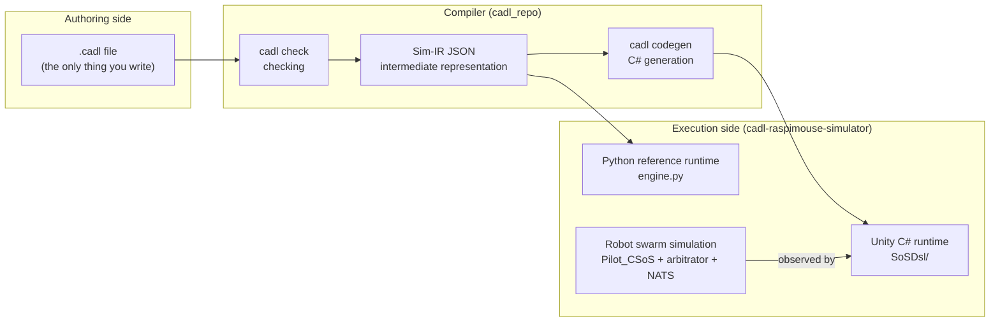

# Chapter 2 — The toolchain and setup

This chapter explains the path by which diagrams, code and execution results are produced from a CADL file (the toolchain) and the four repositories it consists of, and then sets the tools up on your machine (Section 2.4).

## 2.1 The big picture

You only need to write the leftmost box (a CADL file). Everything to its right is generated from it by the toolchain commands.

```
   ┌────────────────────────┐
   │  Your CADL source      │   ← You write this in Chapters 4 & 5
   │  my_delivery.cadl      │
   └──────────┬─────────────┘
              │
              │  cadl check    →  catch typos / type errors
              │  cadl sim-ir   →  emit a JSON Intermediate Representation (IR)
              │
              ▼
   ┌────────────────────────┐
   │  Sim-IR JSON           │
   │  (cadl-spec App. E.7)  │
   └─────┬──────────────┬───┘
         │              │
         │              └──────────────┐
         │  cadl-explorer              │  cadl codegen --target unity-csharp
         │  Lifecycle View             │
         ▼                             ▼
   ┌─────────────────┐       ┌─────────────────────────┐
   │  State machine  │       │  Unity C# tree          │
   │  diagram        │       │  Runtime/    Generated/ │
   └─────────────────┘       └────────────┬────────────┘
                                          │  drop into
                                          ▼
                             ┌──────────────────────────┐
                             │  Unity scene + arbitrator │
                             │  → live contract events   │
                             │  in the Console           │
                             └──────────────────────────┘
```

There are two worlds — the side where specifications are **written** and the side where they **run** — with a compiler connecting them.



Three points to keep in mind:

1. **The `.cadl` file is the only contract logic a person writes.** The IR, the C# contract classes and the diagrams are generated from it by the toolchain commands.
2. **Two runtimes execute the same IR with the same meaning.** The C# contract code is generated from the IR; the Python reference runtime is a hand-written interpreter that reads the IR directly and is used to cross-check results.
3. **The robot control code and the contract code are separate.** Contracts only observe the robots. The robot controller `Pilot_CSoS.cs` contains no contract logic; the only hand-written link is a thin bridge (`PilotContractBridge.cs`) that turns changes of the robot state into contract events.

The tools used in this textbook, and the chapters that use them:

| Tool | What it does | Chapters |
| --- | --- | --- |
| `cadl check` | Checks the syntax, the types and the static rules of the SoS-DSL extension | 4, 5 |
| `cadl verify` | Does what `cadl check` does, and in addition uses an SMT solver (Z3) to find contradictions between assumptions and guarantees and deadlocks in protocols | introduced in 3 |
| `cadl sim-ir` | Turns the file into the JSON of the three-layer intermediate representation (IR) | 5–7 |
| cadl-explorer | Draws the state machine (Lifecycle View) from the IR | 6 |
| `cadl codegen --target unity-csharp` | Generates Unity C# code from the IR | 7 |
| Python reference runtime | Reads the IR and replays how contract instances move between states | 7, 9 |
| Unity and the arbitrator | Run the generated contract code inside the robot-swarm simulation | 8 |

---

## 2.2 The four repositories

The CADL toolchain is split across four repositories so that each part can be developed independently. All four are public, and this textbook can be followed with public repositories only.

| Repository | Role | Branch to use | How this textbook uses it |
| --- | --- | --- | --- |
| `cadl-spec` | The language specification and the learning site that contains this textbook (Docusaurus) | `main` (default) | Read only (viewing it locally is optional) |
| `cadl` (cloned as `cadl_repo`) | The compiler: parser, checks, IR, code generators | `master` (default) | Used as a command |
| `cadl-explorer` | A Streamlit app that edits and checks CADL, draws state machines and compares governance designs | `main` (default) | Used as a web app (Chapter 6) |
| `cadl-raspimouse-simulator` | The simulator: Unity project, Go arbitrator and Python reference runtime | `main` (default) | Where you mainly work in Chapters 7–9 |

The simulator keeps the Unity project (`unity/`), the Go arbitrator (`arbitrator/`) and the Python reference runtime (`cadl/runtime/`) together in one repository.

A note on names: the Unity scene (`C-SoS.unity`), the robot controller (`Pilot_CSoS`) and the arbitrator directory (`C-SoS/`) carry the label "C-SoS". In the simulator, C-SoS stands for Collaborative SoS (its config has `sosType: collaborative`) and names the operating mode used in this textbook, in which the robots claim deliveries and the `arbitrator/C-SoS` arbitrator decides which robot gets each one. The repository also contains a `D-SoS.unity` scene for reference; its arbitrator is not included. That label is set by the simulator and is unrelated to the `type:` in a CADL file. The CADL file of this textbook declares `type: Acknowledged`, and that declaration is what the textbook means when it classifies the robot-delivery SoS (Chapter 1, Section 1.4).

---

## 2.3 Prerequisites

| Tool | Version | Why |
| --- | --- | --- |
| Python | 3.9+ | runs the `cadl` CLI |
| Unity | 6000.2.9f1 (Unity 6.2) | runs the simulation |
| Go | 1.23+ | builds the arbitrator |
| NATS Server | latest | message bus between robots ⇄ arbitrator |
| Node.js | 20+ | renders the spec website (optional) |

```bash
# macOS via Homebrew
brew install python@3.11 go nats-server node
# Unity is installed via Unity Hub.
```

---

## 2.4 Setup (5 min)

### What you'll learn
- The repositories that make up the toolchain and which branch of each one to use.

### Background

Clone the four repositories of Section 2.2 under `~/program` and make the `cadl` command available.

### Procedure

```bash
mkdir -p ~/program && cd ~/program

# 1) Clone the repositories.
#    cadl-spec, cadl and cadl-raspimouse-simulator stay on their default
#    branches (main / master / main).
git clone https://github.com/ertlnagoya/cadl-spec
git clone https://github.com/ertlnagoya/cadl                         cadl_repo
git clone https://github.com/ertlnagoya/cadl-explorer
git clone https://github.com/ertlnagoya/cadl-raspimouse-simulator

# 2) Install the cadl CLI in editable mode so changes are picked up.
cd ~/program/cadl_repo
python3 -m venv .venv && source .venv/bin/activate
python3 -m pip install --upgrade pip   # editable install needs pip 21.3 or later
pip install -e .
cd ~/program
```

### Expected output

```
$ cadl --help
usage: cadl [-h] [--version]
            {parse,check,verify,codegen,regime-map,iec62853,sim-validate,sim-ir,sim-gen,ai}
            ...

CADL: Contract Architecture Description Language toolchain

positional arguments:
  {parse,check,verify,codegen,regime-map,iec62853,sim-validate,sim-ir,sim-gen,ai}
                        Available commands
    parse               Parse a CADL file and report errors
    check               Parse and type-check a CADL file
    verify              Parse, type-check, and verify a CADL file
    codegen             Generate runtime code from a CADL file
    ...
```

### Check

If `cadl codegen --help` lists `unity-csharp` among the `--target` choices (`{python,solidity,opa,unity-csharp}`), your install is correct.

### Recap

After setup you can see that CADL is really four cooperating repositories — the spec site, the compiler, the visualizer, and the simulator. Everything that follows assumes **each repository is on the branch listed in the table of Section 2.2** (`main` everywhere, and `master` for `cadl_repo`); most trouble at this stage comes from a wrong branch.

### Setup troubleshooting

**Check your branches (the most common pitfall).** All four repositories are used on their default branches: `main`, and `master` for `cadl_repo`. If a page or a command described here is missing, first check that you have not switched to an older branch. Verify:

```bash
cd ~/program
echo "cadl-spec:     $(git -C cadl-spec branch --show-current)"       # main
echo "cadl_repo:     $(git -C cadl_repo branch --show-current)"       # master
echo "cadl-explorer: $(git -C cadl-explorer branch --show-current)"   # main
echo "simulator:     $(git -C cadl-raspimouse-simulator branch --show-current)"   # main
```

For any repository on the wrong branch, switch with `git -C ~/program/<repo> checkout <branch>`.

**`pip install -e .` fails with `File "setup.py" or "setup.cfg" not found`.** The pip in the venv is too old. On macOS, `/usr/bin/python3` (Python 3.9 from the Command Line Tools) creates venvs with pip 21.2.4, which cannot do an editable install of a `pyproject.toml`-only project such as `cadl`. Upgrade pip inside the venv and install again:

```bash
cd ~/program/cadl_repo
source .venv/bin/activate
python3 -m pip install --upgrade pip
pip install -e .
```

**`cadl` reports `bad interpreter`, or `cadl --help` shows an older command list.** The shell found a different `cadl` than the one in `cadl_repo/.venv`. Check with `which cadl`; it should print `~/program/cadl_repo/.venv/bin/cadl`. In a new terminal, run `source ~/program/cadl_repo/.venv/bin/activate` first. If the venv itself reports `bad interpreter` (the Python it was built with has been removed), delete `.venv` and repeat step 2.
