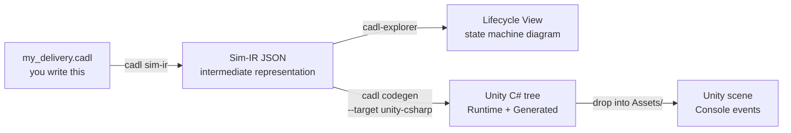

# Chapter 2 — The toolchain and setup

## The big picture

You only need to write the leftmost box (a CADL file). Everything to its right is generated from it by the toolchain commands.

```
   ┌────────────────────────┐
   │  Your CADL source      │   ← You write this in Step 2 & 3
   │  my_delivery.cadl      │
   └──────────┬─────────────┘
              │
              │  cadl check    →  catch typos / type errors
              │  cadl sim-ir   →  emit a JSON Intermediate Representation (IR)
              │
              ▼
   ┌────────────────────────┐
   │  Sim-IR JSON           │
   │  (cadl-spec App. E.7)  │
   └─────┬──────────────┬───┘
         │              │
         │              └──────────────┐
         │  cadl-explorer              │  cadl codegen --target unity-csharp
         │  Lifecycle View             │
         ▼                             ▼
   ┌─────────────────┐       ┌─────────────────────────┐
   │  State machine  │       │  Unity C# tree          │
   │  diagram        │       │  Runtime/    Generated/ │
   └─────────────────┘       └────────────┬────────────┘
                                          │  drop into
                                          ▼
                             ┌──────────────────────────┐
                             │  Unity scene + arbitrator │
                             │  → live contract events   │
                             │  in the Console           │
                             └──────────────────────────┘
```



---

## Prerequisites

| Tool | Version | Why |
| --- | --- | --- |
| Python | 3.9+ | runs the `cadl` CLI |
| Unity | 6000.2.9f1 (Unity 6.2) | runs the simulation |
| Go | 1.23+ | builds the arbitrator |
| NATS Server | latest | message bus between robots ⇄ arbitrator |
| Node.js | 20+ | renders the spec website (optional) |

```bash
# macOS via Homebrew
brew install python@3.11 go nats-server node
# Unity is installed via Unity Hub.
```

---

## Step 0 — Setup (5 min)

### What you'll learn
- The repositories that make up the toolchain and which branch of each one to use.

### Background

The CADL toolchain is split across four repositories so each piece can evolve independently:

| Repository | Role | Branch to use |
| --- | --- | --- |
| `cadl-spec`            | the language reference and this hands-on site (Docusaurus) | `main` (default) |
| `cadl` (cloned as `cadl_repo`) | the compiler: parser, IR, code generators | `master` (default) |
| `cadl-explorer`        | a Streamlit app that visualises and edits CADL | `main` (default) |
| `cadl-raspimouse-simulator` | the simulator used in Steps 5–6: Unity project, Go arbitrator and Python reference runtime in one repository | `main` (default) |

:::info[Repository availability]
`cadl-spec` (this specification and hands-on site), `cadl` (compiler / CLI), `cadl-explorer` (visualisation) and `cadl-raspimouse-simulator` (simulator) are public, so every step of Course A can be followed with public repositories. `mobility-sos-exercise`, used by Course B, is **not publicly available at present**.
:::

### Procedure

```bash
mkdir -p ~/program && cd ~/program

# 1) Clone the repositories.
#    cadl-spec, cadl and cadl-raspimouse-simulator stay on their default
#    branches (main / master / main).
git clone https://github.com/ertlnagoya/cadl-spec
git clone https://github.com/ertlnagoya/cadl                         cadl_repo
git clone https://github.com/ertlnagoya/cadl-explorer
git clone https://github.com/ertlnagoya/cadl-raspimouse-simulator

# 2) Install the cadl CLI in editable mode so changes are picked up.
cd ~/program/cadl_repo
python3 -m venv .venv && source .venv/bin/activate
python3 -m pip install --upgrade pip   # editable install needs pip 21.3 or later
pip install -e .
cd ~/program
```

### Expected output

```
$ cadl --help
usage: cadl [-h] [--version]
            {parse,check,verify,codegen,regime-map,iec62853,sim-validate,sim-ir,sim-gen,ai}
            ...

CADL: Contract Architecture Description Language toolchain

positional arguments:
  {parse,check,verify,codegen,regime-map,iec62853,sim-validate,sim-ir,sim-gen,ai}
                        Available commands
    parse               Parse a CADL file and report errors
    check               Parse and type-check a CADL file
    verify              Parse, type-check, and verify a CADL file
    codegen             Generate runtime code from a CADL file
    ...
```

### Check 0

If `cadl codegen --help` lists `unity-csharp` among the `--target` choices (`{python,solidity,opa,unity-csharp}`), your install is correct.

### Recap

After setup you can see that CADL is really four cooperating repositories — the spec site, the compiler, the visualizer, and the simulator. Everything that follows assumes **each repository is on the branch listed in the table above** (`main` everywhere, and `master` for `cadl_repo`); most trouble at this stage comes from a wrong branch.

### 🛠 Setup troubleshooting

**Check your branches (the most common pitfall).** All four repositories are used on their default branches: `main`, and `master` for `cadl_repo`. If a page or a command described here is missing, first check that you have not switched to an older branch. Verify:

```bash
cd ~/program
echo "cadl-spec:     $(git -C cadl-spec branch --show-current)"       # main
echo "cadl_repo:     $(git -C cadl_repo branch --show-current)"       # master
echo "cadl-explorer: $(git -C cadl-explorer branch --show-current)"   # main
echo "simulator:     $(git -C cadl-raspimouse-simulator branch --show-current)"   # main
```

For any repository on the wrong branch, switch with `git -C ~/program/<repo> checkout <branch>`.

**`pip install -e .` fails with `File "setup.py" or "setup.cfg" not found`.** The pip in the venv is too old. On macOS, `/usr/bin/python3` (Python 3.9 from the Command Line Tools) creates venvs with pip 21.2.4, which cannot do an editable install of a `pyproject.toml`-only project such as `cadl`. Upgrade pip inside the venv and install again:

```bash
cd ~/program/cadl_repo
source .venv/bin/activate
python3 -m pip install --upgrade pip
pip install -e .
```

**`cadl` reports `bad interpreter`, or `cadl --help` shows an older command list.** The shell found a different `cadl` than the one in `cadl_repo/.venv`. Check with `which cadl`; it should print `~/program/cadl_repo/.venv/bin/cadl`. In a new terminal, run `source ~/program/cadl_repo/.venv/bin/activate` first. If the venv itself reports `bad interpreter` (the Python it was built with has been removed), delete `.venv` and repeat step 2.
