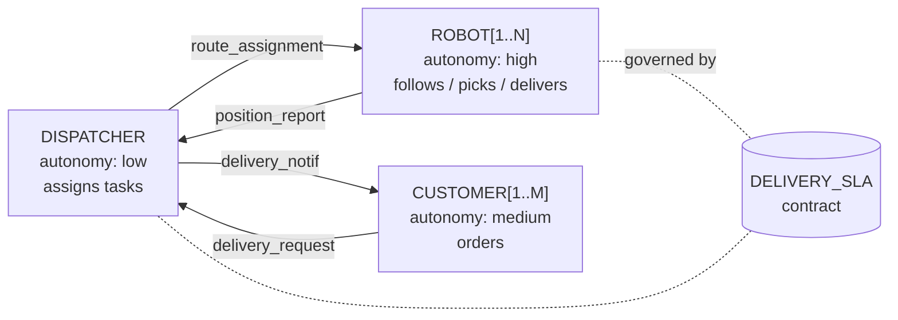
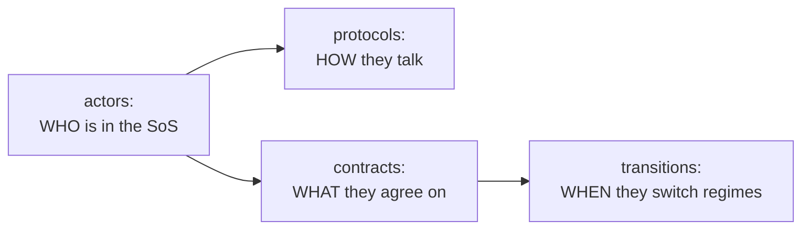

# Chapter 4 — Writing the structure

This chapter writes the structure of the robot-delivery SoS (its actors, contract and protocol) in CADL and checks it with `cadl check` and `cadl sim-ir` (about 15 minutes). In the exercises at the end you add an actor, give the protocol conditions, and write the structure of a domain you do not know yet.

## 4.1 What you'll learn

**In the procedure:**

- How to declare actors with `id`, `role`, `autonomy`, `interface`.
- How to declare a contract's parties, A/G clauses (`assume` / `guarantee`), incentives.
- How to declare a protocol: the messages of one order, as a sequence of `sender -> receiver : message` steps.

**In the exercises:**

- Identify the actors of an SoS and declare them yourself, including one for a domain you do not know yet.
- Run `cadl check` and explain its diagnostics.

## 4.2 Background

Think of a CADL `actors:` block as a UML class diagram for the SoS — each actor type has ports (`interface.input` / `interface.output`) and a degree of self-direction (`autonomy: low | medium | high`). The `contracts:` block is the *agreement* between named subsets of those actors.



### The building blocks of a structure

A CADL file says **who** participates and **what they expect from each other**, before saying anything about *when* or *how often*. The structural building blocks are:



In this chapter you write **actors**, **contracts** and one **protocol**. `transitions` are optional stretch material.

## 4.3 Procedure

Create a new file `my_delivery.cadl` in the root of `cadl_repo` (that is, `~/program/cadl_repo/my_delivery.cadl`; the bundled example it resembles is `examples/sos_dsl_robot_delivery.cadl`), and paste the skeleton below. The commands in Chapters 4–6 are run from `~/program/cadl_repo`. Read the comments — they explain what each block does.

```yaml
# my_delivery.cadl ─── My first SoS specification
# (this file just describes structure; norms come in Chapter 5)

sos:
  name: "MyDelivery"
  type: Acknowledged           # central authority + autonomous agents
  version: "0.1.0"

  context:
    environment:
      grid_size:    30                         # abstract parameter (not the Unity road graph)
      num_robots:    3
      time_step_ms: 100

  # ── WHO exists in the SoS ─────────────────────────────────────
  actors:
    - id: DISPATCHER
      role: "central_coordinator"
      autonomy: low                            # follows policy, no roaming
      capabilities: [assign_tasks]
      interface:
        input:  [delivery_request, position_report, task_completion, ack]
        output: [route_assignment, delivery_notification]

    - id: "ROBOT[1..N]"                        # parametric: N copies
      role: "delivery_agent"
      autonomy: high
      capabilities: [follow_path, pick_up, deliver]
      interface:
        input:  [route_assignment]
        output: [position_report, task_completion, ack]

    - id: "CUSTOMER[1..M]"
      role: "service_requester"
      autonomy: medium
      capabilities: [submit_order]
      interface:
        input:  [delivery_notification]
        output: [delivery_request]

  # ── The agreement between them ────────────────────────────────
  contracts:
    - id: DELIVERY_SLA
      parties: [DISPATCHER, "ROBOT[*]", "CUSTOMER[*]"]
      assume:
        - "ROBOT[i].battery > 20"              # input precondition
      guarantee:
        - "delivery_time <= 300s"              # output postcondition
      incentives:
        type: task_completion
        lambda: 0.5
        rules:
          - "reward(ROBOT[i], 10) when on_time_delivery"

  # ── HOW they talk: the messages of one order ─────────────────
  protocols:
    - id: DeliveryOrder
      trigger: "new_delivery_request(CUSTOMER[j])"
      steps:                                   # "sender -> receiver : message"
        - "CUSTOMER[j] -> DISPATCHER : delivery_request"
        - "DISPATCHER -> ROBOT[i] : route_assignment"
        - "ROBOT[i] -> DISPATCHER : ack"
        - "ROBOT[i] -> DISPATCHER : task_completion"
        - "DISPATCHER -> CUSTOMER[j] : delivery_notification"
```

Run the type-checker:

```bash
cd ~/program/cadl_repo
cadl check my_delivery.cadl
```

## 4.4 Expected output

```
$ cadl check my_delivery.cadl
Type check passed: my_delivery.cadl
```

Now lower it to IR JSON. The output is about 150 lines long; the listing below is abridged to the parts that matter here:

```bash
cadl sim-ir my_delivery.cadl --format json
```

```jsonc
{
  "name": "MyDelivery",
  "sos_type": "Acknowledged",
  "description": "",
  "environment": {
    "grid_size":    30,
    "num_robots":    3,
    "time_step_ms": 100
  },
  "institution": {
    "actors": [ ... ],
    "contracts": [
      {
        "id": "DELIVERY_SLA",
        "parties": ["DISPATCHER", "ROBOT[*]", "CUSTOMER[*]"],
        "assume":   ["ROBOT[i].battery > 20"],
        "guarantee":["delivery_time <= 300s"],
        ...
        "lifecycle": null,           ← we have NOT written it yet
        "monitors":  []
      }
    ]
  },
```

## 4.5 Check

Verify both:

1. `cadl check my_delivery.cadl` prints `Type check passed: my_delivery.cadl` (and no `[ERROR]` lines).
2. The IR JSON has `"lifecycle": null` and `"monitors": []`. These two lines sit at the end of the contract (around line 90 of the output). To print just them:

   ```bash
   cadl sim-ir my_delivery.cadl --format json | grep -n -A1 '"lifecycle"'
   ```

   ```
   90:        "lifecycle": null,
   91-        "monitors": []
   ```

These two `null` / `[]` are **the gap we will fill in Chapter 5** — they are why the structure-only specification cannot say "the robot must ack within 5 seconds".

## 4.6 Common mistakes

| Symptom | Cause |
| --- | --- |
| `YAML parse error: while parsing a flow sequence` | You wrote a subscripted identifier without quoting, e.g. `[ROBOT[i].battery, ...]`. Quote it: `["ROBOT[i].battery", ...]`. |
| `Parse error: Invalid SoS type: 'Centralized'. Must be one of: Directed, Acknowledged, Collaborative, Virtual` | CADL accepts only these four values for `type:`. |
| `[ERROR]: Undefined actor 'CUSTMER' referenced in contract 'DELIVERY_SLA' parties` | A name under `parties:` (or inside a predicate, e.g. `CUSTMER[i].x`) is not declared under `actors:`. Usually a typo. An actor declared as `CUSTOMER[1..M]` is referred to as `"CUSTOMER[*]"` (all) or `CUSTOMER[i]` (one). |

## 4.7 Recap

You now have a CADL file that describes the **structure** of your SoS. It compiles, it lowers to IR, and the IR confirms there is exactly one contract called `DELIVERY_SLA` and one protocol, `DeliveryOrder`. Next we add the norms that let a runtime check that contract.

## 4.8 Exercises

### Exercise 4.1 (★) — Build the baseline structural model

**Goal**: Reproduce the actors, contract and protocol of Section 4.3, by hand, into a fresh file `my_delivery_v1.cadl`.

**Procedure**:

1. Create `my_delivery_v1.cadl` in the root of `cadl_repo` (the bundled example to compare with is `examples/sos_dsl_robot_delivery.cadl`), and run the commands below from that directory.
2. Declare three actors: `DISPATCHER`, `ROBOT[1..N]`, `CUSTOMER[1..M]`. Choose sensible `autonomy` levels for each.
3. Declare one contract `DELIVERY_SLA` with `parties: [DISPATCHER, "ROBOT[*]", "CUSTOMER[*]"]`, `assume: ["ROBOT[i].battery > 20"]`, `guarantee: ["delivery_time <= 300s"]`.
4. Declare the protocol `DeliveryOrder` with the five steps of Section 4.3, and list each message in the `interface` of its sender (`output`) and its receiver (`input`).
5. Run `cadl check my_delivery_v1.cadl` and confirm it prints `Type check passed: my_delivery_v1.cadl`.

**Check**: The file passes the type check, and the IR JSON shows 3 actors, 1 contract and 1 protocol.

### Exercise 4.2 (★★) — Add a fourth actor

**Goal**: Introduce a `MAINTENANCE` actor that periodically inspects robots, and declare a separate contract `MAINTENANCE_SLA` between `MAINTENANCE` and `ROBOT[*]`.

**Procedure**:

1. Add `MAINTENANCE` (single, low autonomy, capabilities `[inspect, repair]`).
2. Add a contract `MAINTENANCE_SLA` with `parties: [MAINTENANCE, "ROBOT[*]"]`.
3. Decide whether `assume` should include `ROBOT[i].battery > 0` or something stronger.
4. Re-run `cadl check`.

**Reflection**: When you have *two* contracts on the same actor, which `assume` clauses apply? (Hint: both must hold simultaneously — this is exactly the *interdependency* concern that Dahmann (2014) [[9]](appendix-d-references.md) calls out as SoS pain point #5.)

### Exercise 4.3 (★★) — Give the protocol conditions

**Goal**: Extend the protocol `DeliveryOrder` of `my_delivery_v1.cadl` with a condition that must hold before it starts and one that holds when it ends, and confirm that both reach the IR.

**Procedure**:

1. Find `DeliveryOrder` under `protocols:`. A protocol has no separate list of participants: who takes part follows from the senders and receivers named in `steps`.
2. Add `precondition: "ROBOT[i].battery > 20"` above `steps:` and `postcondition: "ROBOT[i].status == Delivered"` below them (the other optional keys are `safety_invariant` and `timing`).
3. Run `cadl check my_delivery_v1.cadl`, then confirm that the two conditions really reached the IR: `cadl sim-ir my_delivery_v1.cadl --format json | grep -n -E '"(precondition|postcondition)"'` should print two lines. Do not rely on `cadl check` alone here — it silently ignores keys it does not know, so a misspelt key (`pre:`, `post_condition:` …) still passes.

```yaml
  protocols:
    - id: DeliveryOrder
      trigger: "new_delivery_request(CUSTOMER[j])"
      precondition: "ROBOT[i].battery > 20"
      steps:
        - "CUSTOMER[j] -> DISPATCHER : delivery_request"
        - "DISPATCHER -> ROBOT[i] : route_assignment"
        - "ROBOT[i] -> DISPATCHER : ack"
        - "ROBOT[i] -> DISPATCHER : task_completion"
        - "DISPATCHER -> CUSTOMER[j] : delivery_notification"
      postcondition: "ROBOT[i].status == Delivered"
```

**Reflection**: Why is the protocol described as a sequence of *messages*, not as code? What does this give you that a Python function would not? (Hint: think about who *implements* each step.)

### Exercise 4.4 (★★★) — Write a domain you don't know yet

**Goal**: Without copying any existing file, write a CADL skeleton for a **delivery drone fleet** (instead of ground robots). Same domain shape, different actors and capabilities.

**Procedure**:

1. Create `my_drone_delivery.cadl` from scratch.
2. Decide who the actors are. Hint: a *DRONE* needs different `capabilities` than a *ROBOT* (consider altitude, no-fly zones, weather).
3. Run `cadl check`.

**Reflection**: How much of your file is *the same* as the robot delivery one, and how much is genuinely different? The same lifecycle could be reused with minor modifications — that is exactly the design intent of SoS-DSL.

### Using this chapter in a class

**Before the session.**

- Chapter 2 done (repositories cloned, `cadl` installed).
- 30 min of pre-reading: Chapter 3 of this textbook.

**Wrap-up and homework.**

**Bring to the next session (Chapter 5)**:

- `my_delivery_v1.cadl` (compiles cleanly).
- A short note (3–5 lines) describing what is missing in v1 — i.e., what the structural-only file *cannot* express. (Hint: timing, what counts as a violation, what the consequences are.)
