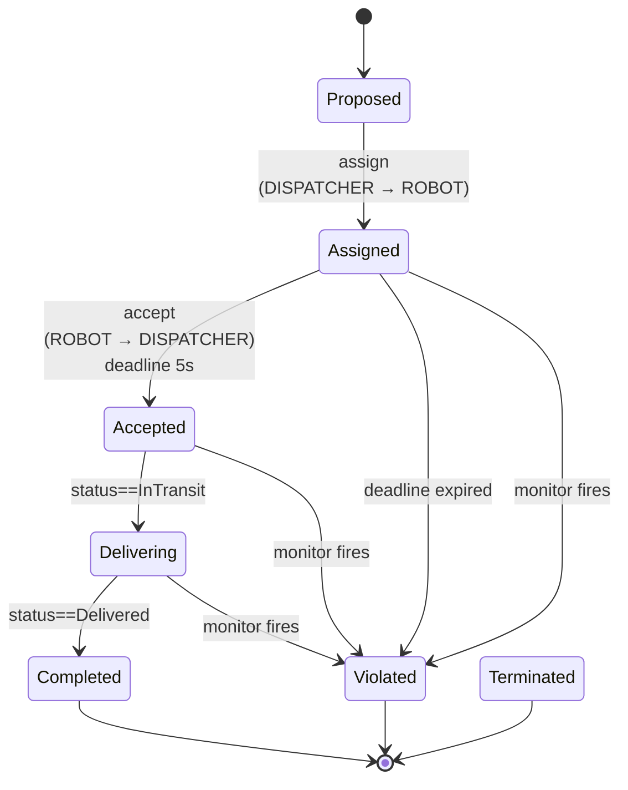
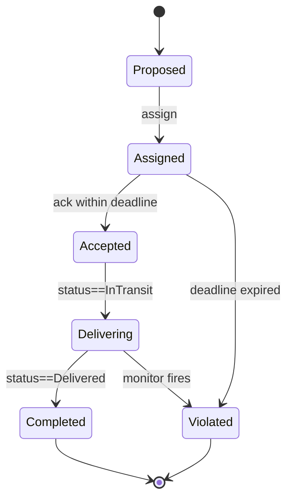

# Chapter 5 — Writing the norms

This chapter adds the lifecycle and the monitors of the SoS-DSL extension to the contract written in Chapter 4 (about 15 minutes). In the exercises you add states and monitors and make two contracts coexist.

## 5.1 What you'll learn

**In the procedure:**

- The seven **lifecycle states** a contract instance can occupy.
- How to write a `deadline` + `on_violation` that puts a time bound on a transition and says where the instance goes when the bound is missed.
- How to write a periodic `monitor` with a predicate over the world snapshot.

**In the exercises:**

- Add a per-instance `lifecycle:` to a structural contract.
- Add declarative `monitors:` with predicates and sampling specs.
- Read `cadl sim-ir` JSON output and locate your additions in it.

## 5.2 Background

A class-level contract spec (Chapter 4) describes the **agreement**, but a real SoS has **many concurrent instances** of that agreement — one per delivery request. Each instance has its own state that progresses over time:



The **same lifecycle** is reused for every delivery request — only the data (which robot, which customer) differs.

### Classes and instances

A class-level contract spec says "this is the kind of agreement we make." But every concrete delivery is its **own instance** of that agreement, going through:



Two new keys make this explicit:

- `lifecycle:` — defines states, initial / terminal markers, and transitions with `deadline` + `on_violation`.
- `monitors:` — declarative observers that are evaluated periodically or on events. When a monitor's `rule` matches, it records a violation (`on_match.violation`), moves the contract instance to the named target state (`on_match.transition`, e.g. `Violated`), or both.

## 5.3 Procedure

First declare, near the top of `my_delivery.cadl`, that the file uses the SoS-DSL extension. [Appendix E](../spec/appendix-e-sos-dsl.md) asks for this declaration (SHOULD), and the bundled example has it:

```yaml
sos:
  name: "MyDelivery"
  type: Acknowledged           # central authority + autonomous agents
  version: "0.1.0"
  extensions:                  # ← NEW: this file uses the SoS-DSL extension
    - sos-dsl: 0.1
```

Then append the two highlighted blocks below to the `DELIVERY_SLA` contract. Indentation matters (YAML).

```yaml
  contracts:
    - id: DELIVERY_SLA
      parties: [DISPATCHER, "ROBOT[*]", "CUSTOMER[*]"]
      assume:
        - "ROBOT[i].battery > 20"
      guarantee:
        - "delivery_time <= 300s"
      incentives:
        type: task_completion
        lambda: 0.5
        rules:
          - "reward(ROBOT[i], 10) when on_time_delivery"

      # ╔═══════════════════════════════════════════════════════════════╗
      # ║  NEW BLOCK 1: per-instance lifecycle                          ║
      # ╚═══════════════════════════════════════════════════════════════╝
      lifecycle:
        states:
          - Proposed
          - Assigned
          - Accepted
          - Delivering
          - Completed
          - Violated
          - Terminated
        initial: Proposed
        terminal: [Completed, Violated, Terminated]
        transitions:
          - id: assign
            from: Proposed
            to:   Assigned
            on:   "DISPATCHER -> ROBOT[i] : route_assignment"

          - id: accept
            from: Assigned
            to:   Accepted
            on:   "ROBOT[i] -> DISPATCHER : ack(accepted)"
            deadline: 5s                           # ⏱  must happen within 5s
            on_violation:                          # otherwise → Violated
              transition: Violated
              severity:   Major

          - id: start_delivery
            from: Accepted
            to:   Delivering
            on:   "ROBOT[i].status == InTransit"

          - id: complete
            from: Delivering
            to:   Completed
            on:   "ROBOT[i].status == Delivered"

      # ╔═══════════════════════════════════════════════════════════════╗
      # ║  NEW BLOCK 2: declarative monitors                            ║
      # ╚═══════════════════════════════════════════════════════════════╝
      monitors:
        - id: battery_guard
          observe: "ROBOT[i].battery"
          sampling: periodic(500ms)
          rule: "ROBOT[i].battery < 20 AND state == Assigned"
          on_match:
            transition: Violated
            severity:   Major
```

Re-run the type-checker:

```bash
cadl check my_delivery.cadl
```

## 5.4 Expected output

```
$ cadl check my_delivery.cadl
Type check passed: my_delivery.cadl
```

Lower to IR and verify the new fields are populated:

```bash
cadl sim-ir my_delivery.cadl --format json \
  | python3 -c "
import json, sys
d = json.load(sys.stdin)
c = d['institution']['contracts'][0]
print(f'lifecycle.initial : {c[\"lifecycle\"][\"initial\"]}')
print(f'lifecycle.states  : {c[\"lifecycle\"][\"states\"]}')
print(f'monitors[0].id    : {c[\"monitors\"][0][\"id\"]}')
print(f'  rule            : {c[\"monitors\"][0][\"rule\"]}')
"
```

```
lifecycle.initial : Proposed
lifecycle.states  : ['Proposed', 'Assigned', 'Accepted', 'Delivering', 'Completed', 'Violated', 'Terminated']
monitors[0].id    : battery_guard
  rule            : ROBOT[i].battery < 20 AND state == Assigned
```

## 5.5 Check

1. The diff between Chapter 4 and Chapter 5 is **only the `extensions:` declaration and the two new blocks**. No actor changed.
2. The IR's `"lifecycle": null` is now a populated object; `"monitors": []` is now a 1-element list.

## 5.6 Common mistakes

| Symptom | Why |
| --- | --- |
| `cadl check` passes, but the IR has `"lifecycle": null` and Chapter 6 shows no states | The `lifecycle:` block has wrong indentation, so it is not read as part of the contract. `lifecycle:` must sit at the same level as `assume:` / `guarantee:`, with `states:` one level below it. The checker does not report this. |
| Parser silently treats `on:` as a boolean | YAML 1.1 quirk; the example file works because the parser has a workaround (`_yaml_on_key`). If you're writing your own parser, watch for this. |
| `monitor.rule` "always false" | The right-hand side of `state == Assigned` is a **bare identifier** by CADL convention. Quoting `"Assigned"` changes the meaning. |

## 5.7 Recap

The same file now describes both the structure (Chapter 4) and the rules (Chapter 5). The IR is no longer "structural-only" — it carries enough information to build a runtime.

## 5.8 Exercises

### Exercise 5.1 (★) — Add the basic lifecycle

**Goal**: Save `my_delivery_v1.cadl` as `my_delivery_v2.cadl`, then add a `lifecycle:` block to `DELIVERY_SLA` with the 7 states of Section 5.3.

**Procedure**:

1. Copy `v1` → `v2`.
2. Add `lifecycle.states`, `lifecycle.initial`, `lifecycle.terminal`, and 4 transitions (`assign`, `accept`, `start_delivery`, `complete`).
3. On `accept`, set `deadline: 5s` and `on_violation.transition: Violated` (the value is the target state). Also declare `extensions: [sos-dsl: 0.1]` under `sos:`, as in Section 5.3.
4. Run `cadl check my_delivery_v2.cadl`, then `cadl sim-ir my_delivery_v2.cadl --format json | grep -n -A3 '"lifecycle"'` (the `"lifecycle"` key sits well past the first screen of the IR — line 88 for the file of Section 5.3, later if you added actors or contracts in Chapter 4 — so `head` would cut it off).
5. Confirm in the output that `"lifecycle"` is no longer `null`: the line now reads `"lifecycle": {`, followed by `"states": [` and the first state names. If you added `MAINTENANCE_SLA` in Exercise 4.2, `grep` prints a second match for that contract, which still reads `"lifecycle": null`; that is expected, because only `DELIVERY_SLA` has a lifecycle.

### Exercise 5.2 (★★) — Add an over-speed monitor

**Goal**: Detect a robot that drives faster than 1.5 m/s while delivering and move the contract instance to `Violated` with severity `Critical`.

**Procedure**: Add a monitor under `monitors:`:

```yaml
- id: over_speed
  observe: "ROBOT[i].speed"
  sampling: periodic(200ms)
  rule: "ROBOT[i].speed > 1.5 AND state == Delivering"
  on_match:
    transition: Violated
    severity: Critical
```

**Reflection**: You have just added a *new normative rule* without changing a single line of the robot's control code (Unity's `Pilot_CSoS.cs`). What does this say about the separation between the structural code and the normative spec? (Compare [Maier 1998] criterion (4), emergent behaviour: here a norm *constrains* it without redesigning the parts.)

### Exercise 5.3 (★★) — Add a Cancelled lifecycle state

**Goal**: Let a customer cancel a delivery while it is still `Assigned`, routing the contract to a new `Cancelled` terminal state.

**Procedure**:

1. Add `Cancelled` to `lifecycle.states` and `lifecycle.terminal`.
2. Add a transition `customer_cancel` from `Assigned` to `Cancelled` triggered by `"CUSTOMER[i] -> DISPATCHER : cancel_order"`.
3. Decide: should `Cancelled` be a violation? In CADL, terminal states are not implicitly violations — they are just *closed*.

**Reflection**: When you added `Cancelled`, did the existing simulation break? Why or why not? (Adding a *state* is backward-compatible; adding a *deadline* is not.)

### Exercise 5.4 (★★★) — Two contracts coexisting

**Goal**: Beside `DELIVERY_SLA`, add a `FLEET_SAFETY` contract whose lifecycle is independent of any delivery — it is *always on* while a robot is operational.

**Procedure**:

1. Define a 3-state lifecycle: `Operational → Degraded → OutOfService`.
2. Add a monitor that fires `Degraded` when battery < 10% (regardless of delivery state).
3. Run `cadl check`. Are there any conflicts with `DELIVERY_SLA` rules?

**Reflection**: A robot can be a party to *both* contracts simultaneously. What semantics do you want when one contract says "you may proceed" and the other says "you must stop"?

### Using this chapter in a class

**Before the session.**

- `my_delivery_v1.cadl` from Chapter 4.
- 30 min of pre-reading: Sections 3.7–3.9 of this textbook (for more detail, [Appendix E](../spec/appendix-e-sos-dsl.md) of the specification).

**Wrap-up and homework.**

**Bring to the next session (Chapter 6)**:

- `my_delivery_v2.cadl` (with at minimum exercises 2.1–5.3 done).
- The IR JSON snapshot saved as `my_delivery_v2.ir.json` (run `cadl sim-ir … --format json > my_delivery_v2.ir.json`).
- (Optional) `my_delivery_v2_with_safety.cadl` if you tackled 2.4.
