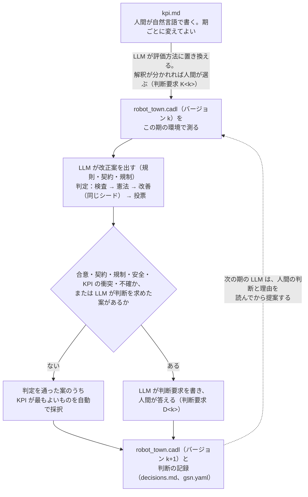
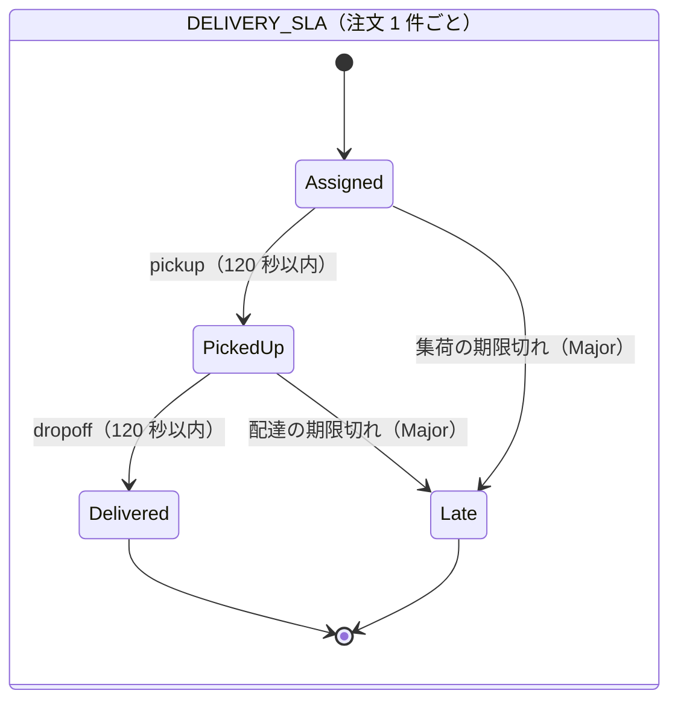
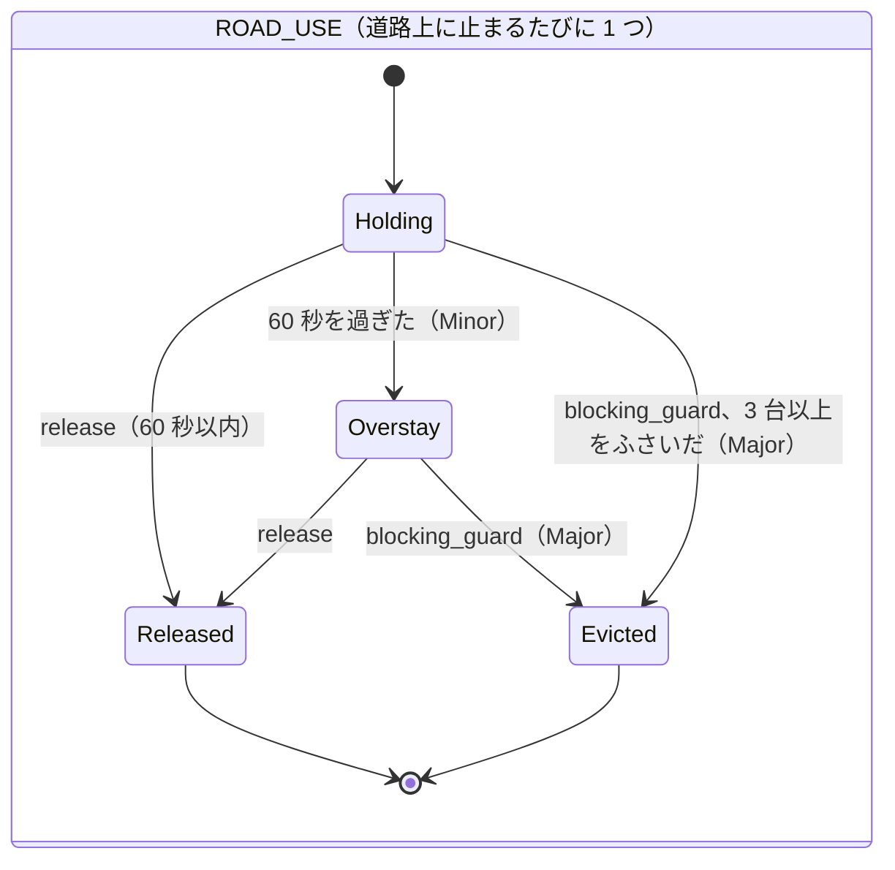
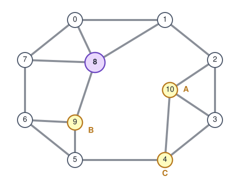
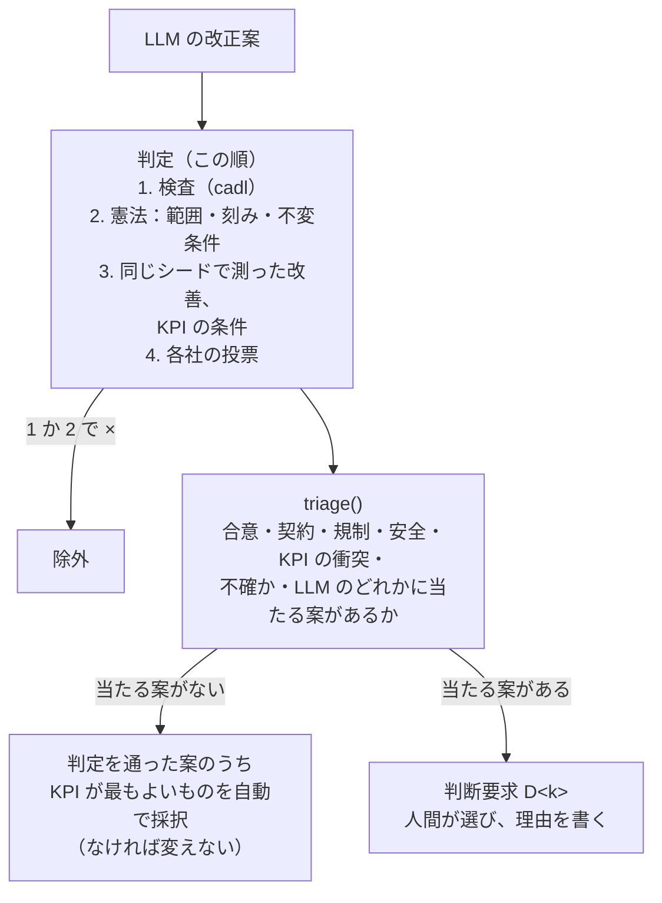
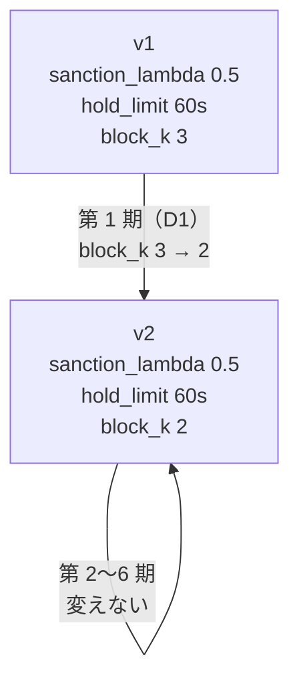
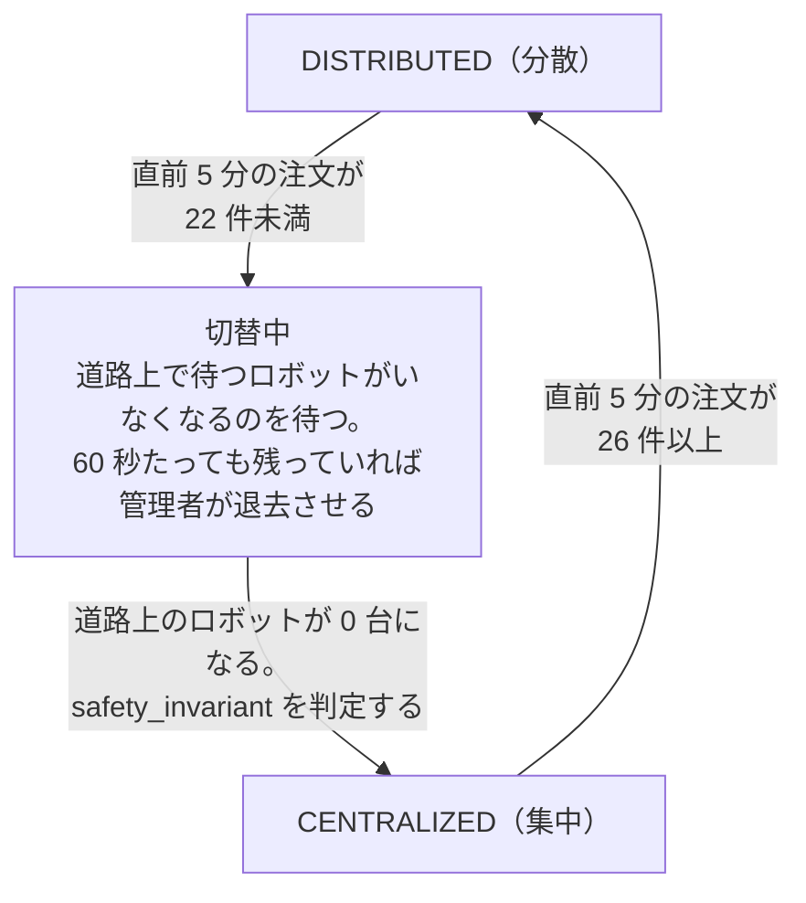

# コース D — ロボットの街：KPI に向けて規則を直す

[コース A — ロボット配送](../textbook/index.md) に戻る

- 対象：[コース A](../textbook/index.md)（CADL/SoS-DSL の基礎）を済ませた方。コース B は不要です
- 所要時間：120〜150 分（改造課題は別）
- 成果物：人間が自然言語で書いた KPI、LLM の改正案と判断要求、人間の判断とその理由（自然言語と GSN）、期ごとに改正された CADL の規則と憲法のバージョン

---

## 0. このコースの概要

コース A と B では、契約を一度書き、シミュレーションの結果をその契約に照らして判定しました。
コース D では、システムが動いている間に契約そのものが変わります。
3 社（A・B・C、各社 2 台）の配送ロボットが、ラズパイマウスのシミュレータと同じ 11 ノードの道路網を共有します。
シミュレーション上の 1 時間（1 期）が終わるたびに、規則の改正を検討します。

改正には、人間、LLM、機械による判定が、次の役割で関わります。

| 担当 | すること |
|---|---|
| 人間（サービスの運営者） | サービスの KPI を自然言語で書く。KPI は時間とともに変えてよい。LLM の判断要求に答え、判断の理由と結果を自然言語または GSN で残す |
| LLM | KPI を測れる指標に置き換え、KPI の達成に向けて規則・規制・契約の改正案を出す。明らかには判断できない問題や、人間の当事者が合意すべきことは自分で決めず、判断に必要な情報を添えて人間に判断を求める |
| 機械による判定 | 検査・憲法・同じ乱数シードで測った改善・各社の投票。LLM の説明は信用せず、測った値だけで判定する |



演習は公開リポジトリ [`cadl-robot-town`](https://github.com/ertlnagoya/cadl-robot-town) にあります。
Unity も SUMO も使いません。街は小さな Python のシミュレーションで、規範の判定には、コース A と同じ参照ランタイム（`cadl-raspimouse-simulator` から複製した `contract_engine.py`）を使います。

:::info[LLM の出力の記録について]
§4〜§8 は、API キーがなくても、`examples/steward-d/` と `examples/steward-goodhart/` に入った LLM の出力の記録を再生して進められます。
これらは、2026-11-18 に Claude Opus 5.5 で実際に実行した記録です（cadl 0.3.36）。英語で実行した記録（`examples/steward-d-en/`）もあります。同じ KPI でも、第 5 期で結論が分かれます（§10）。
判断要求への答え（`answers.yaml`）は、記録を作るときに人間（運営者）の役を Claude が務めて書いたものです。§4 からは、自分で答えて進めてください。
表の数値は、再生したときに判定のプログラムとシミュレーションが測ったものです。自分の API キーで実際の LLM を使って実行する方法は §10 にあります。
:::

---

## 1. セットアップ（5 分）

必要なのは、コース A でクローンした CADL コンパイラ（`~/program/cadl_repo`）だけです。

```bash
cd ~/program
git clone https://github.com/ertlnagoya/cadl-robot-town
cd cadl-robot-town
python3 -m venv .venv
source .venv/bin/activate
python3 -m pip install --upgrade pip
pip install -e ~/program/cadl_repo     # cadl コマンドと PyYAML が入る
```

インストールに失敗した場合は、[テキストブック 2.4 節](../textbook/02-toolchain-setup.md)のセットアップのトラブルシューティングを参照してください。

Anthropic の SDK と API キーが必要なのは、§10 で LLM を実際に呼ぶときだけです。

```bash
pip install anthropic
```

---

## 2. 規則・契約・規制を読む（15 分）

`cadl/robot_town.cadl` を開きます。街の契約は 2 つです。

- **`DELIVERY_SLA`**：注文 1 件ごとのインスタンスです。120 秒以内に集荷し、そこから 120 秒以内に届けなければ `Late` になります。顧客への約束です。
- **`ROAD_USE`**：ロボットが次の注文を待つために道路上に止まるたびに 1 インスタンスです。

```yaml
    - id: DELIVERY_SLA
      parties: [TOWN_STEWARD, "ROBOT[*]"]
      guarantee:
        - "pickup_time <= 120s"         # @amend:pickup_deadline
        - "dropoff_time <= 120s"        # @amend:dropoff_deadline
      lifecycle:
        ...
          - id: pickup
            from: Assigned
            to:   PickedUp
            on:   "ROBOT[i].status == PickedUp"
            deadline: 120s            # @amend:pickup_deadline
            on_violation: { transition: Late, severity: Major }
        ...
    - id: ROAD_USE
      parties: [TOWN_STEWARD, "ROBOT[*]", COUNCIL]
      authority:
        decision_holder: COUNCIL
      incentives:
        type: sanction
        lambda: 0.5                   # @amend:sanction_lambda
      lifecycle:
        states: [Holding, Overstay, Released, Evicted]
        initial: Holding
        terminal: [Released, Evicted]
        transitions:
          - id: release
            from: [Holding, Overstay]
            to:   Released
            on:   "ROBOT[i] -> TOWN_STEWARD : node_released"
            deadline: 60s             # @amend:hold_limit
            on_violation: { transition: Overstay, severity: Minor }
      monitors:
        - id: blocking_guard
          observe: "ROBOT[i].blocking"
          sampling: periodic(1000ms)
          rule: "ROBOT.blocking >= 3 AND state IN [Holding, Overstay]"  # @amend:block_k
          on_match: { transition: Evicted, severity: Major }
```

（抜粋して簡略化したものです。）

2 つのライフサイクルを状態機械で表すと次のようになります。





`# @amend:<名前>` が付いた行の数値が、改正できるパラメータです。
同じ名前の行が複数あるとき（集荷の約束の guarantee と deadline）は、すべて同じ値にしなければなりません。
各パラメータがどの層に属し、どこまで動かしてよいかは `constitution.yaml`（憲法）が決めます。

```yaml
amendable:
  hold_limit:       {layer: rule,     min: 10, max: 120, step: 10}   # 道路上で待ってよい秒数
  block_k:          {layer: rule,     min: 1,  max: 4,   step: 1}    # 後ろで何台待ったら退去させるか
  sanction_lambda:  {layer: rule,     min: 0.0, max: 1.0, step: 0.5} # 違反 1 件あたりの罰点の倍率（Minor 1、Major 3）
  to_central:       {layer: rule, safety: true, ...}                  # 運用モードの切替（§9）
  pickup_deadline:  {layer: contract, min: 60, max: 180, step: 30}   # 集荷の約束の秒数
  dropoff_deadline: {layer: contract, min: 60, max: 180, step: 30}   # 配達の約束の秒数
invariants:
  min_company_on_time_rate: 0.6
vote:
  quorum: 2
regulation:
  invariants.min_company_on_time_rate: {min: 0.5, max: 0.95, step: 0.05}
  vote.quorum:                         {min: 1,   max: 3,    step: 1}
```

（抜粋して簡略化したものです。）

改正の層は 3 つです。

| 層 | 対象 | 誰が決めるか |
|---|---|---|
| 規則 | `ROAD_USE` と、運用モードの切替の条件 | 判定をすべて通れば自動で採択できる。ただし切替の条件（`safety: true`）は人間が決める |
| 契約 | `DELIVERY_SLA`（顧客への約束） | 顧客は投票に加わらないので、人間が決める |
| 規制 | 憲法の値（不変条件、定足数） | 人間が決める |

3 社の振る舞いは違います（`town/policies.py`）。
**A 社**は仕事がなければ必ず車庫に戻ります。**B 社**は道路上で次の注文を待ちますが、`hold_limit` の 5 秒前には離れます。1 台待たせただけで退去させられる規則（`block_k` が 1）なら、道路上では待ちません。罰点がない規則（`sanction_lambda` が 0）では、違反しても損をしないので、C 社と同じく待ち続けます。**C 社**は、注文が来るか退去させられるまで待ち続けます。ただし `sanction_lambda` が上限の 1.0 になると、期限を 15 秒過ぎたところで離れます。
罰点の倍率は、CADL の検査で 0〜1 に限られ、改正では 0.5 刻みで動きます。倍率が 0.5 のときの各社の振る舞いが、§3 の結果です。
交差点に止まっているロボットは、そこを通りたい他のロボットをすべてふさぎます。

道路網は 11 のノードと 17 本の道路からなります（`town/world.py`）。A・B・C 社の車庫はノード 10・9・4（黄色）です。道路上で待つロボットは、最も便利な中央の交差点 8（紫）で待ちます。



### 演習 2-1

1. 今の規則で、罰点を受けることがありえない会社はどこですか。それはなぜですか。
2. 集荷の約束（`pickup_deadline`）を 150 秒に延ばすと、定時配達の件数はどうなると予想しますか。顧客が実際に待つ時間はどうなりますか。
3. 契約の層の改正を、なぜ各社の投票だけで決めてはいけないのですか。

---

## 3. 1 期だけ動かす（10 分）

ここでは運用モードを分散に固定します（モードは §9 で扱います）。

```bash
python -m town.period --mode DISTRIBUTED
```

```text
需要: 各社の注文の平均間隔 75 秒
運用モード: DISTRIBUTED
規則: robot_town.cadl  (hold_limit=60s, block_k=3, sanction_lambda=0.5)
  定時配達 121.8 / 注文 132.2  未配達 0.0  ふさがれた時間 2404s  （シード平均）
  会社  定時率  遅配  道路で待った回数  ふさがれた秒数  罰点   効用
   A     0.84   7.8               0.0            1352    0.0   38.4
   B     0.94   2.6              38.0             849    0.9   38.9
   C     1.00   0.0              39.6             203   14.8   28.8
  違反（原因別，シード平均）: deadline:dropoff=2.6, deadline:pickup=7.8, deadline:release=23.0, monitor:blocking_guard=2.8
  運用モード: 集中の時間 0%  切替 0.0 回（切替中の合計 0s，管理者による退去 0.0 台，安全条件の違反 0.0 回）
```

効用は「定時配達件数 − 罰点」です。数値は 5 つの乱数シードの平均です。

C 社は道路上で待ち、すべての顧客に定時で届け、そのために罰点 14.8 を払っています。
誰もふさいでいない A 社は 1352 秒ふさがれ、7.8 件を遅配しています。
下から 2 行目の違反は、すべて契約ランタイムが IR から判定したものです。`deadline:*` はライフサイクルの期限、`monitor:blocking_guard` は監視ルールによるものです。

---

## 4. KPI を書く（15 分）

人間の最初の仕事は、KPI を書くことです。`kpi.md` を開きます。

```markdown
## 第 1 期から

顧客に約束した時間（注文から集荷まで 120 秒、集荷から配達まで 120 秒）のうちに届く配達を、
町全体でできるだけ増やしたい。どの会社の顧客も、ひどく待たされることがないようにしたい。

## 第 5 期から

閑散期に入り、注文が減る。定時の配達は引き続き大事だが、各社の協力を保つため、
道路の使い方で特定の会社だけが得をしたり損をしたりしないようにしたい。
```

`## 第 k 期から` の見出しで、KPI をいつから適用するかを書きます。
改正ループは期の初めにこのファイルを読み直すので、期と期のあいだに書き換えてもかまいません。

KPI は自然言語なので、そのままでは改正案を比べられません。
LLM が、`town/kpi.py` にある指標（定時配達件数、定時率、遅配件数、未配達、待ち時間、ふさがれた時間、最も低い会社の定時率、会社ごとの効用の差、罰点の合計など）の組み合わせに置き換えます。
これを**評価方法**と呼びます。評価方法は、主目標（改善をこれで測る）、監視する指標（誤差を超えて悪化したら人間に知らせる）、条件（改正後に必ず守る）からなります。

記録を再生して、1 期だけ実行します。`--answers` を付けないので、判断要求には端末で答えます。

```bash
python -m town.steward --mode DISTRIBUTED --rounds 1 --name try-d \
    --llm replay --replay-dir examples/steward-d
```

```text
  KPI（第 1 期から）: 顧客に約束した時間（注文から集荷まで 120 秒、集荷から配達まで 120 秒）のうちに届く配達を、町全体でできるだけ増やしたい。どの会社の顧客も、ひどく待たされることがないようにしたい。
  LLM: 再生: examples/steward-d/p1-kpi.json（claude-opus-5-5、入力 3194 / 出力 2572 トークン）
  読み方: KPI の前半は、約束の時間（注文から集荷まで 120 秒、集荷から配達まで 120 秒）のうちに届く配達を町全体で増やすことなので、主目標は on_time_deliveries（町全体の定時配達件数）と読みます。（略）後半の「どの会社の顧客も、ひどく待たされることがない」は、会社ごとの待ち時間を監視する条件と読みます。ただし、「ひどく待たされる」の水準（何秒を超えたらひどいか、何割の注文までなら許すか）は KPI に書かれていません。（略）
   [1] 定時配達件数を増やし、各社の待ち時間の 95 パーセンタイルを監視する: 主目標 on_time_deliveries（増やす）、worst_company_p95_wait_s（減らす）、unfinished（減らす）
   [2] 定時配達件数を増やし、町全体で最も長い待ち時間を監視する: 主目標 on_time_deliveries（増やす）、max_wait_s（減らす）、worst_company_p95_wait_s（減らす）
   [3] 定時配達件数を増やし、会社ごとの定時率の差を監視する: 主目標 on_time_deliveries（増やす）、min_company_on_time_rate（増やす）、worst_company_p95_wait_s（減らす）
   懸念: 「ひどく待たされる」の水準（何秒を超えたらひどいか）が KPI に書かれていないため、guards を置けません。いまのままでは、待ち時間の悪化は監視するだけで、改正を止める条件になりません。（略）
   懸念: 定時配達件数だけを追うと、すでに約束の時間を過ぎた注文を後回しにする改正が有利になります。その結果、遅れた注文の待ち時間が大きく延びたり、期の終わりに未配達のまま残ったりする恐れがあります。（略）
   懸念: 町全体の定時配達件数を増やすことと、どの会社の顧客も待たせないことは、ぶつかる場合があります。（略）
   懸念: 「ひどく待たされる」をどの指標で表すかによって、どの改正が採択されるかが変わります。（略）
  → 判断要求 K1（LLM の推奨: 1）
  選ぶ id（1 / 2 / 3）:
```

これは、2026-11-18 に Claude Opus 5.5 が実際に書いた出力の再生です。
LLM は、KPI の解釈が 1 通りに定まり懸念もなければ、人間に確かめずにその評価方法を使います。
ここでは「ひどく待たされる」の水準が KPI に書かれていないとして、3 つの評価方法と 4 つの懸念を返しました。
どの選択肢にも、達成基準（「何秒以下」のような値）はありません。KPI の文に書かれていない水準を LLM が決めないよう、依頼で求めているためです。
LLM が書いた評価方法は、指標の名前と形を機械が確かめてから使います。知らない指標を書いた選択肢は、選択肢から外されます。

`worst_company_p95_wait_s` は、会社ごとに求めた待ち時間の 95 パーセンタイルのうち、最も長いものです。待ち時間は注文から届くまでの秒数で、期の終わりに届いていない注文は、期の終わりまでの秒数で数えます。使える指標の一覧は `python -m town.kpi` で表示されます。

番号を選ぶと、理由と前提（GSN の Assumption）を聞かれます。前提は何行でも書け、空のまま Enter で終わります。
記録に入っている答え（`examples/steward-d/answers.yaml`）は次のとおりです。この記録を作るときは、人間（運営者）の役を Claude が務めました。

```yaml
K1:
  choice: "1"
  reason: KPI の文の順のとおり、町全体の定時配達を主目標にし、どの会社の顧客もひどく待たせないことは、会社ごとの待ち時間の 95 パーセンタイルで監視する。「ひどく」の水準は、第 1 期の測定を見てから決める。
  assumptions:
    - 顧客は配送の会社を選べない
```

### 評価方法と達成基準を自分で書く

KPI の文だけでは、何を測り、どこまで行けば達成なのかが決まりません。
`kpi.md` の節に「評価方法:」の箇条書きを書くと、`town.steward` はそれをそのまま評価方法として使い、LLM に読み方を頼みません（見本は `examples/kpi-written/kpi.md`）。

```markdown
## 第 1 期から

顧客に約束した時間のうちに届く配達を、町全体で 95% 以上にしたい。どの会社でも、
約束の合計の 240 秒を超えて待つ顧客を 5% 以下にしたい。

評価方法:
- 主目標: 定時率 >= 0.95
- 監視: 最も待たせた会社の待ち時間p95 <= 240
- 条件: 最低の会社の定時率 >= 0.8
```

| 行 | 意味 |
|---|---|
| `主目標` | 1 つだけ。改善はこれで測る。値を書けば達成基準になる |
| `監視` | 誤差を超えて悪化すれば、KPI の衝突として人間に判断を求める。値を書けば達成基準になる |
| `条件` | 値が必須。改正後に必ず守る（破る案は KPI の衝突になる） |

期ごとに、現行の規則が達成基準と条件に届いているかが「KPI の達成状況」として表示され、改正案の表にも、改正後に届くかが添えられます。
達成基準は表示のためのもので、改正を採るかどうかの判定には使いません。

```bash
python -m town.kpi examples/kpi-written/kpi.md     # 各節をどう読むかを確かめる
```

### 演習 4-1

1. K1 で選択肢 2（町全体で最も長い待ち時間を監視する）を選ぶと、§5 の判断要求はどう変わると予想しますか。
2. LLM の 2 つ目の懸念は、定時配達件数だけを追うと、すでに遅れた注文が後回しにされうると言っています。待ち時間を監視すると、なぜこれを見つけられるのですか。期の終わりに届いていない注文の数え方に注目して説明してください。
3. 「ひどく待たされる」を「約束の合計の 240 秒を超えて待つ顧客が、どの会社でも 5% 以下」と決めたとします。`kpi.md` の第 1 期の節に、評価方法の箇条書きを足してください。`python -m town.kpi` で、書いたとおりに読まれることを確かめてください。

---

## 5. 判断要求に答える（20 分）

K1 に答えると、LLM が改正案を出し、各案が判定にかけられます。

```text
| id | 案 | 層 | 検査 | 憲法 | 定時配達 | 遅配 | ふさがれた秒 | 道路の違反 | 最低の定時率 | 主目標 on_time_deliveries の差 | 改善したシード | KPI の条件 | 効用 A / B / C | 投票 A B C | 達成基準・監視する目標・条件の値 |
|---|---|---|---|---|---|---|---|---|---|---|---|---|---|---|---|
| — | 現行 | — | — | — | 121.8 | 10.4 | 2404 | 25.8 | 0.84 | — | — | — | 38.4 / 38.9 / 28.8 | — | worst_company_p95_wait_s 273、unfinished 0.0 |
| 1 | block_k 3 → 2 | 規則 | ○ | ○ | 131.0 | 1.2 | 985 | 34.0 | 0.98 | +9.2 | 5/5 | ○ | 45.4 / 37.2 / 19.0 | ○ × × | worst_company_p95_wait_s 95.6、unfinished 0.0 |
| 2 | hold_limit 60s → 50s | 規則 | ○ | ○ | 120.6 | 11.6 | 2468 | 28.8 | 0.86 | -1.2 | 2/5 | ○ | 38.8 / 37.6 / 27.2 | ○ × × | worst_company_p95_wait_s 266、unfinished 0.0 |
```

LLM の 1 つ目の案 `block_k 3 → 2`（後ろで 2 台が待った時点で退去させる）は、5 つのシードすべてで定時配達を増やします（+9.2）。遅配は 10.4 件から 1.2 件に、最も待たせた会社の待ち時間の 95 パーセンタイルは 273 秒から 95.6 秒に下がります。
しかし、B 社と C 社が反対し、投票で否決されました。C 社の効用は 28.8 から 19.0 に下がり、道路の違反は 25.8 件から 34.0 件に増えます。退去させられることも違反に数えるためです。
2 つ目の案 `hold_limit 60s → 50s` は、定時配達を増やしません。
LLM は、罰点の倍率を上げる案も、規制や契約を変える案も出しませんでした。
代わりに、所見で「ひどく待たされる」の水準を決めるよう人間に求め、その材料として、今期の最も待たせた会社の p95（273 秒）、町全体の p95（188 秒）、最長の待ち時間（385 秒）を挙げました。

改正ループは、次のどれかに当たる案があると、自動では採択せず、人間に判断を求めます（`town/steward.py` の `triage()`）。

| 理由 | 当たるとき |
|---|---|
| 合意 | KPI はよくなるのに投票で否決され、自動で採択できる案より KPI がよい |
| 契約 | 顧客との約束を変え、KPI がよくなる |
| 規制 | 憲法の値を変える |
| 安全 | 運用モードの切替の条件を変え、KPI がよくなる |
| KPI の衝突 | 主目標はよくなるが、KPI の条件を破るか、監視している指標が悪化する |
| 不確か | 判定はすべて通るが、改善したシードが 5 つのうち 4 つに満たない |
| LLM | LLM 自身が、人間の判断が要ると書いた（憲法の不変条件を守る案に限る） |

各案は、次の順に判定を受けてから、判断を求めるかどうかを決められます。



この期は、1 が「合意」に当たります。KPI はよくなるのに否決され、自動で採択できる案（ここでは、改善のない 2 は採れないので「変えない」）より KPI がよいためです。LLM は判断要求 D1 を書き、`runs/try-d/p1-request.md` に残します。

```text
  → 判断要求 D1（LLM: 再生: examples/steward-d/p1-request.json（claude-opus-5-5、入力 2529 / 出力 2075 トークン））
  **問い**：B・C 社が反対して否決された規則改正「block_k 3 → 2」を、町全体の定時配達と顧客の待ち時間が改善することを理由に採択するか、それとも現行 v1 のまま変えないかを決めてください。
  - **1**：block_k 3 → 2。（略）投票は A 社が賛成、B・C 社が反対なので、採択するには反対を押して決めることになります。（当事者: 得をするのは、すべての会社の顧客（遅配が減り、最も待たされる会社の顧客の待ち時間の 95 パーセンタイルが 273 秒から 95.6 秒に下がります）と A 社（効用 38.4 → 45.4）です。損をするのは C 社（効用 28.8 → 19.0）と B 社（効用 38.9 → 37.2）です。（略））
  - **keep**：変えない。（略）
  LLM の推奨: 1 — KPI の主目標 on_time_deliveries が 5/5 のシードで改善し（+9.2）、監視する目標の worst_company_p95_wait_s も 273 から 95.6 に大きく下がり、最低の定時率は 0.98 になります。（略）ただし C 社の効用が 9.8 下がることと道路の違反が 25.8 から 34.0 に増えることは無視できないため、採択する場合は、C 社の損失の原因を確認し、次の期に道路の違反と各社の効用を監視することを条件とするよう勧めます。
  LLM が知らないこと: B 社・C 社が反対した理由と、C 社の効用が 28.8 から 19.0 に下がる具体的な原因（どの評価項目が下がったか）
  LLM が知らないこと: 反対を押して採択した場合に、B 社・C 社が行動方針を変えるかどうか、また今後の投票や協力にどう影響するか
  LLM が知らないこと: 人間が投票の結果と異なる採択をすることが憲法・手続きのうえで認められる範囲
  （ほかに 6 件）
```

判断要求は、問い、自分で決めない理由、選択肢ごとの結果と当事者の利害、LLM の推奨、LLM が知らないことからなります。
選択肢は、判断を求める理由に当たった案と、自動で採択できる案（あれば）と「変えない」です。LLM は選択肢を増やせません。数値の表は、LLM の文章ではなく、判定のプログラムが測ったものをそのまま示します。

顧客は投票に加わりません。各社の投票は各社の効用で決まるので、遅配が減って得をする顧客の利害は、投票に表れません。
LLM は推奨に「顧客の利害は人間が代わりに考える必要があります」と書き、否決を覆して採ることを勧めました。記録の答えも、否決を覆して 1 を採るものです。

```yaml
D1:
  choice: "1"
  reason: 交差点は 3 社が共有する道路で、そこで待ち続けることはどの会社の権利でもない。5 つのシードすべてで定時配達が増え、遅配が 10.4 件から 1.2 件に、最も待たせた会社の待ち時間の 95 パーセンタイルが 273 秒から 95.6 秒に下がるので、B・C 社の反対を覆して採る。C 社の効用が 28.8 から 19.0 に下がることと、道路の違反が 25.8 から 34.0 に増えることは、次の期にもう一度測る。
```

LLM の推奨は、依頼するたびに変わることがあります。同じ数値の判断要求で、英語の LLM は「変えない」を勧めました（§10）。以前の記録（2026-10-29）では、同じ判断要求をもう一度依頼したところ、推奨が 1 回目の「採る」から 2 回目の「変えない」に変わりました。
LLM は判断の材料をそろえ、それぞれの選択肢に理由があることを示し、人間が決めました。

### 判断の記録

判断は `runs/<名前>/` の 2 つのファイルに残ります。

- `decisions.md`：自然言語の記録。KPI の評価方法、LLM の分析、判断を求めた理由、LLM の推奨と知らないこと、人間の選択と理由を、判断ごとに並べます。
- `gsn.yaml`：GSN（Goal Structuring Notation）の木。`gsn.md` に Mermaid の図を書き出します。

| GSN の要素 | この演習で入るもの |
|---|---|
| Goal | 人間が書いた KPI（バージョンごと） |
| Strategy | その期の判断（採択した改正、または変えない） |
| Solution | 同じシードで測った結果（`p<k>-evidence.md`） |
| Context | KPI の評価方法、その期の環境 |
| Assumption | 人間が書いた前提 |
| Justification | 人間が書いた理由（自動で決まったときは、その条件） |

`gsn.md` の木は次の形です。実線の矢印は supported by、点線の矢印は in context of を表します。


理由は自然言語で書いても、GSN の要素で書いてもかまいません。`--answers` の YAML には、`gsn:` に要素（`type:` と `text:`）を並べられます。次は書き方の例です（記録の答えは、D2 の理由を自然言語で書いています）。

```yaml
D2:
  choice: keep
  gsn:
    - type: justification
      text: 改善したのは 5 つのシードのうち 2 つだけで、確かでない改善のために C 社の効用を 56.3 から 40.1 に下げない
    - type: context
      text: D1 で、C 社の効用と道路の違反を次の期に測り直すと決めた
```

次の期からは、それまでの判断と人間の理由が LLM に渡されます。§6 で、それが LLM の提案と推奨をどう変えるかを見ます。

### 比べる：人間がいない委員会

同じ第 1 期を、ルールベースの委員会（`town.council`）で実行すると、次のようになります。
委員会は、1 つのパラメータを 1 ステップ動かした規則の案をすべて試し、判定を通ったもののうち目標が最もよいものを採ります。否決された案は採りません。

```bash
python -m town.council --mode DISTRIBUTED
```

```text
  改正案                                  定時配達  違反 (道路) ふさがれた  検査 憲法 改善 投票(A B C)
  hold_limit 60s → 50s                     120.6  40.4 (28.8)     2468s    ○    ○    ×   ○ × ×
  hold_limit 60s → 70s                     124.2  31.6 (23.6)     2367s    ○    ○    ○   ○ ○ ○
  block_k 3 → 2                            131.0  35.2 (34.0)      985s    ○    ○    ○   ○ × ×
  block_k 3 → 4                            119.4  36.4 (23.6)     2788s    ○    ○    ×   ○ × ○
  sanction_lambda 0.5 → 0                  119.0  59.0 (45.8)     3059s    ○    ○    ×   ○ ○ ○
  sanction_lambda 0.5 → 1                  132.2  23.6 (23.6)      845s    ○    ○    ○   ○ ○ ×
  ...
  → 採択: sanction_lambda 0.5 → 1（目標 +10.4，賛成 AB）。v2.cadl として保存。
```

委員会は `sanction_lambda 0.5 → 1`（罰点の倍率を 2 倍にする）を採ります。倍率が 1 になると、C 社は期限を 15 秒過ぎたところで交差点を離れるようになり、遅配が 0 件になります。罰点が増える C 社は反対しますが、A・B 社の賛成で定足数（2 社）に届きます。
`block_k 3 → 2` は改善の判定を通りますが、否決されたので委員会は採りません。罰点をなくす案（`0.5 → 0`）には 3 社とも賛成しますが、B 社も期限を気にせず居座るようになり、定時配達が減るので、改善の判定で除かれます。

| 第 1 期に採った改正 | 定時配達 | 遅配 | ふさがれた秒 | 道路の違反 | 効用 A / B / C | 投票 A B C |
|---|---|---|---|---|---|---|
| 委員会：`sanction_lambda 0.5 → 1` | 132.2 | 0.0 | 845 | 23.6 | 46.2 / 41.2 / 19.2 | ○ ○ × |
| D1 の人間：`block_k 3 → 2` | 131.0 | 1.2 | 985 | 34.0 | 45.4 / 37.2 / 19.0 | ○ × × |

どちらも遅配をほぼなくし、損をするのはどちらも C 社です。違いは、罰点の案は道路の違反を減らし、投票も通ることです。
LLM はこの案を出しませんでした。委員会はすべての案を機械的に試しますが、LLM は自分で考えた案しか出しません。LLM には各社の行動方針（`town/policies.py`）を渡していないので、罰点の倍率で C 社の行動が変わることを知りません。ただし、代理指標の KPI（§8）では、同じ LLM が罰点を重くする案を出しています。
一方、委員会は、顧客の利害を理由に否決された案を採ることも、C 社の効用を次の期に測り直すという理由を残すこともしません。

### 演習 5-1

1. D1 に `keep` と答えて、第 1 期を実行し直してください。`decisions.md` と `gsn.md` はどう変わりますか。
2. B 社は自分も 849 秒ふさがれているのに、`block_k 3 → 2` に反対しました。§3 の表から理由を説明してください。
3. 上の表で、委員会の改正と D1 の改正を、K1 の評価方法（主目標は定時配達件数、監視は最も待たせた会社の待ち時間 p95 と未配達）で比べると、どちらがよいですか。評価方法に道路の違反を加えると、答えは変わりますか。

---

## 6. 6 期を実行する（20 分）

記録の答えを使って、6 期を通して実行します。

```bash
python -m town.steward --mode DISTRIBUTED --rounds 6 --name steward-d \
    --llm replay --replay-dir examples/steward-d --answers examples/steward-d/answers.yaml
```

`scenario.yaml` が期ごとの需要（平常・繁忙期・閑散期、期の途中のラッシュ）を決めます。
現行の規則も、その期の環境で測り直してから改正案と比べます。

| 期 | 判断を求めた理由 | LLM の推奨 | 人間の選択 | 結果 |
|---|---|---|---|---|
| 1（平常） | 合意（`block_k 3 → 2` を B・C 社が否決。改善したシードは 5/5） | 1 | `block_k 3 → 2`（否決を覆す） | v2 |
| 2（平常＋ラッシュ） | 不確か（`block_k 2 → 1` の改善したシードは 2/5） | keep | 変えない | v2 |
| 3（繁忙期） | なし（`hold_limit 60s → 50s` は +0.6 で誤差の目安の 1 件に満たず、自動で変えない） | — | — | v2 |
| 4（繁忙期＋ラッシュ） | なし（LLM は案を出さなかった） | — | — | v2 |
| 5（閑散期） | §7 で見る | keep | 変えない | v2 |
| 6（閑散期） | なし（LLM は案を出さなかった） | — | — | v2 |



各期について補足します。

- **第 2 期**：`block_k 2 → 1` は A・B 社の賛成で定足数（2 社）に届いていて、判断を求めた理由は「不確か」だけです。それでも LLM は、問いに「C 社が反対しても投票の結果を覆して採択するか」と書きました。判断要求を書く依頼には憲法を渡していないので、LLM は定足数を知りません（§11）。
  LLM は、D1 の人間の理由（5 つのシードすべてで +9.2 改善したから覆した）を引き、今回はその条件を満たさないとして、変えないことを勧めました。記録の答えも変えないものです。答えの理由には、覆すことにはならない、と書き添えています。
- **第 3・4 期**：遅配は 3.4 件と 2.0 件、最も待たせた会社の待ち時間の 95 パーセンタイルは 95.4 秒と 98.2 秒で、約束の 120 秒の内にあります。改善できる余地は小さく、第 4 期に LLM は案を出しませんでした。
  そのとき LLM は「主目標を伸ばせる余地は最大でも約 2 件で、採択に必要な改善量 1.0 とほぼ同じ」と書きました。`town.steward` は、改善を指標ごとの誤差の目安で判定し、憲法の `min_improvement` は使いません（使うのは `town.council` です）。改正案を出す依頼には憲法の全体を渡しているので、LLM はそこに書かれた値で判定されると読みました（§11）。
- **第 6 期**：LLM は案を出さず、所見で人間に問いを返しました。C 社の罰点を「道路の規則で C 社が損をしている」とみなすのか、「C 社が道路上で待つことを選び、その利害を引き受けている」とみなすのか、という問いです。後者なら、効用の差よりも、A 社がふさがれた時間を公平さの評価方法に加えることを検討すべきだ、と書いています。
- 6 期のうち人間に判断を求めたのは 3 期で、規則が変わったのは第 1 期だけです。

`runs/steward-d/gsn.md` を開いて、6 期分の判断の木を見てください（GitHub や VS Code のプレビューで Mermaid の図として表示されます）。

### CADL Explorer で規則のバージョンを見る

規則のバージョン `runs/steward-d/v1.cadl` と `v2.cadl` は、[CADL Explorer](https://cadl-explorer.streamlit.app/)（v0.5.9 以降）の **Designer** のページで見比べられます。

1. **Open an existing CADL file** から `v1.cadl` を開き、ビューを **Versions** に切り替え、名前に `v1` と入れて **Save as a version** を押します。`v2.cadl` も同じように保存します。
2. **Amendable parameters** の **Constitution** に、このリポジトリの `constitution.yaml` をアップロードします（**Use the Robot Town constitution** を押しても同じファイルが読み込まれます）。表には、`# @amend:` の名前ごとに、値、層、範囲、刻み、誰が決めるか（*decided by*）が出ます。規則の層は検査（the checks）、契約の層と、安全に関わる運用モードの規則は人（a person）です。§2 と同じ分け方です。
3. **History of the amendable values across the versions** を開きます。v2 で `block_k` が 3 から 2 に変わっています。上の表の第 1 期の改正です。
4. **Compare two designs** で **A** に v1、**B** に v2 を選びます。構造の差分とソースの差分の上に、改正したパラメータ（`block_k` 3 → 2）が示されます。

Explorer は、このコースの憲法の判定と同じ規則で、値を確かめます。変えてよいのは `# @amend:` の行の数値だけで、1 回に 1 つを 1 刻み、範囲の中です。ほかの判定は行いません（`cadl` の検査のほかは、改善を測ることも、投票することもしません）。Explorer で値を改正する（**Amend** の欄）と、コメントはそのまま残りますが、判断の記録は、ダウンロードしない限りブラウザのセッションの間しか残りません。このコースの記録は `decisions.md` と `gsn.yaml` です。

### 演習 6-1

`examples/steward-d/answers.yaml` を複製し、D2 を `"2"` に変えて、`--answers` に渡して実行してください。
記録の LLM の出力は、記録の答えを前提にしています。答えを変えると、それ以降の期の再生には「注意：記録したときと依頼の内容が違う」と出ます。
第 3 期の案の数値と投票は、記録とどう変わりますか。§10 の実際の LLM で実行すると、LLM の推奨はどうなると予想しますか。

---

## 7. KPI が変わる（15 分）

第 5 期から、`kpi.md` の別の節が適用されます。
KPI が変わると、LLM は評価方法を作り直し、これまでの判断のうち、前提が成り立たなくなったものを挙げます。

```text
  KPI（第 5 期から）: 閑散期に入り、注文が減る。定時の配達は引き続き大事だが、各社の協力を保つため、道路の使い方で特定の会社だけが得をしたり損をしたりしないようにしたい。
   [1] 公平さ（効用の差）を主目標にし、定時率と各社の定時率を監視する: 主目標 utility_gap（減らす）、on_time_rate（増やす）、min_company_on_time_rate（増やす）、on_time_rate_gap（減らす）、worst_company_p95_wait_s（減らす）
   [2] 公平さ（定時率の差）を主目標にし、最も低い会社の定時率と町全体の定時率を監視する: 主目標 on_time_rate_gap（減らす）、min_company_on_time_rate（増やす）、on_time_rate（増やす）、utility_gap（減らす）、worst_company_p95_wait_s（減らす）
   [3] 定時率を主目標のままにし、公平さは悪化しないことを監視する: 主目標 on_time_rate（増やす）、utility_gap（減らす）、on_time_rate_gap（減らす）、min_company_on_time_rate（増やす）、worst_company_p95_wait_s（減らす）
   懸念: 効用の差や定時率の差は、公平さの代理指標です。差だけを追うと、良い会社の成績を下げて差を縮める改正でも改善と判定されます。（略）
   懸念: 効用（定時配達件数 − 罰点）は注文件数に比例するので、会社ごとの注文件数が違うと、道路の規則と関係なく差が生じます。（略）
   懸念: 直前の KPI にあった「どの会社の顧客もひどく待たされることがない」は今回の文にありません。worst_company_p95_wait_s は監視する目標として残しましたが、K1 で「ひどく」の水準が決まらないままなので、続けて監視するか、水準を置くかを人間が決める必要があります。
   （ほかに 3 件）
   見直し対象: K1 — （略）第 5 期の KPI は会社の間の公平さを新しく求めていて、注文件数も減るので、主目標と監視する目標の前提が変わりました。
   見直し対象: D1 — D1 は町全体の定時配達の増加を理由に、B・C 社の反対を覆して block_k を 3 から 2 に下げ、C 社の効用が 28.8 から 19.0 に下がりました。今回の KPI は道路の使い方で特定の会社が損をしないことを求めているので、この規則が公平さを損なっていないかを、新しい評価方法でもう一度測る必要があります。（略）
   （ほかに 1 件）
  → 判断要求 K5（LLM の推奨: 1）
```

記録の答えは選択肢 1（効用の差を主目標にする）です。選択肢 1 は、最も待たせた会社の待ち時間の 95 パーセンタイルも監視します。この期の改正案は次のとおりです。

| id | 案 | 定時配達 | 遅配 | 主目標 utility_gap の差 | 改善したシード | 効用 A / B / C | 投票 A B C | 最低の定時率 | 最も待たせた会社の待ち時間p95 |
|---|---|---|---|---|---|---|---|---|---|
| — | 現行 | 80.8 | 1.8 | — | — | 25.2 / 25.4 / 10.2 | — | 0.96 | 178 秒 |
| 1 | `block_k 2 → 3` | 74.8 | 7.8 | +7.5 | 4/5 | 23.0 / 23.6 / 15.9 | × × ○ | 0.83 | 390 秒 |
| 2 | `hold_limit 60s → 70s` | 80.2 | 2.4 | +1.7 | 4/5 | 25.0 / 24.7 / 11.5 | ○ × ○ | 0.95 | 212 秒 |
| 3 | `sanction_lambda 0.5 → 0` | 76.0 | 6.6 | +11.2 | 4/5 | 23.2 / 27.2 / 25.6 | × ○ ○ | 0.89 | 289 秒 |

効用の差 15.2 の原因は罰点です。C 社の定時率は 3 社で最も高いのに、罰点の合計 20.0 のうち 18.2 を C 社が受けています。

- 1 は、D1 の改正を元に戻す案です。差は縮みますが、遅配が 1.8 件から 7.8 件に増え、最も低い会社の定時率は 0.83 に、最も待たせた会社の p95 は 390 秒に悪化します。A・B 社が反対し（合意）、監視している指標が悪化します（KPI の衝突）。
- 3 は、罰点をなくす案です。差は最も大きく縮みますが、B 社も C 社も期限を気にせず居座るようになり、道路の違反は 26.0 件から 45.8 件に、遅配は 6.6 件に増えます（KPI の衝突）。LLM は「評価方法の上でだけ差を消す疑いがあります」と書きました。
- 1 と 3 の効用の差が縮むのは、C 社の効用が上がるからだけではありません。A 社の効用も下がります。K5 の懸念（差は、良い会社を下げることでも縮む）がそのまま当てはまる案です。
- 2 は A・C 社の賛成で定足数に届き、悪化は小さい案です。それでも、最も待たせた会社の p95 が 178 秒から 212 秒に延びるので、KPI の衝突に当たります。

```text
  LLM の推奨: keep — 案 1 と案 3 は、主目標の改善と引き換えに定時配達・最低の定時率・待ち時間がすべて大きく悪化し（略）、K5 で人間が示した方針に反します。（略）案 2 は悪化が小さいものの、主目標の改善は +1.7 で C 社の効用は 10.2 から 11.5 にしか上がらず、すでに約束の 120 秒を超えている worst_company_p95_wait_s を 178 から 212 に悪化させます。（略）ただし C 社の不利益が続くことを重く見るなら、案 2 は監視する目標の悪化が最も小さく投票も通っているので、次の候補になります。
```

記録の答えも「変えない」です。

```yaml
D5:
  choice: keep
  reason: block_k を 3 に戻す案（1）と罰点をなくす案（3）は、効用の差を縮めるが、遅配が 1.8 件から 7.8 件・6.6 件に増え、最も低い会社の定時率も下がる。差を縮めるためにサービスを悪くすることはしない。罰点をなくす案は、道路の違反もほぼ倍になる。hold_limit の案（2）は C 社の効用を 1.3 しか上げず、最も待たせた会社の待ち時間の 95 パーセンタイルを、約束の 120 秒を超えた 178 秒からさらに 212 秒に延ばす。C 社の効用が低い原因は、閑散期にもう一度測って考える。
```

英語の記録では、同じ `hold_limit 60s → 70s` の案が採られました（§10）。英語の K5 の評価方法は待ち時間を監視していなかったので、この案の悪化が示されなかったためです。
同じ案でも、評価方法で何を監視するかによって、人間に示される悪化が変わり、判断が変わりました。

C 社の効用は、第 5 期に 10.2、第 6 期に 10.5 と、3 社のうちで最も低いままです。新しい KPI のもとでも、記録の人間は、C 社の効用を上げるためにサービスを悪くする案を採りませんでした。C 社の効用を上げる別の手段（たとえば、交差点で待つ順番を決める規則）は、今の規則のパラメータにはありません。

### 演習 7-1

1. K5 で選択肢 3 を選んで、第 5 期を実行してください（`answers.yaml` を複製して K5 を書き換えます）。判断要求の選択肢はどう変わりますか。記録の判断要求は選択肢 1 の評価方法を前提にしているので、どうなりますか。
2. 3（罰点をなくす案）が判断要求の対象にならずに自動で採択されるのは、どんな評価方法で、投票がどうなったときですか。それは望ましいですか。再生では KPI の言い換えが記録のままなので、`kpi.md` を書き直して確かめるには §10 の実際の LLM を使います。
3. 第 5 期の `kpi.md` の節に、評価方法の箇条書きで `- 監視: 最も待たせた会社の待ち時間p95 <= 240` と書くと、2 の案は人間に示されますか。表の値から答えてください。

---

## 8. 代理指標の KPI（15 分）

KPI が、測りやすい代わりの指標（代理指標）を目標にしているとどのような問題が生じるかを調べます。
`examples/steward-goodhart/kpi.md` には、次の KPI が書いてあります。

```markdown
## 第 1 期から

道路の規則をきちんと守らせたい。道路の規則の違反を、できるだけ減らしたい。
```

LLM は評価方法の選択肢と懸念を返し、どちらの記録でも「違反件数は規則の中身を緩めても減ります」と書きました。
記録では K1 に 2 通りに答えています。違反の件数だけを主目標にして罰点の合計を監視する場合（`proxy/`）と、配達の成績・待ち時間・ふさがれた時間も監視する場合（`guarded/`）です。
2 回の依頼で、LLM が出した評価方法の選択肢は違います。どちらの記録でも答えは選択肢 2 ですが、中身は上のとおり違います。

```bash
python -m town.steward --kpi examples/steward-goodhart/kpi.md --mode DISTRIBUTED --name goodhart-proxy \
    --llm replay --replay-dir examples/steward-goodhart/proxy --answers examples/steward-goodhart/proxy/answers.yaml
python -m town.steward --kpi examples/steward-goodhart/kpi.md --mode DISTRIBUTED --name goodhart-guarded \
    --llm replay --replay-dir examples/steward-goodhart/guarded --answers examples/steward-goodhart/guarded/answers.yaml
```

`proxy` では、LLM は 3 つの案を出しました。

| id | 案 | 定時配達 | 遅配 | ふさがれた秒 | 道路の違反 | 主目標の差 | 改善したシード | 投票 A B C |
|---|---|---|---|---|---|---|---|---|
| — | 現行 | 121.8 | 10.4 | 2404 | 25.8 | — | — | — |
| 1 | `sanction_lambda 0.5 → 1` | 132.2 | 0.0 | 845 | 23.6 | +2.2 | 4/5 | ○ ○ × |
| 2 | `block_k 3 → 2` | 131.0 | 1.2 | 985 | 34.0 | -8.2 | 0/5 | ○ × × |
| 3 | `hold_limit 60s → 70s` | 124.2 | 8.0 | 2367 | 23.6 | +2.2 | 5/5 | ○ ○ ○ |

1（罰点を重くする）と 3（道路で止まってよい秒数を 60 秒から 70 秒に延ばす）は、違反の件数を同じ 23.6 件に減らします。
1 は C 社の居座りを短くして減らし、ふさがれた時間も遅配も減らします。3 は違反とみなす基準をゆるめて減らし、ふさがれた時間はほとんど変わりません。
主目標の数字だけでは、この 2 つを区別できません。
守らせる方向の案でも、2（`block_k 3 → 2`）は退去を増やすので、数えられる違反はかえって増えます（-8.2）。

3 は判定をすべて通り、自動で採択できる案です。1 は、監視している罰点の合計を 15.7 から 25.6 に増やすので「KPI の衝突」に当たり、人間に判断を求めました。人間がいなければ、ゆるめる案 3 が自動で採られていました。
LLM は判断要求で 1 を勧めました。

```text
  LLM の推奨: 1 — 案 1 は罰点を重くすることでロボットの行動を変えて違反を減らしており、「道路の規則をきちんと守らせたい」という KPI の意図に合います。（略）案 3 は基準を緩めて件数を減らす案であり、K1 で人間が示した「違反の件数を減らす」意図には形式上合いますが、規則を守らせる意図には合わないと考えます。（略）
```

記録の答えは 1 を採りました。

`guarded` では、LLM は 3 の案を出しませんでした。所見に「hold_limit を延ばせば違反の件数は数字の上では減りますが、止まる時間が長くなりふさがれた時間が増えるおそれが強く、人間が残した理由（交差点をふさがせない）と合わないため、この案は出していません」と書いています。
LLM は、K1 の答えの理由を読んで、ゆるめる案を出しませんでした。出した 2 案のうち 1 は判定をすべて通り、監視する指標も悪化しないので、自動で採択されました。
英語で同じ KPI を書いた記録（`examples/steward-goodhart/en/`、§10）でも、LLM は 1 と 2 だけを出し、1 が自動で採択されました。

以前の記録（2026-11-15）では、罰点の倍率を変えてもロボットの行動が変わらなかったので、1 は違反を 1 件も減らしませんでした。そのとき LLM が出せた、件数を減らす案は 3 だけでした。件数を減らす手段が、規則を守らせる案にもあるかどうかで、代理指標の危うさの現れ方が変わります。

人間がいない場合に規則がどこまで変わるかは、ルールベースの委員会で確かめられます。委員会は KPI の文を使わず、目標の数字だけで判定します。

```bash
python -m town.council --mode DISTRIBUTED --rounds 8 --objective road_violations --name goodhart-d
python -m town.council --mode DISTRIBUTED --rounds 6 --name seasons-d
python -m town.compare runs/goodhart-d/v1.cadl runs/goodhart-d/v5.cadl runs/seasons-d/v4.cadl --mode DISTRIBUTED
```

| 規則 | 定時配達 | 遅配 | 道路の規則の違反 | ふさがれた時間 | A 社の定時率 |
|---|---|---|---|---|---|
| 初期 v1 | 112.2 | 10.8 | 25.0 | 2457 秒 | 0.82 |
| 道路の違反を目標にした v5 | 106.0 | 17.0 | **21.0** | **3681 秒** | 0.72 |
| 定時配達を目標にした v4 | 122.8 | 0.2 | **19.8** | 956 秒 | 1.00 |

（改正ループが評価に使っていないシード 1001〜1005 で比べています。）
道路の違反を目標にした委員会は、8 期のうちに規則を 4 回、すべて緩める方向に改正しました。数えている違反は減り、ふさがれた時間と遅配はどちらも約 1.5 倍に増えました。憲法の不変条件（定時率 6 割以上）では、この改正を止められません。
罰点を重くする案も毎期出ていて、違反の件数を減らしていました。それでも採られなかったのは、緩める案のほうが件数の減り方が同じか大きかったためです（第 1 期はどちらも 23.6 件で、先に並ぶ緩める案が採られました）。罰点を重くする案には、C 社がいつも反対します。
定時配達を目標にした委員会は、第 1 期に罰点を重くしたので、違反の件数も v5 より少なくなりました。

委員会は、主目標の数字が同じなら、緩める案と守らせる案を区別しません。`town.steward` の `proxy` では、LLM が守らせる案を勧め、人間がそれを選びました。`guarded` では、LLM が人間の理由を読んで、緩める案をはじめから出しませんでした。
ただし、LLM が今回のように KPI の意図を読むとは限りません。評価方法を選ぶのも、ゆるめる案が出たときに決めるのも人間です。

---

## 9. 分散と集中の運用モード（15 分）

| モード | 待機の場所 | 道路の使い方 |
|---|---|---|
| DISTRIBUTED（分散） | 各社が道路上（中央の交差点 8）で待つ | 交差点を自由に通る |
| CENTRALIZED（集中） | 管理者が道路の外の待避所（ノード 5・2・7 の脇、各 1 台）を割り当てる。道路上での待機は禁止 | 管理者がエッジを 1 台ずつ専有で割り当てる（C-SoS の調停器と同じ）。エッジに入るたびに 1 秒の許可待ち |

集中では交差点をふさがれなくなりますが、注文が非常に多いと、エッジの許可待ちが積み重なります。
モードを固定したときの定時配達（シード 1〜5 の平均）は次のとおりです。

| 注文の平均間隔 | 30 秒 | 45 秒 | 75 秒 | 120 秒 | 180 秒 |
|---|---|---|---|---|---|
| 分散 | **319.6** | 210.2 | 121.8 | 76.8 | 51.2 |
| 集中 | 309.2 | **217.4** | **132.2** | **83.2** | **58.6** |

切り替える条件は CADL ファイルの中に書かれています。5 分ごとに、直前 5 分の観測で判定します。

```yaml
  transitions:
    - from: DISTRIBUTED
      to: CENTRALIZED
      condition: "orders_in_window < 22"      # @amend:to_central
      protocol: SWITCH
      safety_invariant: "robots_on_road == 0"
    - from: CENTRALIZED
      to: DISTRIBUTED
      condition: "orders_in_window >= 26"     # @amend:to_distributed
      protocol: SWITCH
```



集中への切替は、道路上で待っているロボットが 1 台もいなくなってから有効になります（C 社は 30 秒渋り、60 秒たっても残っていれば管理者が退去させます）。有効になった時点で `safety_invariant` を判定します。
ラッシュのある期を、3 通りの運用で比べます。

```bash
python -m town.compare cadl/robot_town.cadl --rush 1200 2400 25 --mode DISTRIBUTED
python -m town.compare cadl/robot_town.cadl --rush 1200 2400 25 --mode CENTRALIZED
python -m town.compare cadl/robot_town.cadl --rush 1200 2400 25 --mode adaptive
```

| 運用 | 定時配達 | 遅配 | ふさがれた時間 | 集中の時間 |
|---|---|---|---|---|
| 分散に固定 | 202.8 | 8.0 | 2141 秒 | 0% |
| 集中に固定 | 206.2 | 4.6 | 843 秒 | 100% |
| CADL の条件で切替 | **209.2** | **1.6** | 1116 秒 | 60% |

切替は 1 期に 3 回起きます。開始 5 分で集中へ、ラッシュで分散へ、ラッシュが終わると集中へ戻ります。
次に、道路が空くのを待たずに切替を有効にしてみます。

```bash
python -m town.period --rush 1200 2400 25 --no-quiescence
```

最後の行に、安全条件の違反が 1 期あたり約 1.4 回（`安全条件の違反 1.4 回`）と出ます。

切替の 2 つのしきい値は、憲法で `safety: true` になっています。
`town.steward` を `--mode adaptive`（既定）で実行すると、しきい値を変える案は、KPI をよくするものであれば必ず「安全」として人間に判断を求めます。

---

## 10. 実際の LLM で実行する（任意、15 分）

§4〜§8 の記録は、2026-11-18 に Claude Opus 5.5 で実際に実行したものです（cadl 0.3.36）。
自分の API キーで実行すると、LLM はそのつど新しく答えるので、記録とは違う案や推奨が返ってきます。

```bash
export ANTHROPIC_API_KEY=...        # 自分のキーを入力する。チャットやファイルには貼らない
python -m town.steward --mode DISTRIBUTED --rounds 6 --name live-d
python -m town.steward --lang en --mode DISTRIBUTED --rounds 6 --name live-d-en   # 英語。KPI は kpi.en.md
```

1 期に、KPI が変わったときの評価方法の作り直し、改正案、判断要求の 3 種類の依頼を出します（判断要求は、判断を求める案があるときだけ）。
LLM の出力は `runs/<名前>/llm/` に残ります。
端末がなく答えもないときは、判断要求を `p<k>-request.md` に書き出して止まります。答えを YAML に書き、同じ `--name` のまま `--answers <YAML>` を付けて同じコマンドを実行すると、記録のある LLM の出力は呼び直さずに続きます。

記録の 6 期分で使ったトークンは、日本語で入力約 63,300・出力約 50,100、英語で入力約 61,600・出力約 51,100 でした。以前の記録（2026-10-29〜30）を作ったときは、1 回の依頼に 20 秒〜2 分ほどかかり、1 度だけ、11 分たっても応答のない依頼があってやり直しました。

### 英語で実行した記録

`examples/steward-d-en/` には、同じ KPI を英語で書いて（`kpi.en.md`）実行した記録が入っています。

```bash
python -m town.steward --lang en --mode DISTRIBUTED --rounds 6 --name steward-d-en \
    --llm replay --replay-dir examples/steward-d-en --answers examples/steward-d-en/answers.yaml
```

| 期 | 判断を求めた理由 | LLM の推奨 | 人間の選択 | 結果 |
|---|---|---|---|---|
| 1 | 合意（`block_k 3 → 2` を B・C 社が否決。5/5） | keep | 否決を覆して `block_k 3 → 2` | v2 |
| 2 | 不確か（`block_k 2 → 1`、2/5） | keep | 変えない | v2 |
| 3・4 | なし（第 3 期の `hold_limit 60s → 50s` は +0.6 で誤差の目安に満たず、第 4 期は案なし） | — | — | v2（自動） |
| 5 | 合意と KPI の衝突（`block_k 2 → 3`）、KPI の衝突（罰点をなくす案） | 2（`hold_limit 60s → 70s`） | `hold_limit 60s → 70s` | v3 |
| 6 | KPI の衝突（`hold_limit 70s → 80s` と `block_k 2 → 3` は、どちらも最低の定時率を下げる） | keep | 変えない | v3 |

第 4 期までは、日本語の記録と同じ案が出て、同じ結果になりました。違いは次のとおりです。

- 第 1 期に、英語の LLM は、日本語と同じ数値の判断要求で「変えない」を勧めました。C 社の効用が約 3 分の 1 下がる理由がわかっていないためです。人間の答えは、日本語と同じく否決を覆して採るものです。
- 第 2 期に、英語の LLM は「A・B 社の賛成で、覆さずに通る」と正しく書きました。日本語の LLM は同じ案を「投票の結果を覆す」と書きました（§6）。
- K1 で、英語の LLM は、約束の 2 区間を足した 240 秒を「ひどく待たされる」の水準にする選択肢も出しました。ただし、これは人間が確かめるべき読み方だと書いています。記録の答えは、水準を置かない選択肢 1 です。
- 第 5 期に、結論が分かれました。英語の K5 の評価方法は、最も待たせた会社の待ち時間を監視していません。そのため `hold_limit 60s → 70s` は悪化を示されず、LLM はこれを勧め、人間はこれを採りました。日本語では、この案で最も待たせた会社の p95 が 178 秒から 212 秒に延びると示され、変えませんでした（§7）。
- 第 6 期に、英語の LLM は D5 の人間の理由（サービスを悪くせずに差を縮める）を引いて、2 つの案のどちらも採らないことを勧めました。
- 代理指標の KPI（§8）では、英語の LLM は罰点を重くする案と `block_k 3 → 2` だけを出し、罰点を重くする案が自動で採択されました。規則をゆるめる案は出しませんでした。

### 実際に実行して分かったこと

- LLM の推奨は、言語や依頼ごとに変わります。第 1 期の判断要求は、日本語と英語で数値が同じなのに、推奨は「採る」と「変えない」に分かれました。以前の日本語の記録では、D1 の推奨が、同じ数値で依頼し直すと「採る」から「変えない」に変わりました。人間が判断に使えるのは、推奨よりも、問い、当事者の利害、LLM が知らないことです。
- 第 5 期に日本語と英語で結論が分かれたのは、K5 で人間が選んだ評価方法が違ったためです。待ち時間を監視していれば悪化が示され、監視していなければ示されません。K の判断要求で選んだ評価方法によって、その後の D の判断要求に示される数値が変わります。
- LLM が「知らないこと」に挙げた項目から、ツールに足りないものが分かります。最初のバージョンの表には、監視している指標の値がありませんでした。LLM が「on_time_rate_gap が具体的にどれだけ悪化したか（表には最低の定時率しか載っていません）」と書いたので、表に「監視する目標と条件の値」の列を足しました。定足数を知らないこと（日本語の第 2 期）と、`town.steward` が使わない憲法の `min_improvement` を判定に使うと思い込むこと（日本語・英語の第 4 期）は、まだ直していません（§11）。
- LLM は、過去の判断の理由を、次の提案と推奨に使います。日本語の第 2 期には D1 の理由を、英語の第 6 期には D5 の理由を引いて、LLM は変えないことを勧めました。代理指標の `guarded` では、K1 の答えの理由を読んだ LLM が、規則をゆるめる案をはじめから出しませんでした。
- LLM の案と人間の判断は、シミュレーションの作りによって変わります。以前の記録（2026-11-15）では、各社の行動が罰点の倍率に左右されなかったので、罰点をなくす案は定時配達を変えずに効用の差だけを縮め、LLM はそれを勧めたこともありました。今の記録では、罰点をなくすと居座りが増えて遅配が増えるので、LLM はどちらの言語でもこの案を勧めていません。

### 実際の LLM の記録：委員会として案を出させた場合

`examples/llm-distributed/` には、2026-11-16 に Claude Opus 5.5 が書いた 2 期分の案が入っています。
これは、`town.council` の LLM の委員会（`--proposer llm`）として、規則の案だけを出させたものです。KPI も判断要求もなく、判定で機械的に採否が決まります。

```bash
python -m town.council --proposer replay --replay-dir examples/llm-distributed --mode DISTRIBUTED --rounds 2
```

| 期 | LLM の案 | 検査 | 憲法 | 改善 | 投票（A B C） |
|---|---|---|---|---|---|
| 1（平常） | `block_k` 3 → 2 | ○ | ○ | ○ | ○ × × |
| | `hold_limit` 60s → 50s | ○ | ○ | × | ○ × × |
| 2（平常＋ラッシュ） | `hold_limit` 60s → 50s | ○ | ○ | × | ○ ○ × |
| | `block_k` 3 → 2 | ○ | ○ | ○ | ○ × × |

- 4 案とも正しい形の改正でしたが、どの期も採択はありませんでした。
- ルールベースの委員会が第 1 期に採る `sanction_lambda 0.5 → 1` を、LLM は出しませんでした。この依頼には各社の行動方針（`town/policies.py`）を渡していないので、LLM は罰点の倍率で C 社の行動が変わることを知りません。
- 第 1 期に、LLM は「B 社もふさがれた秒数 849 が減るので賛成する見込み」と書きましたが、B 社は反対しました。LLM は B 社の投票を、B 社自身の利害からではなく、町全体の利益から予想していました。
- 1 回の呼び出しで、入力は約 5,300 トークン、出力は約 7,000 トークンでした。

記録には依頼の要約（`request_digest`）が入っています。再生のとき、いまの規則・憲法・改正履歴・プロンプトから組み立てた依頼が記録と違えば、「注意：記録したときと依頼の内容が違う」と表示します。

---

## 11. 改造課題（任意）

| 課題 | ヒント |
|---|---|
| LLM に定足数を教える | `town/llm_steward.py` の `request_request()` に、憲法の `vote` と、各案が投票の判定を通ったかを渡す。日本語の記録の第 2 期の「C 社が反対しても投票の結果を覆して採択するか」という誤った問いは消えるか |
| 使わない憲法の値を LLM に渡さない | `town/llm_steward.py` の `propose_request()` に渡す憲法から、`town.steward` が使わない `objective` と `min_improvement` を外す。第 4 期の「採択に必要な改善量 1.0」という読み（日本語・英語とも）は消えるか |
| 各社の行動方針を LLM に伝える | `town/llm_council.py` の依頼に、`town/policies.py` の各社の振る舞いを文章で足す。LLM の委員会は `sanction_lambda 0.5 → 1` を出すようになるか |
| 人間の前提が成り立たない場合を調べる | D1 で LLM は「反対を押して採択した場合に、B 社・C 社が行動方針を変えるかどうか」を知らないことに挙げた。`town/policies.py` の C 社を、受けた罰点や効用に応じて街から撤退する（注文を受けない）ように変え、D1 で否決を覆して採った改正がどうなるかを調べる |
| 判断を求める条件を足す | `town/steward.py` の `triage()` に、「どれかの会社の効用が 10 以上下がる案は人間に判断を求める」といった条件を足す |
| 指標を足して KPI を書く | `town/kpi.py` の `METRICS` に、たとえば会社ごとのふさがれた時間の最大を足し、それを使う KPI を `kpi.md` に書く。日本語の記録の第 6 期の LLM の問い（C 社の罰点を損とみるか、C 社が引き受けた利害とみるか。後者なら、A 社がふさがれた時間を公平さの評価に加える）に応えられるか |
| 改正に期限を付ける | 採った改正は、環境が戻っても廃止されない。N 期のうちに再び採られなければ失効する、という規則を足す |
| 代理指標による改正の行き過ぎを規制で止める | ふさがれた時間や遅配についての不変条件を、`constitution.yaml` の `invariants` と `regulation`、`town/council.py` の `invariants_ok()` に足す |
| GSN を別のツールで開く | `runs/<名前>/gsn.yaml` を、使っている GSN エディタの形式に書き出すスクリプトを書く |

---

## 12. 研究課題：改正の速さと移行の混乱（任意、数時間〜）

KPI を早く達成するには、規則を一度に大きく変えるのが効率がよいように見えます。
しかし、規則に従う側が人間の場合、急に大きく変えると戸惑い、慣れるまでは古い規則のまま動いてしまいます。ロボットは新しい規則をその場で読むので戸惑いませんが、それでも移行の問題は起きます。
この課題では、KPI を達成するまでの速さと、規則の改正の大きさ・頻度とのトレードオフが、従う側が人間かロボットかでどう変わるかを調べます。

ここまでのハンズオンで、この課題に関係することをすでに 3 つ見ています。

- 憲法の「1 回に 1 パラメータを 1 ステップだけ」（`constitution.yaml` の `step`）は、改正の速さの上限です。
- §8 で使ったルールベースの委員会の 6 期の実行（`seasons-d`）では、第 1 期に罰点の倍率を 0.5 から 1 に上げたあと、繁忙期に `hold_limit` が 60 → 70 → 80 秒と上がり、閑散期には変わりませんでした。`scenario.yaml` が期ごとに決める需要に合わせて動いた結果です（改正の行き過ぎによるものではありません）。環境が変われば、1 回ごとの改正が正しくても、規則の値は動きます。需要への追従と改正の行き過ぎを見分けることも、この課題に含まれます。
- §9 では、ラッシュのある期に、道路が空くのを待たずに運用モードを切り替えると、ロボットだけでも安全条件の違反が 1 期あたり約 1.4 回出ました。規則が変わる時点では、古いバージョンのもとで始まった注文や待機がまだ続いています。

### 共通の設定：ゴールと測る量

4 つの課題とも、次のゴールと量で比べます。数値で比べられるように、評価の環境を 1 つに固定します。

**評価の環境**：需要を繁忙期（注文の平均間隔 45 秒）に固定し、改正ループが使わないシード 1001〜1005 で測ります。

```bash
python -m town.compare runs/<名前>/v*.cadl --mode DISTRIBUTED --interval 45
```

改正ループも、6 期とも繁忙期にした `scenario.yaml` で実行します。需要が期ごとに変わると、値の上下が需要への追従なのか、改正の行き過ぎなのかを見分けられないためです。

```yaml
periods:
  - {label: 繁忙期, label_en: busy, order_interval_s: 45, seed_offset: 0}
  - {label: 繁忙期, label_en: busy, order_interval_s: 45, seed_offset: 100}
  - {label: 繁忙期, label_en: busy, order_interval_s: 45, seed_offset: 200}
  - {label: 繁忙期, label_en: busy, order_interval_s: 45, seed_offset: 300}
  - {label: 繁忙期, label_en: busy, order_interval_s: 45, seed_offset: 400}
  - {label: 繁忙期, label_en: busy, order_interval_s: 45, seed_offset: 500}
```

**ゴール（KPI の達成基準）**：次の 2 つを両方満たすバージョンができたら、KPI を達成したとみなします。

| 記号 | 達成基準 | 理由 |
|---|---|---|
| G1 | 遅配が 1 期あたり 1.0 件以下 | 約束を守れない配達をほぼなくす |
| G2 | ふさがれた時間が 600 秒以下 | 規則の `metrics` の目標（交差点をふさがせない） |

**守る条件**：改正のたびに、次の 2 つを守らなければなりません。破るバージョンは、G1・G2 を満たしても達成とみなしません。

| 記号 | 条件 | 理由 |
|---|---|---|
| C1 | どの会社の定時率も 0.6 以上 | 憲法の不変条件 |
| C2 | 最も低い会社の効用が 30 以上 | 初期の規則の C 社（51.0）の約 6 割。特定の会社だけが大きく損をする改正を止める |

**測る量**：

| 記号 | 量 | 求め方 |
|---|---|---|
| T | 達成までの期の数 | G1・G2・C1・C2 をすべて満たす最初のバージョンを採った期。6 期で届かなければ「未達」（図では 7 とする） |
| L | 移行中の損失 | 第 1〜6 期のそれぞれで、その期に有効なバージョン（第 k 期は、第 k−1 期までに採った最新のバージョン）の遅配を測り、`max(0, 遅配 − 1.0)` を足す。第 1 期は必ず初期の規則なので、L は 7.8 以上になる |
| A | 累積の改正量 | 改正ごとに、動かした量を既定の `step` で割って足す |
| O | 振動 | 同じパラメータを、直前の改正と逆向きに動かした回数 |
| S | 副作用 | 最後のバージョンの道路の違反と、最も低い会社の効用 |

**判断の規則**：条件 X が基準（既定の `step`、すべてロボット）より「よい」と言えるのは、C1・C2 を 6 期とも守り、かつ T が小さいか、T が同じで L が小さいときです。C2 を一度でも破った条件は、T が小さくても採りません。

**基準の値**：2026-11-18 に cadl 0.3.36 で測った値です。自分の結果がこれと合うことを、最初に確かめてください。

| 条件 | 採った改正 | 最後のバージョン | 遅配 | ふさがれた時間 | 道路の違反 | 最低の効用 | G1 | G2 | C2 | T | L |
|---|---|---|---|---|---|---|---|---|---|---|---|
| 初期の規則 v1 | — | — | 8.8 | 2398 秒 | 27.4 | 51.0 | × | × | ○ | — | — |
| 既定の `step`（`hold_limit` 10 秒、`block_k` 1） | 第 1 期 `sanction_lambda 0.5 → 1`、第 3 期 `hold_limit 60s → 70s` | v3 | 0.8 | 1541 秒 | 23.6 | 41.8 | ○ | × | ○ | 未達 | 7.8 |
| 大きな `step`（`hold_limit` 30 秒、`block_k` 2） | 第 1 期 `block_k 3 → 1` | v2 | 0.0 | 113 秒 | 38.6 | 18.7 | ○ | ○ | × | 未達（C2） | 7.8 |

既定の `step` では、遅配は第 1 期の改正で G1 に届きますが、ふさがれた時間は 6 期たっても G2 に届きません。
`step` を大きくすると、第 1 期の 1 回の改正で G1 と G2 の両方に届きますが、C 社の効用が 18.7 に下がって C2 を破り、道路の違反も 4 割増えます。
この設定では、早く達成しようとすると、C 社が大きく損をします。G1・G2 に届き、かつ C2 を守る `step` があるかどうかを、課題 12-1 で調べます。

### 課題 12-1：改正の幅と、KPI を達成する速さ（ロボットだけ）

`constitution.yaml` の `step` を変えて、ルールベースの委員会で 6 期を実行します（`scenario.yaml` は上の繁忙期に固定したもの）。
現行の値から 1 ステップ動かした値が、min から max の範囲に入るように選んでください（範囲の外に出る案は、委員会が作りません）。
憲法はリポジトリの直下から読まれるので、条件ごとに `--name` を変え、終わったら `git checkout constitution.yaml scenario.yaml` で元に戻します。

```bash
python -m town.council --mode DISTRIBUTED --rounds 6 --name step30
python -m town.compare runs/step30/v*.cadl --mode DISTRIBUTED --interval 45
```

少なくとも次の 4 条件を実行し、条件ごとに T、L、A、O、S を表にしてください。

| 条件 | `hold_limit` の `step` | `block_k` の `step` | `sanction_lambda` の `step` |
|---|---|---|---|
| 基準 | 10 | 1 | 0.5 |
| `hold_limit` だけ大きく | 30 | 1 | 0.5 |
| `block_k` だけ大きく | 10 | 2 | 0.5 |
| どちらも大きく | 30 | 2 | 0.5 |

**答えること**：

1. 判断の規則で、基準より「よい」条件はありましたか。あれば、その T と L を示してください。
2. G2 に届いた条件のうち、C2 を守ったものはありましたか。なければ、G2 と C2 を同時に満たすには、規則に何が足りないと考えますか（ヒント：§7 の最後の段落）。
3. `step` を大きくすると、T、O、L はそれぞれ増えましたか、減りましたか。

### 課題 12-2：人間が運転する会社

人間が運転する会社の振る舞いを、`town/policies.py` に足します。次のモデルを使ってください（値を変えて感度を調べるのは自由です）。

- 規則が変わった期に、人間が運転するロボットは、確率 `p` で古い規則のまま動きます（古い `hold_limit` で待つ、など）。
- `p = min(0.9, 0.3 × 動かしたステップ数)` とします。1 ステップの改正なら 0.3、3 ステップなら 0.9 です。
- 次の期からは、`p` が毎期半分になります（2 期目に 0.15、3 期目に 0.075、…）。改正が続けば、新しい改正の `p` を足します（上限 0.9）。

各社の振る舞いは `town/world.py` の `Town` が `self.rules = read_rules(ir)` で読んだ規則だけで決まり、前のバージョンの情報を持ちません。`Town` に前のバージョンの IR（または規則の値）と「変更から何期目か」を渡せるようにし、`town/period.py` の `evaluate()` と `town/council.py` から渡してください。

そのうえで、次の 3 つの構成で課題 12-1 の 4 条件を繰り返します（12 通り）。

| 構成 | 人間が運転する会社 |
|---|---|
| R | なし（3 社ともロボット） |
| H1 | C 社だけ |
| H3 | 3 社とも |

T と L に加えて、**移行中の違反**を測ります。改正を施行した期の道路の違反から、同じ期を施行前のバージョンで動かしたときの道路の違反を引いた値です。

**ゴール**：構成ごとに、C1・C2 を守り、かつ L が基準（R・既定の `step`）の 1.5 倍以下の条件のうち、T が最も小さいものを選びます。

**答えること**：

1. 横軸を T、縦軸を L とした散布図に 12 点を描き、構成ごとにパレート前線（T も L も、ほかの点に負けない点）を結んでください。
2. 構成ごとに、ゴールの規則で選んだ `step` を示してください。人間が増えると、選ぶ `step` は小さくなりましたか。
3. 移行中の違反が最も大きかったのは、どの構成のどの条件ですか。

### 課題 12-3：施行の仕方

ロボットだけでも、移行の扱いは問題になります。§9 では、道路が空くのを待たずに運用モードを切り替えると、安全条件の違反が 1 期あたり約 1.4 回出ました。
次の 3 つの施行の仕方を `town/` のコードに足し、課題 12-1 の「どちらも大きく」の条件で比べてください。

- **予告期間**：採択したバージョンを、次の期ではなく N 期あとから施行する（N = 1、2）
- **段階施行**：2 ステップ以上の変更を、1 期に 1 ステップずつ施行する
- **経過措置**：施行前に始まった注文や待機には、古いバージョンの期限を使い続ける

施行した期について、次を測ります。

| 量 | 求め方 |
|---|---|
| 移行による遅配の上乗せ | 施行した期の遅配 −（同じ期を新旧どちらかのバージョンだけで動かしたときの遅配のうち、多いほう） |
| 移行による違反の上乗せ | 道路の違反について、上と同じように求める |
| 安全条件の違反 | `town.period` の最後の行の「安全条件の違反」 |
| 施行の遅れ | 採択から、新しいバージョンがすべて施行されるまでの期の数 |

**ゴール**：遅配と違反の上乗せがどちらも 0 以下で、安全条件の違反が 0 回の施行の仕方のうち、施行の遅れが最も小さいものを選びます。どれも満たさなければ、上乗せの合計が最も小さいものを選び、理由を書きます。

経過措置は、CADL の仕様の課題でもあります。`cadl` 0.3.31 までは、動いている契約のインスタンスに、どちらのバージョンの期限や監視を適用するかを書けませんでした。`cadl` 0.3.32 からは、改正拡張の `amendment.transitional` で、契約ごとに古いバージョンを保つ（`keep`）か新しいバージョンに切り替える（`switch`）かを書けます（[付録K の K.4](../spec/appendix-k-amendment.md)、§13）。演習のシミュレータはこの宣言をまだ読まないので、上の 3 つの方法は `town/` のコードに加えて試してください。

### 課題 12-4：速さを、人間と LLM に決めさせる

§10 の実際の LLM で、`town.steward` に速さの選択をさせます。
共通の設定のゴールを、評価方法の箇条書きで `kpi.md` に書きます。主目標に G1、監視に G2 を置き、C2 は効用の指標がないので、文で書きます。

```markdown
## 第 1 期から

遅配を 1 期あたり 1 件以下にし、交差点がふさがれる時間を 600 秒以下にしたい。
配達員が戸惑うような急な変更は避けたい。どの会社の効用も 30 を下回らないようにしたい。

評価方法:
- 主目標: 遅配件数 <= 1
- 監視: ふさがれた時間 <= 600
- 条件: 最低の会社の定時率 >= 0.6
```

さらに、`town/steward.py` の `triage()` に、「2 ステップ以上動かす案は人間に判断を求める」という条件を足し、課題 12-1 の「どちらも大きく」の `step` で 6 期を実行します（`--kpi` で上のファイルを渡します）。

**答えること**：

1. T と L を、同じ `step` の委員会（課題 12-1）と比べてください。判断の規則で、LLM と人間のほうが「よい」と言えますか。
2. 人間に判断を求めた回数と、そのうち 2 ステップ以上の案が理由だった回数を数えてください。これが人間の負担です。
3. LLM は判断要求に、移行のコスト（配達員の戸惑い）をどう書きましたか。C2（効用 30 以上）について、LLM は表のどの数値を使いましたか。

どの速さを選ぶかは、KPI の数字だけでは決まらず、規則に従う人がその変更を受け入れられるかにもよります。この課題での人間の判断と理由を、GSN に残してください。実際の LLM で 6 期を実行すると、§10 の記録では入力約 6 万・出力約 5 万トークン（Claude Opus 5.5）でした。

### まとめの問い

- 構成（R・H1・H3）ごとのパレート前線はどう違いましたか。ゴールの規則で選んだ `step` は、構成でどう変わりましたか。
- 憲法の `step` は、強化学習で方策の更新幅を制限する信頼領域（TRPO や PPO）に似ています。どこが同じで、どこが違いますか。
- 速さの上限は誰が決めるべきですか。規則（委員会や LLM が変えてよい）、規制（人間が決める）、契約（顧客との約束）のどの層に置くのがよいですか。課題で選んだ `step` と、そのときの T・L を根拠にして答えてください。

---

## 13. 仕様でまだ書けないこと

この演習を作る過程で、CADL 0.3 に次の 5 つの不足が見つかりました。いずれも `cadl` 0.3.31 までは残っていました。`cadl` 0.3.32 では、それぞれについて次の項目に書いた構文またはIRへの出力が加わりました。ただし演習は今も専用のファイルを使い、規則の適用はシミュレータが行います。

- `cadl` 0.3.31 までは、`cadl sim-ir` は `sos.transitions[*].safety_invariant` を IR に出力しませんでした（`cadl check` は式として検査します）。そのため演習では、検査を通ったソースファイルから読んでいます。`cadl` 0.3.32 からは、IR の `transitions[*].safety_invariant` に書かれたとおりに出力されます（[付録A の A.7.1](../spec/appendix-a-syntax.md#a71-regime-bindings)）。
- `cadl` 0.3.31 までは、運用モード（regime）は名前だけで、パラメータの値や契約を結びつける構文がありませんでした。`cadl` 0.3.32 からは、ブロック `regimes:` で、モードごとに、契約の `alpha`、`beta`、`lambda` と `context.environment` のエントリの値、および有効な契約と停止する契約を書けます（[付録A の A.7.1](../spec/appendix-a-syntax.md#a71-regime-bindings)）。`cadl sim-ir` は全モードの束縛を出力し、`cadl verify` は、両方が有効なモードのない 2 つの契約の矛盾を、失敗とせず警告として報告し、生成した Python コードは契約をそれが有効なモードでだけ監視します。確率モデル拡張は、束縛された値を設計のパラメータの値として使います（[付録H の H.6](../spec/appendix-h-stochastic.md)）。集中モードに待避所があること（たとえば `environment.bays: 3`）と、そこでどの契約が有効かは CADL で書けるようになりました。ロボットが待避所とエッジの専有をどう使うかは、今もシミュレータの側で決めています。
- `cadl` 0.3.31 までは、どのパラメータがどの層（規則・契約）に属し、誰が改正を決めるかは、`constitution.yaml` と `# @amend:` のコメントにしか書けませんでした。`cadl` 0.3.32 からは、改正拡張（`amendment: 0.1`、[付録K の K.3](../spec/appendix-k-amendment.md)）で、改正できるパラメータをモデルの中で宣言できます。宣言するのは、層、改正を判断するアクターまたは役割（たとえば定足数 2 の投票で決める `COUNCIL` や、人間の `OPERATOR`）、`min`、`max`、`step`、1 回の改正で動かせるステップ数、値を持つモデル内の場所（`at:`）です。`cadl check` は、未知のアクター、範囲の外やステップに乗らない値、値を持たない場所をエラーにします。演習は今も `constitution.yaml` とコメントを読んでいます。
- `cadl` 0.3.31 までは、規則のバージョンの施行の時期や、動いている契約のインスタンスにどちらのバージョンを適用するか（経過措置。§12 の課題 12-3）を書く構文がありませんでした。`cadl` 0.3.32 からは、バージョンが `sos.version`、置き換えるバージョン、適用を始める期または時刻を持ち、動いているインスタンスが終わるまで古いバージョンを保つか、新しいバージョンに切り替わるか（すぐに、または指定した状態にあるときに）を契約ごとに書けます（[付録K の K.4](../spec/appendix-k-amendment.md)）。規範拡張の `on_amendment:`（[付録F の F.6](../spec/appendix-f-norms.md)）が適用されるのは、切り替わる場合です。古いバージョンを保つインスタンスは改正されません。`cadl amend-diff OLD NEW` は、2 つのバージョンのあいだで変わったパラメータと契約を挙げ、宣言した改正の範囲が許さない変更をすべて報告します。街の動作中にバージョンを適用するツールはなく、それは今もシミュレータの側で決めています。
- `cadl` 0.3.31 までは、`metrics` の `target` は 1 つの式で、期ごとに変わる KPI や、KPI の評価方法を書く構文も、人間の判断の記録（GSN）を規則のバージョンに結びつける構文もありませんでした。`cadl` 0.3.32 からは、メトリクスに `schedule:`（ある期、時刻、バージョンからの目標）と `measure:`（たとえば 1 期、5 つのシード、平均）を書け、バージョンはその根拠となった判断の記録（`decisions.md#d1`、`gsn.yaml#S2`）を挙げ、パラメータ、目標、評価方法がそれを指せます（[付録K の K.5](../spec/appendix-k-amendment.md)）。これらは宣言です。自然言語の KPI と記録そのものは、今も `kpi.md`、`decisions.md`、`gsn.yaml` にあります。

`cadl` 0.3.11 までは、`deadline: soon` のような読めない値も `cadl check` を通り、IR では `null` になっていました。0.3.12 からはエラーです。演習では、街を動かすのに必要な値が IR にそろわない規則も却下するので、古いコンパイラでも検査による判定は機能します。

---

## まとめ

- KPI は人間が自然言語で書き、時間とともに変えてよいものです。LLM はそれを評価方法に置き換えますが、解釈が分かれるときや代理指標の恐れがあるときは、選ぶのは人間です。
- LLM は、KPI に向けた規則・規制・契約の改正案を出します。当事者の合意が要ること、顧客との約束、規制、安全、KPI どうしの衝突、確かでない改善は、自分で決めずに、測った結果と当事者の利害と自分が知らないことを添えて人間に渡します。
- 人間の判断と理由は、自然言語と GSN でバージョンとともに残り、次の期の LLM の提案と判断要求を変えます。
- 何を採択するかは、最終的に、検査・憲法・測った改善・当事者の合意という判定と、人間が残した理由によって決まります。

---

## 参考資料

- コース A（ロボット配送）: [テキストブック](../textbook/index.md)
- コース B（都市モビリティ）: [コース B — 都市モビリティ](mobility-sos-tutorial.md)
- SoS-DSL 仕様: cadl-spec [Appendix E](../spec/appendix-e-sos-dsl.md)
- 演習リポジトリ: https://github.com/ertlnagoya/cadl-robot-town
