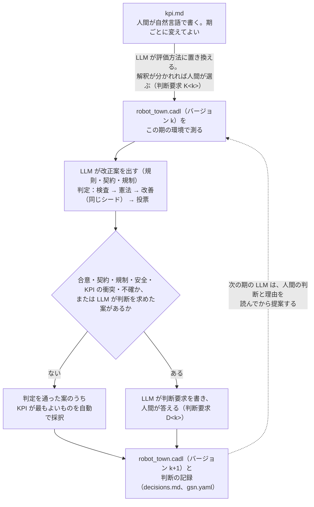
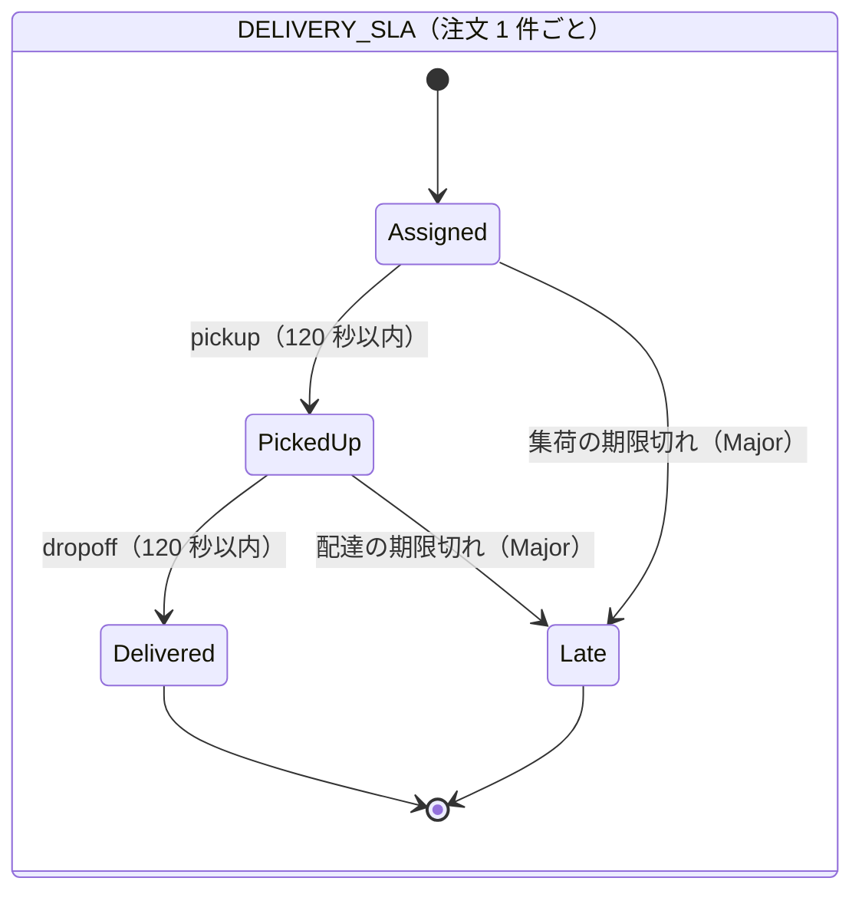
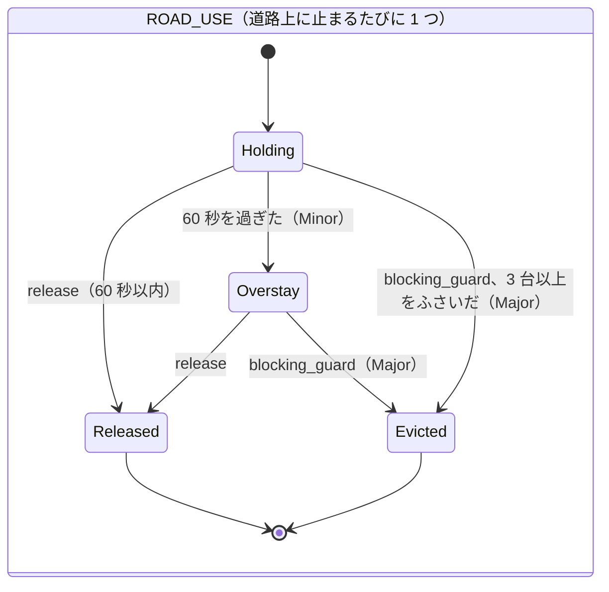
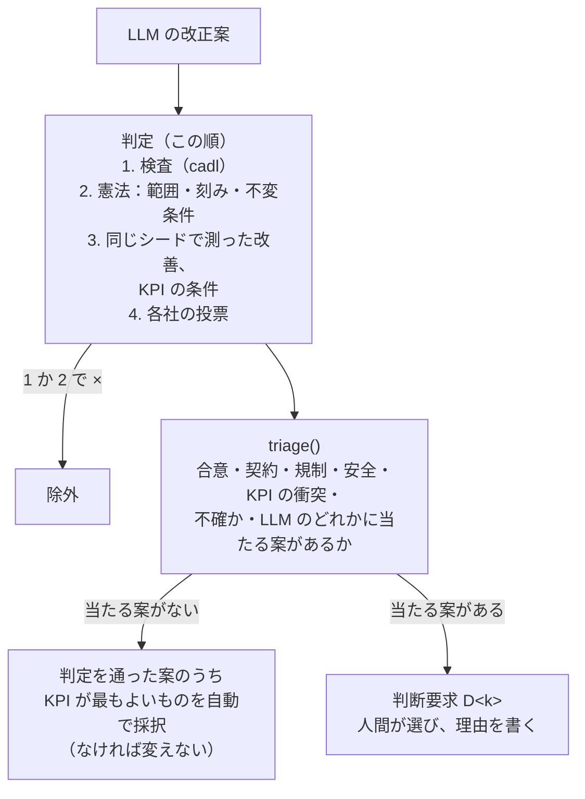
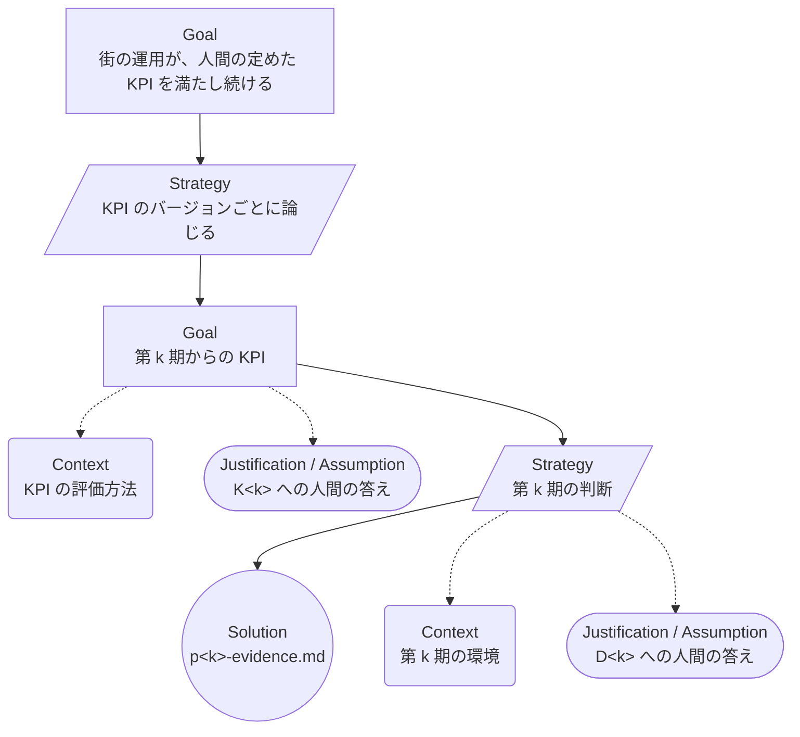
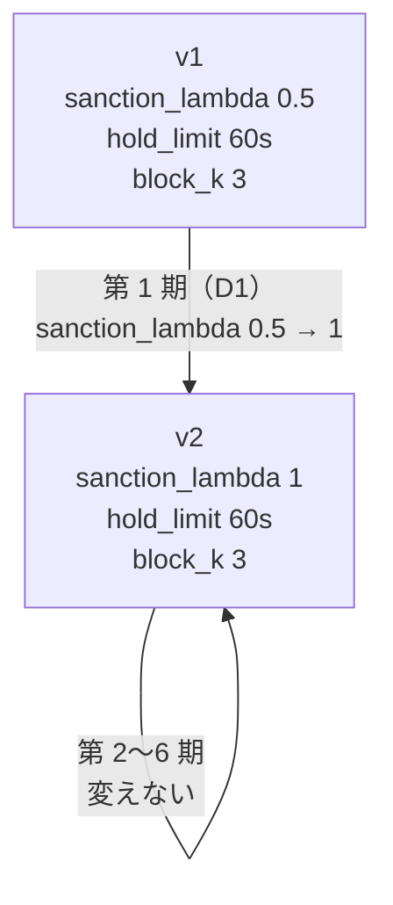
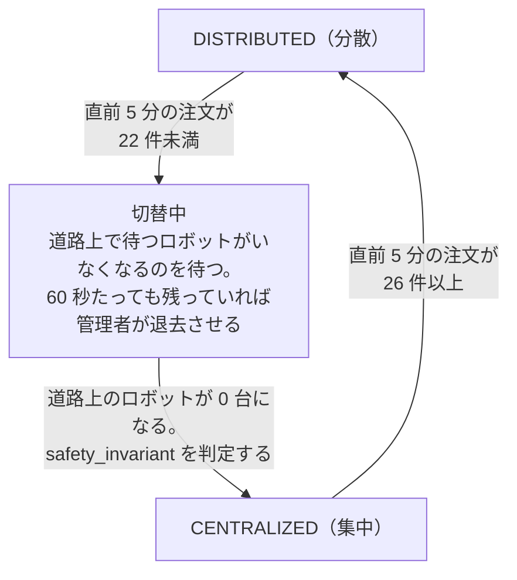

# コース D — ロボットの街：KPI に向けて規則を直す

[コース A — ロボット配送](../textbook/index.md) に戻る

- 対象：[コース A](../textbook/index.md)（CADL/SoS-DSL の基礎）を済ませた方。コース B は不要です
- 所要時間：120〜150 分（改造課題は別）
- 成果物：人間が自然言語で書いた KPI、LLM の改正案と判断要求、人間の判断とその理由（自然言語と GSN）、期ごとに改正された CADL の規則と憲法のバージョン

---

## 0. このコースの概要

コース A と B では、契約を一度書き、シミュレーションの結果をその契約に照らして判定しました。
コース D では、システムが動いている間に契約そのものが変わります。
3 社（A・B・C、各社 2 台）の配送ロボットが、ラズパイマウスのシミュレータと同じ 11 ノードの道路網を共有します。
シミュレーション上の 1 時間（1 期）が終わるたびに、規則の改正を検討します。

改正には、人間、LLM、機械による判定が、次の役割で関わります。

| 担当 | すること |
|---|---|
| 人間（サービスの運営者） | サービスの KPI を自然言語で書く。KPI は時間とともに変えてよい。LLM の判断要求に答え、判断の理由と結果を自然言語または GSN で残す |
| LLM | KPI を測れる指標に置き換え、KPI の達成に向けて規則・規制・契約の改正案を出す。明らかには判断できない問題や、人間の当事者が合意すべきことは自分で決めず、判断に必要な情報を添えて人間に判断を求める |
| 機械による判定 | 検査・憲法・同じ乱数シードで測った改善・各社の投票。LLM の説明は信用せず、測った値だけで判定する |



演習は公開リポジトリ [`cadl-robot-town`](https://github.com/ertlnagoya/cadl-robot-town) にあります。
Unity も SUMO も使いません。街は小さな Python のシミュレーションで、規範の判定には、コース A と同じ参照ランタイム（`cadl-raspimouse-simulator` から複製した `contract_engine.py`）を使います。

:::info[LLM の出力の記録について]
§4〜§8 は、API キーがなくても、`examples/steward-d/` と `examples/steward-goodhart/` に入った LLM の出力の記録を再生して進められます。
これらは、2026-11-16 に Claude Opus 5.5 で実際に実行した記録です。英語で実行した記録（`examples/steward-d-en/`）もあります。同じ KPI でも、第 1 期から経過が分かれます（§10）。
判断要求への答え（`answers.yaml`）は、記録を作るときに人間（運営者）の役を Claude が務めて書いたものです。§4 からは、自分で答えて進めてください。
表の数値は、再生したときに判定のプログラムとシミュレーションが測ったものです。自分の API キーで実際の LLM を使って実行する方法は §10 にあります。
:::

---

## 1. セットアップ（5 分）

必要なのは、コース A でクローンした CADL コンパイラ（`~/program/cadl_repo`）だけです。

```bash
cd ~/program
git clone https://github.com/ertlnagoya/cadl-robot-town
cd cadl-robot-town
python3 -m venv .venv
source .venv/bin/activate
python3 -m pip install --upgrade pip
pip install -e ~/program/cadl_repo     # cadl コマンドと PyYAML が入る
```

インストールに失敗した場合は、[テキストブック 2.4 節](../textbook/02-toolchain-setup.md)のセットアップのトラブルシューティングを参照してください。

Anthropic の SDK と API キーが必要なのは、§10 で LLM を実際に呼ぶときだけです。

```bash
pip install anthropic
```

---

## 2. 規則・契約・規制を読む（15 分）

`cadl/robot_town.cadl` を開きます。街の契約は 2 つです。

- **`DELIVERY_SLA`**：注文 1 件ごとのインスタンスです。120 秒以内に集荷し、そこから 120 秒以内に届けなければ `Late` になります。顧客への約束です。
- **`ROAD_USE`**：ロボットが次の注文を待つために道路上に止まるたびに 1 インスタンスです。

```yaml
    - id: DELIVERY_SLA
      parties: [TOWN_STEWARD, "ROBOT[*]"]
      guarantee:
        - "pickup_time <= 120s"         # @amend:pickup_deadline
        - "dropoff_time <= 120s"        # @amend:dropoff_deadline
      lifecycle:
        ...
          - id: pickup
            from: Assigned
            to:   PickedUp
            on:   "ROBOT[i].status == PickedUp"
            deadline: 120s            # @amend:pickup_deadline
            on_violation: { transition: Late, severity: Major }
        ...
    - id: ROAD_USE
      parties: [TOWN_STEWARD, "ROBOT[*]", COUNCIL]
      authority:
        decision_holder: COUNCIL
      incentives:
        type: sanction
        lambda: 0.5                   # @amend:sanction_lambda
      lifecycle:
        states: [Holding, Overstay, Released, Evicted]
        initial: Holding
        terminal: [Released, Evicted]
        transitions:
          - id: release
            from: [Holding, Overstay]
            to:   Released
            on:   "ROBOT[i] -> TOWN_STEWARD : node_released"
            deadline: 60s             # @amend:hold_limit
            on_violation: { transition: Overstay, severity: Minor }
      monitors:
        - id: blocking_guard
          observe: "ROBOT[i].blocking"
          sampling: periodic(1000ms)
          rule: "ROBOT.blocking >= 3 AND state IN [Holding, Overstay]"  # @amend:block_k
          on_match: { transition: Evicted, severity: Major }
```

（抜粋して簡略化したものです。）

2 つのライフサイクルを状態機械で表すと次のようになります。





`# @amend:<名前>` が付いた行の数値が、改正できるパラメータです。
同じ名前の行が複数あるとき（集荷の約束の guarantee と deadline）は、すべて同じ値にしなければなりません。
各パラメータがどの層に属し、どこまで動かしてよいかは `constitution.yaml`（憲法）が決めます。

```yaml
amendable:
  hold_limit:       {layer: rule,     min: 10, max: 120, step: 10}   # 道路上で待ってよい秒数
  block_k:          {layer: rule,     min: 1,  max: 4,   step: 1}    # 後ろで何台待ったら退去させるか
  sanction_lambda:  {layer: rule,     min: 0.0, max: 1.0, step: 0.5} # 違反 1 件あたりの罰点の倍率（Minor 1、Major 3）
  to_central:       {layer: rule, safety: true, ...}                  # 運用モードの切替（§9）
  pickup_deadline:  {layer: contract, min: 60, max: 180, step: 30}   # 集荷の約束の秒数
  dropoff_deadline: {layer: contract, min: 60, max: 180, step: 30}   # 配達の約束の秒数
invariants:
  min_company_on_time_rate: 0.6
vote:
  quorum: 2
regulation:
  invariants.min_company_on_time_rate: {min: 0.5, max: 0.95, step: 0.05}
  vote.quorum:                         {min: 1,   max: 3,    step: 1}
```

（抜粋して簡略化したものです。）

改正の層は 3 つです。

| 層 | 対象 | 誰が決めるか |
|---|---|---|
| 規則 | `ROAD_USE` と、運用モードの切替の条件 | 判定をすべて通れば自動で採択できる。ただし切替の条件（`safety: true`）は人間が決める |
| 契約 | `DELIVERY_SLA`（顧客への約束） | 顧客は投票に加わらないので、人間が決める |
| 規制 | 憲法の値（不変条件、定足数） | 人間が決める |

3 社の振る舞いは違います（`town/policies.py`）。
**A 社**は仕事がなければ必ず車庫に戻ります。**B 社**は道路上で次の注文を待ちますが、`hold_limit` の 5 秒前には離れます。1 台待たせただけで退去させられる規則（`block_k` が 1）なら、道路上では待ちません。罰点がない規則（`sanction_lambda` が 0）では、違反しても損をしないので、C 社と同じく待ち続けます。**C 社**は、注文が来るか退去させられるまで待ち続けます。ただし `sanction_lambda` が上限の 1.0 になると、期限を 15 秒過ぎたところで離れます。
罰点の倍率は、CADL の検査で 0〜1 に限られ、改正では 0.5 刻みで動きます。倍率が 0.5 のときの各社の振る舞いが、§3 の結果です。
交差点に止まっているロボットは、そこを通りたい他のロボットをすべてふさぎます。

道路網は 11 のノードと 17 本の道路からなります（`town/world.py`）。A・B・C 社の車庫はノード 10・9・4（黄色）です。道路上で待つロボットは、最も便利な中央の交差点 8（紫）で待ちます。


### 演習 2-1

1. 今の規則で、罰点を受けることがありえない会社はどこですか。それはなぜですか。
2. 集荷の約束（`pickup_deadline`）を 150 秒に延ばすと、定時配達の件数はどうなると予想しますか。顧客が実際に待つ時間はどうなりますか。
3. 契約の層の改正を、なぜ各社の投票だけで決めてはいけないのですか。

---

## 3. 1 期だけ動かす（10 分）

ここでは運用モードを分散に固定します（モードは §9 で扱います）。

```bash
python -m town.period --mode DISTRIBUTED
```

```text
需要: 各社の注文の平均間隔 75 秒
運用モード: DISTRIBUTED
規則: robot_town.cadl  (hold_limit=60s, block_k=3, sanction_lambda=0.5)
  定時配達 121.8 / 注文 132.2  未配達 0.0  ふさがれた時間 2404s  （シード平均）
  会社  定時率  遅配  道路で待った回数  ふさがれた秒数  罰点   効用
   A     0.84   7.8               0.0            1352    0.0   38.4
   B     0.94   2.6              38.0             849    0.9   38.9
   C     1.00   0.0              39.6             203   14.8   28.8
  違反（原因別，シード平均）: deadline:dropoff=2.6, deadline:pickup=7.8, deadline:release=23.0, monitor:blocking_guard=2.8
  運用モード: 集中の時間 0%  切替 0.0 回（切替中の合計 0s，管理者による退去 0.0 台，安全条件の違反 0.0 回）
```

効用は「定時配達件数 − 罰点」です。数値は 5 つの乱数シードの平均です。

C 社は道路上で待ち、すべての顧客に定時で届け、そのために罰点 14.8 を払っています。
誰もふさいでいない A 社は 1352 秒ふさがれ、7.8 件を遅配しています。
下から 2 行目の違反は、すべて契約ランタイムが IR から判定したものです。`deadline:*` はライフサイクルの期限、`monitor:blocking_guard` は監視ルールによるものです。

---

## 4. KPI を書く（15 分）

人間の最初の仕事は、KPI を書くことです。`kpi.md` を開きます。

```markdown
## 第 1 期から

顧客に約束した時間（注文から集荷まで 120 秒、集荷から配達まで 120 秒）のうちに届く配達を、
町全体でできるだけ増やしたい。どの会社の顧客も、ひどく待たされることがないようにしたい。

## 第 5 期から

閑散期に入り、注文が減る。定時の配達は引き続き大事だが、各社の協力を保つため、
道路の使い方で特定の会社だけが得をしたり損をしたりしないようにしたい。
```

`## 第 k 期から` の見出しで、KPI をいつから適用するかを書きます。
改正ループは期の初めにこのファイルを読み直すので、期と期のあいだに書き換えてもかまいません。

KPI は自然言語なので、そのままでは改正案を比べられません。
LLM が、`town/kpi.py` にある指標（定時配達件数、遅配件数、未配達、ふさがれた時間、最も低い会社の定時率、会社ごとの効用の差、罰点の合計など）の組み合わせに置き換えます。
これを**評価方法**と呼びます。評価方法は、主目標（改善をこれで測る）、監視する指標（誤差を超えて悪化したら人間に知らせる）、条件（改正後に必ず守る）からなります。

記録を再生して、1 期だけ実行します。`--answers` を付けないので、判断要求には端末で答えます。

```bash
python -m town.steward --mode DISTRIBUTED --rounds 1 --name try-d \
    --llm replay --replay-dir examples/steward-d
```

```text
  KPI（第 1 期から）: 顧客に約束した時間（注文から集荷まで 120 秒、集荷から配達まで 120 秒）のうちに届く配達を、町全体でできるだけ増やしたい。どの会社の顧客も、ひどく待たされることがないようにしたい。
  LLM: 再生: examples/steward-d/p1-kpi.json（claude-opus-5-5、入力 2569 / 出力 3222 トークン）
  読み方: KPI には 2 つの目標が含まれていると読みました。1 つ目は、約束の時間（注文から集荷まで 120 秒、集荷から配達まで 120 秒）のうちに届く配達を町全体で増やすことで、on_time_deliveries でそのまま測れます。2 つ目は「どの会社の顧客も、ひどく待たされることがない」ことです。これは、特定の会社の顧客だけが不利にならないこと（会社ごとの定時率の下限）とも、極端に長く待たされる注文（遅配や期末の未配達）がないこととも読めます。（略）
   [1] 町全体の定時配達を主目標とし、最も低い会社の定時率に下限を設ける: 主目標 on_time_deliveries（増やす）、min_company_on_time_rate（増やす）、unfinished（減らす）、late_deliveries（減らす）。条件 min_company_on_time_rate >= 0.8
   [2] 町全体の定時配達を主目標とし、未配達と遅配の増加を禁じる: 主目標 on_time_deliveries（増やす）、unfinished（減らす）、late_deliveries（減らす）、min_company_on_time_rate（増やす）。条件 unfinished <= 2、late_deliveries <= 5
   [3] 最も低い会社の定時率を主目標とし、町全体の定時配達を下げない: 主目標 min_company_on_time_rate（増やす）、on_time_deliveries（増やす）、on_time_rate_gap（減らす）、unfinished（減らす）。条件 on_time_rate_gap <= 0.15
   懸念: 「ひどく待たされる」の程度を直接測る指標（遅れの秒数や最大待ち時間）がありません。最も低い会社の定時率、遅配件数、未配達件数は、どれもその代理指標です。どれを使うかで、防げる事態が変わります。
   懸念: 町全体の定時配達件数だけを追うと、ある会社の配達を後回しにして合計を増やす改正が採択されうるため、2 つの目標がぶつかる可能性があります。（略）
   懸念: guards の数値（0.8、2 件、5 件、15 ポイント）は、現在の測定値を見ずに置いた暫定値です。（略）
   懸念: 定時配達件数は、約束の時間（DELIVERY_SLA）を延ばすだけでも増えます。KPI は 120 秒の約束を前提にしているので、契約の時間を緩めることで指標を改善する提案は、KPI の意図に反すると考えます。契約の変更は人間が決める事項なので、評価方法の外で扱います。
   （ほかに 1 件）
  → 判断要求 K1（LLM の推奨: 1）
  選ぶ id（1 / 2 / 3）:
```

これは、2026-11-16 に Claude Opus 5.5 が実際に書いた出力の再生です。
LLM は、KPI の解釈が 1 通りに定まり懸念もなければ、人間に確かめずにその評価方法を使います。
ここでは「ひどく待たされる」が 2 通り以上に読めるとして、3 つの評価方法と 5 つの懸念を返しました。
LLM が書いた評価方法は、指標の名前と形を機械が確かめてから使います。知らない指標を書いた選択肢は、選択肢から外されます。

番号を選ぶと、理由と前提（GSN の Assumption）を聞かれます。前提は何行でも書け、空のまま Enter で終わります。
記録に入っている答え（`examples/steward-d/answers.yaml`）は次のとおりです。この記録を作るときは、人間（運営者）の役を Claude が務めました。

```yaml
K1:
  choice: "1"
  reason: KPI の文の順のとおり、町全体の定時配達を主目標にし、最も低い会社の定時率に下限を置く。下限の 0.8 は暫定値とし、第 1 期の測定を見て決め直す。
  assumptions:
    - 顧客は配送の会社を選べない
```

### 演習 4-1

1. 選択肢 2 を選ぶと、§5 の判断要求はどう変わると予想しますか。
2. LLM の 4 つ目の懸念は、§2 の演習 2-1 の 2 と同じことを言っています。KPI の文のどこから、LLM はそう読んだのでしょうか。

---

## 5. 判断要求に答える（20 分）

K1 に答えると、LLM が改正案を出し、各案が判定にかけられます。

```text
| id | 案 | 層 | 検査 | 憲法 | 定時配達 | 遅配 | ふさがれた秒 | 道路の違反 | 最低の定時率 | 主目標 on_time_deliveries の差 | 改善したシード | KPI の条件 | 効用 A / B / C | 投票 A B C | 監視する目標と条件の値 |
|---|---|---|---|---|---|---|---|---|---|---|---|---|---|---|---|
| — | 現行 | — | — | — | 121.8 | 10.4 | 2404 | 25.8 | 0.84 | — | — | — | 38.4 / 38.9 / 28.8 | — | min_company_on_time_rate 0.84、unfinished 0.0、late_deliveries 10.4 |
| 1 | hold_limit 60s → 50s | 規則 | ○ | ○ | 120.6 | 11.6 | 2468 | 28.8 | 0.86 | -1.2 | 2/5 | ○ | 38.8 / 37.6 / 27.2 | ○ × × | min_company_on_time_rate 0.86、unfinished 0.0、late_deliveries 11.6 |
| 2 | block_k 3 → 2 | 規則 | ○ | ○ | 131.0 | 1.2 | 985 | 34.0 | 0.98 | +9.2 | 5/5 | ○ | 45.4 / 37.2 / 19.0 | ○ × × | min_company_on_time_rate 0.98、unfinished 0.0、late_deliveries 1.2 |
| 3 | sanction_lambda 0.5 → 1 | 規則 | ○ | ○ | 132.2 | 0.0 | 845 | 23.6 | 1.00 | +10.4 | 5/5 | ○ | 46.2 / 41.2 / 19.2 | ○ ○ × | min_company_on_time_rate 1.00、unfinished 0.0、late_deliveries 0.0 |
| R1 | invariants.min_company_on_time_rate 0.6 → 0.65 | 規制 | — | ○ | | | | | | | | | | | |
```

（備考の列を省いています。1 の備考は「悪化: late_deliveries」、R1 の備考は「現行の規則は新しい条件を満たす」です。）
LLM の 3 つ目の案 `sanction_lambda 0.5 → 1`（罰点の倍率を 2 倍にする）は、5 つのシードすべてで遅配を 0 件にします。倍率が 1 になると、C 社は期限を 15 秒過ぎたところで交差点を離れるようになり、ふさがれた時間が 2404 秒から 845 秒に減るためです。罰点が増える C 社は反対しましたが、A・B 社の賛成で定足数（2 社）に届いています。
2 つ目の案 `block_k 3 → 2`（後ろで 2 台が待った時点で退去させる）も定時配達を 9.2 件増やしますが、B 社と C 社が反対し、投票で否決されました。
LLM は、憲法の定時率の下限を 0.6 から 0.65 に上げる規制の案（R1）も出しました。
契約を緩める案は出しませんでした。K1 で、約束の時間を緩める改正は KPI の改善とみなさない、と読んでいたためです。

改正ループは、次のどれかに当たる案があると、自動では採択せず、人間に判断を求めます（`town/steward.py` の `triage()`）。

| 理由 | 当たるとき |
|---|---|
| 合意 | KPI はよくなるのに投票で否決され、自動で採択できる案より KPI がよい |
| 契約 | 顧客との約束を変え、KPI がよくなる |
| 規制 | 憲法の値を変える |
| 安全 | 運用モードの切替の条件を変え、KPI がよくなる |
| KPI の衝突 | 主目標はよくなるが、KPI の条件を破るか、監視している指標が悪化する |
| 不確か | 判定はすべて通るが、改善したシードが 5 つのうち 4 つに満たない |
| LLM | LLM 自身が、人間の判断が要ると書いた（憲法の不変条件を守る案に限る） |

各案は、次の順に判定を受けてから、判断を求めるかどうかを決められます。



この期は、R1 が「規制」に当たります。2 は否決されましたが、自動で採択できる 3 のほうが KPI がよいので、「合意」には当たりません。LLM は判断要求 D1 を書き、`runs/try-d/p1-request.md` に残します。

```text
  → 判断要求 D1（LLM: 再生: examples/steward-d/p1-request.json（claude-opus-5-5、入力 2915 / 出力 2248 トークン））
  **問い**：会社ごとの定時率の下限を定める憲法の不変条件 invariants.min_company_on_time_rate を、0.6 から 0.65 に上げるかどうかを決めてください。
  - **R1**：invariants.min_company_on_time_rate 0.6 → 0.65。（略）今期の運行は変わらず、今後、最低の定時率を 0.65 未満にする規則改正は憲法の判定で採択できなくなります。（略）
  - **3**：sanction_lambda 0.5 → 1。（略）投票は A ○、B ○、C × で、自動で採択できる案です。憲法は変わりません。（当事者: 顧客は、遅配が 0.0 になり、定時配達が増えるので利益を得ます。A の効用は 38.4 から 46.2、B は 38.9 から 41.2 に上がります。C の効用は 28.8 から 19.2 に下がり、C は反対票を投じています。顧客全体の利益と、C という一社の利害が対立します。）
  - **keep**：変えない。（略）
  LLM の推奨: R1 — R1 は現行の規則が新しい条件を満たすので今期の運行に影響がなく、将来の規則改正で一社の顧客がひどく待たされることを防ぐという KPI の後半の意図を憲法に反映できます。案 3 は規則の層で判定をすべて通っており、人間の判断がなくても採択の手続きを進められるので、R1 と別に扱えます。（略）
  LLM が知らないこと: R1 について、定時配達・遅配・効用などの数値は測っていません。（略）
  LLM が知らないこと: 各社、特に案 3 で効用が下がる C が、今後どのような行動方針をとるか（運行の変更、投票の態度、撤退など）はわかりません。
  （ほかに 4 件）
```

判断要求は、問い、自分で決めない理由、選択肢ごとの結果と当事者の利害、LLM の推奨、LLM が知らないことからなります。
選択肢は、判断を求める理由に当たった案と、自動で採択できる案（あれば）と「変えない」です。LLM は選択肢を増やせません。数値の表は、LLM の文章ではなく、判定のプログラムが測ったものをそのまま示します。

1 期に採れる案は 1 つです。R1 を選ぶと、この期は 3 を採りません。
LLM は「3 は R1 と別に扱える」と書いていますが、この選択肢の作り方では両方は選べません。LLM はこの仕組みを知らずに推奨を書いています。
記録の答えは、LLM の推奨（R1）ではなく、3 を採るものです。

```yaml
D1:
  choice: "3"
  reason: 罰点の倍率を上げると、5 つのシードすべてで遅配が 10.4 件から 0 件になり、最も低い会社の定時率も 1.00 に上がる。C 社は反対しているが、A・B 社の賛成で定足数に届いている。C 社の効用が 28.8 から 19.2 に下がることは、次の期にもう一度測る。憲法の下限（R1）は今の運用を何も変えないので、今回は見送る。
```

LLM の推奨は、依頼するたびに変わることがあります。以前の記録（2026-10-29）では、この判断要求を同じ数値でもう一度依頼したところ、推奨が 1 回目の「採る」から 2 回目の「変えない」に変わりました。
LLM は判断の材料をそろえ、それぞれの選択肢に理由があることを示し、人間が決めました。

### 判断の記録

判断は `runs/<名前>/` の 2 つのファイルに残ります。

- `decisions.md`：自然言語の記録。KPI の評価方法、LLM の分析、判断を求めた理由、LLM の推奨と知らないこと、人間の選択と理由を、判断ごとに並べます。
- `gsn.yaml`：GSN（Goal Structuring Notation）の木。`gsn.md` に Mermaid の図を書き出します。

| GSN の要素 | この演習で入るもの |
|---|---|
| Goal | 人間が書いた KPI（バージョンごと） |
| Strategy | その期の判断（採択した改正、または変えない） |
| Solution | 同じシードで測った結果（`p<k>-evidence.md`） |
| Context | KPI の評価方法、その期の環境 |
| Assumption | 人間が書いた前提 |
| Justification | 人間が書いた理由（自動で決まったときは、その条件） |

`gsn.md` の木は次の形です。実線の矢印は supported by、点線の矢印は in context of を表します。



理由は自然言語で書いても、GSN の要素で書いてもかまいません。`--answers` の YAML には、`gsn:` に要素（`type:` と `text:`）を並べられます。次は書き方の例です（記録の答えは、D2 の理由を自然言語で書いています）。

```yaml
D2:
  choice: keep
  gsn:
    - type: justification
      text: 改善したのは 5 つのシードのうち 2 つだけで、確かでない改善のために B・C 社の反対を覆し、C 社の効用を 12 も下げない
    - type: context
      text: D1 で、C 社の効用を次の期に測り直すと決めた
```

次の期からは、それまでの判断と人間の理由が LLM に渡されます。§6 で、それが LLM の提案と推奨をどう変えるかを見ます。

### 比べる：人間がいない委員会

同じ第 1 期を、ルールベースの委員会（`town.council`）で実行すると、次のようになります。
委員会は、1 つのパラメータを 1 ステップ動かした規則の案をすべて試し、判定を通ったもののうち目標が最もよいものを採ります。否決された案は採りません。

```bash
python -m town.council --mode DISTRIBUTED
```

```text
  改正案                                  定時配達  違反 (道路) ふさがれた  検査 憲法 改善 投票(A B C)
  hold_limit 60s → 50s                     120.6  40.4 (28.8)     2468s    ○    ○    ×   ○ × ×
  hold_limit 60s → 70s                     124.2  31.6 (23.6)     2367s    ○    ○    ○   ○ ○ ○
  block_k 3 → 2                            131.0  35.2 (34.0)      985s    ○    ○    ○   ○ × ×
  block_k 3 → 4                            119.4  36.4 (23.6)     2788s    ○    ○    ×   ○ × ○
  sanction_lambda 0.5 → 0                  119.0  59.0 (45.8)     3059s    ○    ○    ×   ○ ○ ○
  sanction_lambda 0.5 → 1                  132.2  23.6 (23.6)      845s    ○    ○    ○   ○ ○ ×
  ...
  → 採択: sanction_lambda 0.5 → 1（目標 +10.4，賛成 AB）。v2.cadl として保存。
```

委員会も D1 と同じ `sanction_lambda 0.5 → 1` を採ります。罰点をなくす案（`0.5 → 0`）には 3 社とも賛成しますが、B 社も期限を気にせず居座るようになり、定時配達が減るので、改善の判定で除かれます。
結果は同じでも、委員会には R1 のような規制の案を出す役も、C 社の効用が下がることを次の期に測り直すという理由を残す役もありません。D1 との違いは、誰が何を理由に決めたかが残るかどうかです。

### 演習 5-1

1. D1 に `keep`（または `R1`）と答えて、第 1 期を実行し直してください。`decisions.md` と `gsn.md` はどう変わりますか。
2. B 社は自分も 849 秒ふさがれているのに、`block_k 3 → 2` に反対しました。§3 の表から理由を説明してください。

---

## 6. 6 期を実行する（20 分）

記録の答えを使って、6 期を通して実行します。

```bash
python -m town.steward --mode DISTRIBUTED --rounds 6 --name steward-d \
    --llm replay --replay-dir examples/steward-d --answers examples/steward-d/answers.yaml
```

`scenario.yaml` が期ごとの需要（平常・繁忙期・閑散期、期の途中のラッシュ）を決めます。
現行の規則も、その期の環境で測り直してから改正案と比べます。

| 期 | 判断を求めた理由 | LLM の推奨 | 人間の選択 | 結果 |
|---|---|---|---|---|
| 1（平常） | 規制（憲法の定時率の下限 0.6 → 0.65） | R1 | `sanction_lambda 0.5 → 1`（自動で採択できる案） | v2 |
| 2（平常＋ラッシュ） | 合意（`block_k 3 → 2` を B・C 社が否決。改善したシードは 2/5） | keep | 変えない | v2 |
| 3（繁忙期） | 合意（`block_k 3 → 2` と `hold_limit 60s → 50s` を B・C 社が否決。どちらも改善したシードは 1/5）、LLM | keep | 変えない | v2 |
| 4（繁忙期＋ラッシュ） | 不確か（`hold_limit 60s → 50s` の改善したシードは 2/5） | keep | 変えない | v2 |
| 5（閑散期） | §7 で見る | keep | 変えない | v2 |
| 6（閑散期） | LLM（`hold_limit 60s → 70s` は効用の差を 0.4 縮めるが、改善したシードは 2/5） | keep | 変えない | v2 |



各期について補足します。

- **第 2〜4 期**：第 1 期に罰点を重くしてから、遅配は 4.4 件、2.2 件、3.0 件と少なくなり、改善できる余地も小さくなりました。LLM が出した案は、どれも改善したシードが 5 つのうち 1〜2 つでした。
  LLM は、第 3 期に D2 の人間の理由（確かでない改善のために C 社の効用を下げない）を、第 4 期に D2・D3 の理由を引いて、変えないことを勧めました。記録の答えも変えないものです。
- **第 4 期**：`hold_limit 60s → 50s` は A・B 社の賛成で定足数に届いていて、判断を求めた理由は「不確か」だけです。LLM も記録の答えも、投票を覆すとは書いていません。
- **第 6 期**：LLM は「憲法の判定の目標は on_time_deliveries（最小改善 1.0）なので、この案は改善と認められない見込み」と書いて判断を求めました。これは誤りです。`town.steward` は、KPI の主目標（この期は utility_gap）で改善を判定し、憲法の `objective` と `min_improvement` は使いません（使うのは `town.council` です）。改正案を出す依頼には憲法の全体を渡しているので、LLM はそこに書かれた目標で判定されると読みました。
- 6 期すべてで人間に判断を求めましたが、規則が変わったのは第 1 期だけです。第 2 期以降の答えは、どれも「確かでない改善のために、効用の最も低い C 社の効用を下げない」という同じ理由によります。

`runs/steward-d/gsn.md` を開いて、6 期分の判断の木を見てください（GitHub や VS Code のプレビューで Mermaid の図として表示されます）。

### CADL Explorer で規則のバージョンを見る

規則のバージョン `runs/steward-d/v1.cadl` と `v2.cadl` は、[CADL Explorer](https://cadl-explorer.streamlit.app/)（v0.5.9 以降）の **Designer** のページで見比べられます。

1. **Open an existing CADL file** から `v1.cadl` を開き、ビューを **Versions** に切り替え、名前に `v1` と入れて **Save as a version** を押します。`v2.cadl` も同じように保存します。
2. **Amendable parameters** の **Constitution** に、このリポジトリの `constitution.yaml` をアップロードします（**Use the Robot Town constitution** を押しても同じファイルが読み込まれます）。表には、`# @amend:` の名前ごとに、値、層、範囲、刻み、誰が決めるか（*decided by*）が出ます。規則の層は検査（the checks）、契約の層と、安全に関わる運用モードの規則は人（a person）です。§2 と同じ分け方です。
3. **History of the amendable values across the versions** を開きます。v2 で `sanction_lambda` が 0.5 から 1 に変わっています。上の表の第 1 期の改正です。
4. **Compare two designs** で **A** に v1、**B** に v2 を選びます。構造の差分とソースの差分の上に、改正したパラメータ（`sanction_lambda` 0.5 → 1）が示されます。

Explorer は、このコースの憲法の判定と同じ規則で、値を確かめます。変えてよいのは `# @amend:` の行の数値だけで、1 回に 1 つを 1 刻み、範囲の中です。ほかの判定は行いません（`cadl` の検査のほかは、改善を測ることも、投票することもしません）。Explorer で値を改正する（**Amend** の欄）と、コメントはそのまま残りますが、判断の記録は、ダウンロードしない限りブラウザのセッションの間しか残りません。このコースの記録は `decisions.md` と `gsn.yaml` です。

### 演習 6-1

`examples/steward-d/answers.yaml` を複製し、D2 を `"1"` に変えて、`--answers` に渡して実行してください。
記録の LLM の出力は、記録の答えを前提にしています。答えを変えると、それ以降の期の再生には「注意：記録したときと依頼の内容が違う」と出ます。
第 3 期の案の数値と投票は、記録とどう変わりますか。§10 の実際の LLM で実行すると、LLM の推奨はどうなると予想しますか。

---

## 7. KPI が変わる（15 分）

第 5 期から、`kpi.md` の別の節が適用されます。
KPI が変わると、LLM は評価方法を作り直し、これまでの判断のうち、前提が成り立たなくなったものを挙げます。

```text
  KPI（第 5 期から）: 閑散期に入り、注文が減る。定時の配達は引き続き大事だが、各社の協力を保つため、道路の使い方で特定の会社だけが得をしたり損をしたりしないようにしたい。
   [1] 効用の差を主目標にする（利害の公平さを優先）: 主目標 utility_gap（減らす）、on_time_deliveries（増やす）、min_company_on_time_rate（増やす）、sanction_total（減らす）。条件 min_company_on_time_rate >= 0.8
   [2] 定時率の差を主目標にする（サービスの公平さを優先）: 主目標 on_time_rate_gap（減らす）、on_time_deliveries（増やす）、utility_gap（減らす）。条件 min_company_on_time_rate >= 0.8
   [3] 定時配達を主目標にし、公平さを条件にする: 主目標 on_time_deliveries（増やす）、utility_gap（減らす）、on_time_rate_gap（減らす）。条件 min_company_on_time_rate >= 0.8、on_time_rate_gap <= 0.1
   懸念: 「特定の会社だけが得をしたり損をしたり」は、効用の差（utility_gap）とも定時率の差（on_time_rate_gap）とも読めます。効用の差には罰点が含まれ、罰点の倍率のような道路の規則の変更の影響を直接受けます。定時率の差には罰点が含まれません。
   懸念: 差を小さくする目標は、効用や定時率の高い会社を下げることでも達成できます。公平さを主目標にすると、町全体の定時配達とぶつかる場合があります。
   （ほかに 3 件）
   見直し対象: K1 — KPI が変わり、主目標が町全体の定時配達件数のままでよいかという前提が崩れました。（略）
   見直し対象: D1 — 罰点の倍率を 0.5 から 1 に上げた変更は、A・B 社の賛成と C 社の反対で採択されました。その結果、C 社の効用は 28.8 から 19.2 に下がっています。新しい KPI は、道路の規則で特定の会社が損をしないことを求めています。この変更がまさに C 社だけに損をさせていないかを、効用の差で測り直す必要があります。（略）
  → 判断要求 K5（LLM の推奨: 1）
```

記録の答えは選択肢 1（効用の差を主目標にする）です。この期の改正案は次のとおりです。

| id | 案 | 定時配達 | 遅配 | 主目標 utility_gap の差 | 改善したシード | 効用 A / B / C | 投票 A B C | 監視する指標の値（抜粋） |
|---|---|---|---|---|---|---|---|---|
| — | 現行 | 82.6 | 0.0 | — | — | 26.0 / 28.0 / 10.0 | — | 最低の定時率 1.00、sanction_total 18.6 |
| 1 | `sanction_lambda 1 → 0.5` | 74.8 | 7.8 | +10.3 | 5/5 | 23.0 / 23.6 / 15.9 | × × ○ | 最低の定時率 0.83、sanction_total 12.3 |
| 2 | `hold_limit 60s → 70s` | 82.6 | 0.0 | +0.4 | 3/5 | 26.0 / 28.0 / 10.4 | ○ ○ ○ | 最低の定時率 1.00、sanction_total 18.2 |

1 は、D1 で重くした罰点を元に戻す案です。効用の差は 5 つのシードすべてで大きく縮みます。
しかし、罰点を軽くすると C 社がまた交差点に居座るようになるので、遅配が 0 件から 7.8 件に増え、最も低い会社の定時率も 0.83 に下がります。A・B 社が反対し（合意）、監視している定時配達と最低の定時率が悪化します（KPI の衝突）。
効用の差が縮むのは、C 社の効用が上がるからだけではありません。A 社と B 社の効用も下がります。K5 の 2 つ目の懸念（差は、高い会社を下げることでも縮む）がそのまま当てはまる案です。
2 は 3 社とも賛成しますが、改善は +0.4 と小さく、5 つのシードのうち 3 つでしか改善しません。

LLM は、憲法の定足数を 2 から 3 に上げる規制の案（R1）も出しました。1 社でも反対すれば規則を変えられなくなる案です。D1 の改正も、この定足数なら採られませんでした。

```text
  LLM の推奨: keep — 案 1 は utility_gap を 5/5 のシードで改善しますが、定時配達を 82.6 から 74.8 に下げ、遅配を 0.0 から 7.8 に増やします。KPI は定時の配達を引き続き大事だとしており、K5 の理由も、差だけを縮めて定時配達が悪化する改正はそのつど判断するとしています。また、A・B 社の反対を覆すことは、KPI の意図である各社の協力の維持に反します。R1 はこの期の結果を変えず、今後の改正を通りにくくするので、閑散期を一度測った後に改めて検討するほうがよいと考えます。（略）
```

記録の答えも「変えない」です。

```yaml
D5:
  choice: keep
  reason: 罰点の倍率を 0.5 に戻すと、効用の差は縮むが、C 社がまた交差点に居座るようになり、遅配が 0 件から 7.8 件に増え、最も低い会社の定時率も 0.83 に下がる。差を縮めるためにサービスを悪くすることはしない。定足数を 3 にする案（R1）は、今期の結果を変えず、今後の改正を通りにくくするだけなので見送る。C 社の効用が最も低いことは、閑散期にもう一度測って考える。
```

C 社の効用は、第 5 期に 10.0、第 6 期に 8.4 と、3 社のうちで最も低いままです。新しい KPI のもとでも、記録の人間は、C 社の効用を上げるためにサービスを悪くする案を採りませんでした。C 社の効用を上げる別の手段（たとえば、交差点で待つ順番を決める規則）は、今の規則のパラメータにはありません。

### 演習 7-1

1. K5 で選択肢 3 を選んで、第 5 期を実行してください（`answers.yaml` を複製して K5 を書き換えます）。判断要求の選択肢はどう変わりますか。記録の判断要求は選択肢 1 の評価方法を前提にしているので、どうなりますか。
2. 1（罰点を軽くする案）が判断要求の対象にならずに自動で採択されるのは、どんな評価方法で、投票がどうなったときですか。それは望ましいですか。再生では KPI の言い換えが記録のままなので、`kpi.md` を書き直して確かめるには §10 の実際の LLM を使います。

---

## 8. 代理指標の KPI（15 分）

KPI が、測りやすい代わりの指標（代理指標）を目標にしているとどのような問題が生じるかを調べます。
`examples/steward-goodhart/kpi.md` には、次の KPI が書いてあります。

```markdown
## 第 1 期から

道路の規則をきちんと守らせたい。道路の規則の違反を、できるだけ減らしたい。
```

LLM は 3 つの評価方法を出し、「road_violations は測りやすい代わりの指標です。release の期限を延ばす、blocking_guard の条件を緩めるといった規則の緩和でも件数は下がりますが、それは「きちんと守らせる」という意図とは異なります」と懸念を書きました。
記録では K1 に 2 通りに答えています。件数を主目標にし、配達の成績とふさがれた時間を監視する場合（`proxy/`、選択肢 1）と、ふさがれた時間と会社ごとの効用の差も監視する場合（`guarded/`、選択肢 2）です。2 回の依頼で、LLM が出した評価方法の選択肢は少しずつ違います。

```bash
python -m town.steward --kpi examples/steward-goodhart/kpi.md --mode DISTRIBUTED --name goodhart-proxy \
    --llm replay --replay-dir examples/steward-goodhart/proxy --answers examples/steward-goodhart/proxy/answers.yaml
python -m town.steward --kpi examples/steward-goodhart/kpi.md --mode DISTRIBUTED --name goodhart-guarded \
    --llm replay --replay-dir examples/steward-goodhart/guarded --answers examples/steward-goodhart/guarded/answers.yaml
```

どちらの記録でも、LLM は同じ 3 つの案を出しました。

| id | 案 | 定時配達 | 遅配 | ふさがれた秒 | 道路の違反 | 主目標の差 | 改善したシード | 投票 A B C |
|---|---|---|---|---|---|---|---|---|
| — | 現行 | 121.8 | 10.4 | 2404 | 25.8 | — | — | — |
| 1 | `sanction_lambda 0.5 → 1` | 132.2 | 0.0 | 845 | 23.6 | +2.2 | 4/5 | ○ ○ × |
| 2 | `block_k 3 → 2` | 131.0 | 1.2 | 985 | 34.0 | -8.2 | 0/5 | ○ × × |
| 3 | `hold_limit 60s → 70s` | 124.2 | 8.0 | 2367 | 23.6 | +2.2 | 5/5 | ○ ○ ○ |

1（罰点を重くする）と 3（道路で止まってよい秒数を 60 秒から 70 秒に延ばす）は、違反の件数を同じ 23.6 件に減らします。
1 は C 社の居座りを短くして減らし、ふさがれた時間も遅配も減らします。3 は違反とみなす基準をゆるめて減らし、ふさがれた時間はほとんど変わりません。
主目標の数字だけでは、この 2 つを区別できません。
守らせる方向の案でも、2（`block_k 3 → 2`）は退去を増やすので、数えられる違反はかえって増えます（-8.2）。

LLM は、どちらの記録でも 3 を人間に回し、1 を勧めました。

```text
  LLM の推奨: 1 — 案 1 は案 3 と同じだけ違反を減らします（23.6）。しかも規則の基準を緩めず罰を強めて行動を変えるので、KPI の「規則をきちんと守らせたい」という意図に合います。（略）
```

`guarded` では、1 も「KPI の衝突」に当たりました。C 社だけ罰点が増えるので、監視している会社ごとの効用の差が 10.1 から 27.0 に広がるためです。
記録の答えは、どちらも 1 を採りました。
英語で同じ KPI を書くと（`examples/steward-goodhart/en/`、§10）、LLM は 1 だけを出し、判定をすべて通ったので自動で採択されました。

以前の記録（2026-11-15）では、罰点の倍率を変えてもロボットの行動が変わらなかったので、1 は違反を 1 件も減らしませんでした。そのとき LLM が出せた、件数を減らす案は 3 だけでした。件数を減らす手段が、規則を守らせる案にもあるかどうかで、代理指標の危うさの現れ方が変わります。

人間がいない場合に規則がどこまで変わるかは、ルールベースの委員会で確かめられます。委員会は KPI の文を使わず、目標の数字だけで判定します。

```bash
python -m town.council --mode DISTRIBUTED --rounds 8 --objective road_violations --name goodhart-d
python -m town.council --mode DISTRIBUTED --rounds 6 --name seasons-d
python -m town.compare runs/goodhart-d/v1.cadl runs/goodhart-d/v5.cadl runs/seasons-d/v4.cadl --mode DISTRIBUTED
```

| 規則 | 定時配達 | 遅配 | 道路の規則の違反 | ふさがれた時間 | A 社の定時率 |
|---|---|---|---|---|---|
| 初期 v1 | 112.2 | 10.8 | 25.0 | 2457 秒 | 0.82 |
| 道路の違反を目標にした v5 | 106.0 | 17.0 | **21.0** | **3681 秒** | 0.72 |
| 定時配達を目標にした v4 | 122.8 | 0.2 | **19.8** | 956 秒 | 1.00 |

（改正ループが評価に使っていないシード 1001〜1005 で比べています。）
道路の違反を目標にした委員会は、8 期のうちに規則を 4 回、すべて緩める方向に改正しました。数えている違反は減り、ふさがれた時間と遅配はどちらも約 1.5 倍に増えました。憲法の不変条件（定時率 6 割以上）では、この改正を止められません。
罰点を重くする案も毎期出ていて、違反の件数を減らしていました。それでも採られなかったのは、緩める案のほうが件数の減り方が同じか大きかったためです（第 1 期はどちらも 23.6 件で、先に並ぶ緩める案が採られました）。罰点を重くする案には、C 社がいつも反対します。
定時配達を目標にした委員会は、第 1 期に罰点を重くしたので、違反の件数も v5 より少なくなりました。

委員会は、主目標の数字が同じなら、緩める案と守らせる案を区別しません。`town.steward` では、LLM が緩める案を人間に回し、人間が守らせる案を選びました。
ただし、LLM が今回のように KPI の意図を読むとは限りません。評価方法を選ぶのも、ゆるめる案が出たときに決めるのも人間です。

---

## 9. 分散と集中の運用モード（15 分）

| モード | 待機の場所 | 道路の使い方 |
|---|---|---|
| DISTRIBUTED（分散） | 各社が道路上（中央の交差点 8）で待つ | 交差点を自由に通る |
| CENTRALIZED（集中） | 管理者が道路の外の待避所（ノード 5・2・7 の脇、各 1 台）を割り当てる。道路上での待機は禁止 | 管理者がエッジを 1 台ずつ専有で割り当てる（C-SoS の調停器と同じ）。エッジに入るたびに 1 秒の許可待ち |

集中では交差点をふさがれなくなりますが、注文が非常に多いと、エッジの許可待ちが積み重なります。
モードを固定したときの定時配達（シード 1〜5 の平均）は次のとおりです。

| 注文の平均間隔 | 30 秒 | 45 秒 | 75 秒 | 120 秒 | 180 秒 |
|---|---|---|---|---|---|
| 分散 | **319.6** | 210.2 | 121.8 | 76.8 | 51.2 |
| 集中 | 309.2 | **217.4** | **132.2** | **83.2** | **58.6** |

切り替える条件は CADL ファイルの中に書かれています。5 分ごとに、直前 5 分の観測で判定します。

```yaml
  transitions:
    - from: DISTRIBUTED
      to: CENTRALIZED
      condition: "orders_in_window < 22"      # @amend:to_central
      protocol: SWITCH
      safety_invariant: "robots_on_road == 0"
    - from: CENTRALIZED
      to: DISTRIBUTED
      condition: "orders_in_window >= 26"     # @amend:to_distributed
      protocol: SWITCH
```



集中への切替は、道路上で待っているロボットが 1 台もいなくなってから有効になります（C 社は 30 秒渋り、60 秒たっても残っていれば管理者が退去させます）。有効になった時点で `safety_invariant` を判定します。
ラッシュのある期を、3 通りの運用で比べます。

```bash
python -m town.compare cadl/robot_town.cadl --rush 1200 2400 25 --mode DISTRIBUTED
python -m town.compare cadl/robot_town.cadl --rush 1200 2400 25 --mode CENTRALIZED
python -m town.compare cadl/robot_town.cadl --rush 1200 2400 25 --mode adaptive
```

| 運用 | 定時配達 | 遅配 | ふさがれた時間 | 集中の時間 |
|---|---|---|---|---|
| 分散に固定 | 202.8 | 8.0 | 2141 秒 | 0% |
| 集中に固定 | 206.2 | 4.6 | 843 秒 | 100% |
| CADL の条件で切替 | **209.2** | **1.6** | 1116 秒 | 60% |

切替は 1 期に 3 回起きます。開始 5 分で集中へ、ラッシュで分散へ、ラッシュが終わると集中へ戻ります。
次に、道路が空くのを待たずに切替を有効にしてみます。

```bash
python -m town.period --rush 1200 2400 25 --no-quiescence
```

最後の行に、安全条件の違反が 1 期あたり約 1.4 回（`安全条件の違反 1.4 回`）と出ます。

切替の 2 つのしきい値は、憲法で `safety: true` になっています。
`town.steward` を `--mode adaptive`（既定）で実行すると、しきい値を変える案は、KPI をよくするものであれば必ず「安全」として人間に判断を求めます。

---

## 10. 実際の LLM で実行する（任意、15 分）

§4〜§8 の記録は、2026-11-16 に Claude Opus 5.5 で実際に実行したものです。
自分の API キーで実行すると、LLM はそのつど新しく答えるので、記録とは違う案や推奨が返ってきます。

```bash
export ANTHROPIC_API_KEY=...        # 自分のキーを入力する。チャットやファイルには貼らない
python -m town.steward --mode DISTRIBUTED --rounds 6 --name live-d
python -m town.steward --lang en --mode DISTRIBUTED --rounds 6 --name live-d-en   # 英語。KPI は kpi.en.md
```

1 期に、KPI が変わったときの評価方法の作り直し、改正案、判断要求の 3 種類の依頼を出します（判断要求は、判断を求める案があるときだけ）。
LLM の出力は `runs/<名前>/llm/` に残ります。
端末がなく答えもないときは、判断要求を `p<k>-request.md` に書き出して止まります。答えを YAML に書き、同じ `--name` のまま `--answers <YAML>` を付けて同じコマンドを実行すると、記録のある LLM の出力は呼び直さずに続きます。

記録の 6 期分で使ったトークンは、日本語で入力約 70,700・出力約 63,700、英語で入力約 60,300・出力約 48,700 でした。以前の記録（2026-10-29〜30）を作ったときは、1 回の依頼に 20 秒〜2 分ほどかかり、1 度だけ、11 分たっても応答のない依頼があってやり直しました。

### 英語で実行した記録

`examples/steward-d-en/` には、同じ KPI を英語で書いて（`kpi.en.md`）実行した記録が入っています。

```bash
python -m town.steward --lang en --mode DISTRIBUTED --rounds 6 --name steward-d-en \
    --llm replay --replay-dir examples/steward-d-en --answers examples/steward-d-en/answers.yaml
```

| 期 | 判断を求めた理由 | LLM の推奨 | 人間の選択 | 結果 |
|---|---|---|---|---|
| 1 | 合意（`block_k 3 → 2` を B・C 社が否決）、規制（定時率の下限 0.6 → 0.65） | 2（`block_k 3 → 2`） | 否決を覆して `block_k 3 → 2` | v2 |
| 2 | 不確か（`block_k 2 → 1`、2/5）、LLM、規制 | keep | keep | v2 |
| 3・4 | なし（第 3 期の `hold_limit 60s → 70s` は +0.4 で誤差の目安に満たず、第 4 期は案なし） | — | — | v2（自動） |
| 5 | 合意と KPI の衝突（`block_k 2 → 3`）、KPI の衝突（罰点をなくす案） | 3（`hold_limit 60s → 70s`） | `hold_limit 60s → 70s` | v3 |
| 6 | KPI の衝突（`hold_limit 70s → 80s` で最低の定時率が 0.97 から 0.94 に） | 1（`hold_limit 70s → 80s`） | keep | v3 |

第 1 期から、日本語の記録と経過が分かれます。

- 第 1 期に、英語の LLM は罰点の倍率を上げる案を出しませんでした。出した案のうち KPI をよくするのは、B・C 社が否決した `block_k 3 → 2` だけで、LLM はこれを勧めました。記録の答えは、否決を覆してこれを採りました。罰点の倍率は、6 期を通して 0.5 のままです。
- 第 2 期に、LLM は「`block_k 2 → 1` は B・C 社が反対して否決される見込みが高く、採れば 2 度目の覆しになる」と書きました。表では A・B 社が賛成し、定足数（2 社）に届いています。LLM 自身も、この食い違いを知らないことに挙げています。判断要求を書く依頼には憲法を渡していないので、LLM は定足数を知りませんでした（§11）。
- 第 5 期の罰点をなくす案では、B 社も期限を気にせず居座るようになり、遅配が 1.8 件から 6.6 件に増え、最も低い会社の定時率が 0.89 に下がって KPI の条件（0.9 以上）を破りました。LLM は「罰点をなくすと、道路の使い方を変えるのではなく、C 社の居座りの費用を消すことで差を縮める」と書き、`hold_limit 60s → 70s` を勧めました。
- 第 6 期に、LLM は D5 の続きとして `hold_limit 70s → 80s` を勧めました。記録の答えは、最低の定時率が下がることを理由に変えませんでした。
- 代理指標の KPI（§8）では、英語の LLM は罰点を重くする案だけを出し、それが自動で採択されました。規則をゆるめる案は出しませんでした。

### 実際に実行して分かったこと

- LLM の推奨は、依頼するたびに変わることがあります。同じ KPI でも、日本語と英語の記録では、第 1 期に LLM が出した案から違いました。日本語の LLM は罰点の倍率を上げる案を出し、英語の LLM は出しませんでした。以前の日本語の記録では、D1 の推奨が、同じ数値で依頼し直すと 1 から keep に変わりました。判断要求で役に立つのは、推奨よりも、問い、当事者の利害、LLM が知らないことがそろっていることです。
- LLM が「知らないこと」に挙げた項目から、ツールに足りないものが分かります。最初のバージョンの表には、監視している指標の値がありませんでした。LLM が「on_time_rate_gap が具体的にどれだけ悪化したか（表には最低の定時率しか載っていません）」と書いたので、表に「監視する目標と条件の値」の列を足しました。定足数を知らないこと（英語の第 2 期）と、`town.steward` が使わない憲法の目標を判定に使うと思い込むこと（日本語の第 6 期）は、まだ直していません（§11）。
- 過去の判断の理由は、次の推奨に使われます。日本語の記録では、第 3 期と第 4 期に、D2・D3 の人間の理由を引いて、LLM は変えないことを勧めました。
- シミュレーションの作りは、LLM の案と人間の判断の両方に表れます。以前の記録（2026-11-15）では、各社の行動が罰点の倍率に左右されなかったので、罰点をなくす案は定時配達を変えずに効用の差だけを縮め、LLM はそれを勧めたこともありました。今の記録では、罰点を軽くすると居座りが増えて遅配が増えるので、LLM はどちらの言語でも罰点を軽くする案を勧めていません。

### 実際の LLM の記録：委員会として案を出させた場合

`examples/llm-distributed/` には、2026-11-16 に Claude Opus 5.5 が書いた 2 期分の案が入っています。
これは、`town.council` の LLM の委員会（`--proposer llm`）として、規則の案だけを出させたものです。KPI も判断要求もなく、判定で機械的に採否が決まります。

```bash
python -m town.council --proposer replay --replay-dir examples/llm-distributed --mode DISTRIBUTED --rounds 2
```

| 期 | LLM の案 | 検査 | 憲法 | 改善 | 投票（A B C） |
|---|---|---|---|---|---|
| 1（平常） | `block_k` 3 → 2 | ○ | ○ | ○ | ○ × × |
| | `hold_limit` 60s → 50s | ○ | ○ | × | ○ × × |
| 2（平常＋ラッシュ） | `hold_limit` 60s → 50s | ○ | ○ | × | ○ ○ × |
| | `block_k` 3 → 2 | ○ | ○ | ○ | ○ × × |

- 4 案とも正しい形の改正でしたが、どの期も採択はありませんでした。
- ルールベースの委員会が第 1 期に採る `sanction_lambda 0.5 → 1` を、LLM は出しませんでした。この依頼には各社の行動方針（`town/policies.py`）を渡していないので、LLM は罰点の倍率で C 社の行動が変わることを知りません。
- 第 1 期に、LLM は「B 社もふさがれた秒数 849 が減るので賛成する見込み」と書きましたが、B 社は反対しました。LLM は B 社の投票を、B 社自身の利害からではなく、町全体の利益から予想していました。
- 1 回の呼び出しで、入力は約 5,300 トークン、出力は約 7,000 トークンでした。

記録には依頼の要約（`request_digest`）が入っています。再生のとき、いまの規則・憲法・改正履歴・プロンプトから組み立てた依頼が記録と違えば、「注意：記録したときと依頼の内容が違う」と表示します。

---

## 11. 改造課題（任意）

| 課題 | ヒント |
|---|---|
| LLM に定足数を教える | `town/llm_steward.py` の `request_request()` に、憲法の `vote` と、各案が投票の判定を通ったかを渡す。英語の記録の第 2 期の「B・C 社が反対して否決される見込み」という誤りは消えるか |
| 使わない憲法の値を LLM に渡さない | `town/llm_steward.py` の `propose_request()` に渡す憲法から、`town.steward` が使わない `objective` と `min_improvement` を外す。日本語の記録の第 6 期の「憲法の判定の目標は on_time_deliveries」という誤りは消えるか |
| 各社の行動方針を LLM に伝える | `town/llm_council.py` の依頼に、`town/policies.py` の各社の振る舞いを文章で足す。LLM の委員会は `sanction_lambda 0.5 → 1` を出すようになるか |
| 人間の前提が成り立たない場合を調べる | `town/policies.py` の C 社を、受けた罰点や効用に応じて街から撤退する（注文を受けない）ように変え、英語の記録の D1 の前提（B・C 社は配送を続ける）が成り立たなくなったときにどうなるかを調べる |
| 判断を求める条件を足す | `town/steward.py` の `triage()` に、「どれかの会社の効用が 10 以上下がる案は人間に判断を求める」といった条件を足す |
| 指標を足して KPI を書く | `town/kpi.py` の `METRICS` に、たとえば会社ごとのふさがれた時間の最大を足し、それを使う KPI を `kpi.md` に書く。第 5 期の LLM の懸念（「効用の差には、道路の規則と関係のない、会社ごとの注文の数や配置の違いも含まれます」）に応えられるか |
| 改正に期限を付ける | 採った改正は、環境が戻っても廃止されない。N 期のうちに再び採られなければ失効する、という規則を足す |
| 代理指標による改正の行き過ぎを規制で止める | ふさがれた時間や遅配についての不変条件を、`constitution.yaml` の `invariants` と `regulation`、`town/council.py` の `invariants_ok()` に足す |
| GSN を別のツールで開く | `runs/<名前>/gsn.yaml` を、使っている GSN エディタの形式に書き出すスクリプトを書く |

---

## 12. 研究課題：改正の速さと移行の混乱（任意、数時間〜）

KPI を早く達成するには、規則を一度に大きく変えるのが効率がよいように見えます。
しかし、規則に従う側が人間の場合、急に大きく変えると戸惑い、慣れるまでは古い規則のまま動いてしまいます。ロボットは新しい規則をその場で読むので戸惑いませんが、それでも移行の問題は起きます。
この課題では、KPI を達成するまでの速さと、規則の改正の大きさ・頻度とのトレードオフが、従う側が人間かロボットかでどう変わるかを調べます。

ここまでのハンズオンで、この課題に関係することをすでに 3 つ見ています。

- 憲法の「1 回に 1 パラメータを 1 ステップだけ」（`constitution.yaml` の `step`）は、改正の速さの上限です。
- §8 で使ったルールベースの委員会の 6 期の実行（`seasons-d`）では、第 1 期に罰点の倍率を 0.5 から 1 に上げたあと、繁忙期に `hold_limit` が 60 → 70 → 80 秒と上がり、閑散期には変わりませんでした。`scenario.yaml` が期ごとに決める需要に合わせて動いた結果です（改正の行き過ぎによるものではありません）。環境が変われば、1 回ごとの改正が正しくても、規則の値は動きます。需要への追従と改正の行き過ぎを見分けることも、この課題に含まれます。
- §9 では、ラッシュのある期に、道路が空くのを待たずに運用モードを切り替えると、ロボットだけでも安全条件の違反が 1 期あたり約 1.4 回出ました。規則が変わる時点では、古いバージョンのもとで始まった注文や待機がまだ続いています。

### 課題 12-1：改正の幅と、KPI を達成する速さ（ロボットだけ）

`constitution.yaml` の `step` を変えて（たとえば `hold_limit` を 10 から 20 や 30 に、`block_k` を 1 から 2 に）、ルールベースの委員会で 6 期を実行します。
現行の値から 1 ステップ動かした値が、min から max の範囲に入るように選んでください（範囲の外に出る案は、委員会が作りません）。憲法はリポジトリの直下から読まれるので、条件ごとに `--name` を変え、終わったら `git checkout constitution.yaml` で元に戻します。

需要は期ごとに変わる（`scenario.yaml`）ので、値が上下するのは委員会が需要に合わせた結果かもしれません。改正の行き過ぎだけを見るには、すべての期を同じ需要にした場合（たとえば 6 期とも繁忙期）でも各条件を実行し、終わったら `git checkout scenario.yaml` で元に戻します。

```bash
python -m town.council --mode DISTRIBUTED --rounds 6 --name step30
python -m town.compare runs/step30/v*.cadl --mode DISTRIBUTED      # 評価に使っていないシードで、バージョンごとに比べる
```

条件ごとに、次の量を表にしてください。

| 量 | 求め方 |
|---|---|
| KPI を達成するまでの期の数 | 目標を決める（たとえば「`town.compare` で遅配が 2 件以下」）。目標を満たす最初のバージョンが、第何期の改正で生まれたか |
| 累積の改正量 | `history.md` の改正ごとに、動かした量を元の `step` で割って足し合わせる |
| 振動 | 同じパラメータを、前の改正と逆向きに動かした回数 |
| 移行中の損失 | 目標を満たすまでの各期の、目標との差の合計 |

`step` を大きくすると、目標を満たすまでの期の数、振動、移行中の損失はそれぞれどう変わりますか。

### 課題 12-2：人間が運転する会社

人間が運転する会社の振る舞いを、`town/policies.py` に足します。モデルは自分で考えてください。たとえば次のようなものです。

- 規則が変わった直後は、確率 p で古い規則のまま動く（古い `hold_limit` で待つ、など）。p は期を追うごとに小さくなる（学習曲線）
- 1 回の変更が大きいほど、また変更が続くほど、p が大きく、p が小さくなるのが遅い

各社の振る舞いは `town/world.py` の `Town` が `self.rules = read_rules(ir)` で読んだ規則だけで決まり、前のバージョンの情報を持ちません。`Town` に前のバージョンの IR（または規則の値）と「変更から何期目か」を渡せるようにし、`town/period.py` の `evaluate()` と `town/council.py` から渡してください。

そのうえで、3 社すべてロボット、1 社が人間、3 社すべて人間、の構成で課題 12-1 を繰り返します。
構成ごとに、目標を満たす速さと移行中の混乱（移行中の損失や違反）の関係を図にし、最もよい `step` がどう変わるかを調べてください。

### 課題 12-3：施行の仕方

ロボットだけでも、移行の扱いは問題になります。次の施行の仕方を足し、移行中の違反・遅配・安全条件の違反を比べてください。

- **予告期間**：採択したバージョンを、次の期ではなく N 期あとから施行する
- **段階施行**：大きな変更を、何期かに分けて少しずつ施行する
- **経過措置**：施行前に始まった注文や待機には、古いバージョンの期限を使い続ける

経過措置は、CADL の仕様の課題でもあります。動いている契約のインスタンスに、どちらのバージョンの期限や監視を適用するかを、今の CADL では書けません（§13）。

### 課題 12-4：速さを、人間と LLM に決めさせる

§10 の実際の LLM で、`town.steward` に速さの選択をさせます。

- `kpi.md` に、たとえば「定時配達を早く増やしたいが、配達員が戸惑うような急な変更は避けたい」と書く。LLM はどんな評価方法を出し、判断要求に移行のコストをどう書くか
- `town/steward.py` の `triage()` に、「一度に大きく動かす案は人間に判断を求める」という条件を足す。課題 12-1 の大きな `step` と組み合わせる

どの速さを選ぶかは、KPI の数字だけでは決まらず、規則に従う人がその変更を受け入れられるかにもよります。この課題での人間の判断と理由を、GSN に残してください。実際の LLM で 6 期を実行すると、§10 の記録では 入力・出力とも 1 回あたり約 5 万〜7 万トークン（Claude Opus 5.5）でした。

### まとめの問い

- 従う側の構成ごとに、目標を満たす速さと移行の混乱のパレート前線はどうなりましたか。
- 憲法の `step` は、強化学習で方策の更新幅を制限する信頼領域（TRPO や PPO）に似ています。どこが同じで、どこが違いますか。
- 速さの上限は誰が決めるべきですか。規則（委員会や LLM が変えてよい）、規制（人間が決める）、契約（顧客との約束）のどの層に置くのがよいですか。

---

## 13. 仕様でまだ書けないこと

この演習を作る過程で、CADL 0.3 に次の不足が見つかりました。`cadl` 0.3.31 でも残っています。

- `cadl sim-ir` は `sos.transitions[*].safety_invariant` を IR に出力しません（`cadl check` は式として検査します）。演習では、検査を通ったソースファイルから読んでいます。
- 運用モード（regime）は名前だけで、パラメータの値や契約を結びつける構文がありません。集中モードで何が変わるか（待避所、エッジの専有）は、シミュレータの側で決めています。確率モデル拡張の `model.regimes:`（[付録H の H.6](../spec/appendix-h-stochastic.md)）はモードごとにパラメータの値を割り当てますが、その値を使うのは確率モデルの中だけで、シミュレーションや生成したコードは使いません。
- どのパラメータがどの層（規則・契約）に属し、誰が改正を決めるかは、CADL ではなく `constitution.yaml` と `# @amend:` のコメントで書いています。
- 規則のバージョンが変わるとき、動いている契約のインスタンスにどちらのバージョンを適用するか（経過措置）や、施行の時期を書く構文がありません（§12 の課題 12-3）。規範拡張の `on_amendment:`（[付録F の F.6](../spec/appendix-f-norms.md)）は、改正が効力を持ったときに動作中の規範のインスタンスをどう扱うかを定めますが、施行の時期は規範拡張の対象外です。また、この演習は規範を使っていません。
- `metrics` の `target` は 1 つの式で、期ごとに変わる KPI や、KPI の評価方法の選択を書く構文はありません。人間の判断の記録（GSN）を、規則のバージョンに結びつける構文もありません。演習では `kpi.md`、`decisions.md`、`gsn.yaml` を規則の外に置いています。

`cadl` 0.3.11 までは、`deadline: soon` のような読めない値も `cadl check` を通り、IR では `null` になっていました。0.3.12 からはエラーです。演習では、街を動かすのに必要な値が IR にそろわない規則も却下するので、古いコンパイラでも検査による判定は機能します。

---

## まとめ

- KPI は人間が自然言語で書き、時間とともに変えてよいものです。LLM はそれを評価方法に置き換えますが、解釈が分かれるときや代理指標の恐れがあるときは、選ぶのは人間です。
- LLM は、KPI に向けた規則・規制・契約の改正案を出します。当事者の合意が要ること、顧客との約束、規制、安全、KPI どうしの衝突、確かでない改善は、自分で決めずに、測った結果と当事者の利害と自分が知らないことを添えて人間に渡します。
- 人間の判断と理由は、自然言語と GSN でバージョンとともに残り、次の期の LLM の提案と判断要求を変えます。
- 何を採択するかは、最終的に、検査・憲法・測った改善・当事者の合意という判定と、人間が残した理由によって決まります。

---

## 参考資料

- コース A（ロボット配送）: [テキストブック](../textbook/index.md)
- コース B（都市モビリティ）: [コース B — 都市モビリティ](mobility-sos-tutorial.md)
- SoS-DSL 仕様: cadl-spec [Appendix E](../spec/appendix-e-sos-dsl.md)
- 演習リポジトリ: https://github.com/ertlnagoya/cadl-robot-town
