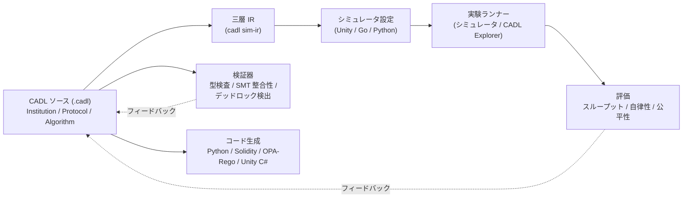

# CADL: Contract Architecture Description Language

**言語仕様書 — Version 0.3（ドラフト）**

名古屋大学大学院情報学研究科 ERTL

2026年10月20日

---

## 概要

CADL（Contract Architecture Description Language）は，マルチエージェント
**System of Systems（SoS）** における**制度設計**を形式的に記述・検証・展開
するためのドメイン特化言語（DSL）です。

CADLは**三層アーキテクチャ**——制度層（Institution）・プロトコル層（Protocol）・
アルゴリズム層（Algorithm）——を採用し，ガバナンスルールとエージェント間の
調整メカニズムを単一の統合言語で精密に記述できます。
アルゴリズム層は，中央側とローカル側がそれぞれ実行するアルゴリズムの名前を示すものであり，その内部は記述しません。
CADL仕様からシミュレータ設定の自動生成や設計整合性の検証を行うツールチェーンも
提供します。

## アーキテクチャ全体像

1つのソースから3種類の出力が生成されます。形式検証と制度制約コード
（スマートコントラクト／ポリシー／ランタイムクラス）は構文解析された定義から，
ランタイムシミュレータ設定は三層 IR から生成されます。
実験結果は CADL ソースへフィードバックされ，ガバナンスパラメータ
（[α, β, λ, ρ](./glossary.md)）の調整に利用されます。α，β，λ は契約ごとのパラメータであり，
ρ は動機拡張（[付録C](./appendix-c-motivation.md)）のパラメータです。
`cadl` ツールが扱うのは，ソース，検証器，コード生成，IR，シミュレータ設定の各ステップです。
実験の実行とその評価は，シミュレータまたは CADL Explorer で行います。

## 本仕様書の読み方

本書は3部構成になっています。以下の順序で読むことを推奨しますが，各章は
単独でも読めるように構成されています。

### 第I部 — 背景と要件

- **[1. はじめに](./01-introduction.md)** — 動機，問題設定，SoS研究における
  CADLの位置づけ。
- **[2. 目的](./02-objectives.md)** — CADLが解決する課題と，本ドラフトのスコープ。
- **[3. 比較](./03-comparison.md)** — 既存ADL・契約言語・マルチエージェントDSLとの関係。
- **[4. 要件](./04-requirements.md)** — 言語設計を駆動する機能的・非機能的要件。

### 第II部 — 言語と設計

- **[5. 言語仕様](./05-language-spec.md)** — 三層（制度・プロトコル・アルゴリズム）
  のコア構文と意味論。
- **[6. 設計](./06-design.md)** — 設計の根拠，ツールチェーン構成，検証エンジン，
  ランタイムシステム。中間表現（IR）は
  [付録EのE.7節](./appendix-e-sos-dsl.md#e7-intermediate-representation-ir-addition)と
  [用語集](./glossary.md)で説明します。
- **[7. 例](./07-examples.md)** — CADLの典型的な利用例。

### 第III部 — 応用と展望

- **[8. ユースケース](./08-use-cases.md)** — 応用領域とケーススタディ。
- **[9. 研究](./09-research.md)** — 未解決の研究課題と理論的基盤。
- **[10. ロードマップ](./10-roadmap.md)** — 実装フェーズと，リファレンス実装の現在の状況。

### 付録

- **[付録A — 構文](./appendix-a-syntax.md)** — EBNF文法リファレンス。
- **[付録B — 参考文献](./appendix-b-references.md)** — 参照文献。
- **[付録C — 動機拡張](./appendix-c-motivation.md)** — エージェントの動機モデルとプロファイル。
- **[付録D — コード生成ターゲット](./appendix-d-codegen.md)** — コード生成ターゲットの一覧。
- **[付録E — SoS-DSL拡張](./appendix-e-sos-dsl.md)** — 契約のライフサイクルとランタイムモニター。
- **[用語集](./glossary.md)** — 仕様全体で用いる用語。

## 推奨される読み順

- **はじめて読む方** — まず試すなら[クイックスタート](../quickstart/index.md)から，
  順を追って学ぶなら[テキストブック](../textbook/index.md)から始めてください。
  本仕様書そのものは，1〜2章を読み，5章をざっと眺めてから7章で具体例を確認。
  7章の記述例は概念的なものです。実行できる例は，cadlリポジトリの
  [`examples/` ディレクトリ](https://github.com/ertlnagoya/cadl/tree/master/examples)にあります。
- **実装者・ツール開発者** — 5章，6章，付録Aを中心に。
- **研究者** — 3章，9章，10章で全体的な文脈と未解決問題を把握。

## ツールの入手

リファレンス実装は [`cadl`](https://github.com/ertlnagoya/cadl) で，PyPIでは `cadl-lang`
として公開しています。コマンド名は `cadl` です。インストールして最初の例題を検査する手順は，
[クイックスタートの経路 B](../quickstart/index.md#path-b)にあります。リポジトリをクローンして
使う場合（ハンズオン教材と同じ編集モードのインストール）は，
[テキストブックの2.4節](../textbook/02-toolchain-setup.md)の手順に従ってください。
すべてのコマンドは[リポジトリのREADME](https://github.com/ertlnagoya/cadl#readme)にあります。

## 関連ツール

- **[cadl](https://github.com/ertlnagoya/cadl)** — CADLのコンパイラ兼コマンドラインツール
  （リファレンス実装）。PyPIでは [cadl-lang](https://pypi.org/project/cadl-lang/) として
  公開しています。
- **[CADL Explorer](https://cadl-explorer.streamlit.app/)** — CADLの
  ガバナンスパイプラインをエンドツーエンドで体験できるインタラクティブな
  Webアプリケーション。仕様からシミュレーション，ガバナンス評価までを
  一貫して可視化します。
- **[cadl-raspimouse-simulator](https://github.com/ertlnagoya/cadl-raspimouse-simulator)** —
  ハンズオン教材で使用するシミュレータ。

## 手を動かして学ぶ

仕様を読むだけでなく実際に書いて動かしたい場合は，[テキストブック](../textbook/index.md)を参照してください。ロボット配送を題材に，仕様の記述からコード生成・シミュレーション実行までを一通り体験できます。他のドメインを扱うコースは[ハンズオン教材](../handson/index.md)にあります。

## ステータス

本書は**Version 0.3（ドラフト）** です。言語およびツールチェーンは開発中であり，
構文・意味論は今後のリビジョンで変更される可能性があります。

Version 0.3 は，Version 0.2 に次のものを加えました。Version 0.2 で正しいファイルは
Version 0.3 でも正しく，同じ意味に読まれます。

- **単項マイナス**：式に単項の `-` を書けます（`permit_state == -2`，`x > -0.5`，
  `-a * b`）。`*` と `/` より強く結び付き，`-x` は `0 - x` の値を持ちます
  （[付録A A.10節](./appendix-a-syntax.md#a10-expressions)）。
- **遷移を検証の対象にする**：`verification:` の要素の `target:` に，遷移を
  `FROM->TO` の形で書けます（[付録A A.8節](./appendix-a-syntax.md#a8-verification-block)）。
- **SoS の `name` は文字列**です。識別子である必要はありません
  （[付録A A.3節](./appendix-a-syntax.md#a3-context-actors-metrics)）。
- **動機拡張の `model: hybrid` は予約語**です。処理系はこれを受け付け，
  `commitment_budget` として扱わなければなりません（[付録C](./appendix-c-motivation.md)）。

Version 0.2 は，Version 0.1 の記述をリファレンス実装に合わせて改めたものです。
Version 0.1 のファイルの読み方に影響する変更は次のとおりです。

- **β は意思決定集中度**：0 が完全分散，1 が完全集中です
  （[5.4.2 節](./05-language-spec.md)）。Version 0.1 には，逆の向きで説明している
  箇所がありました。
- **SoS-DSL拡張（[付録E](./appendix-e-sos-dsl.md)）**：`on_violation.transition` と
  `on_match.transition` は移り先の**状態**を指し（規則 L-5，M-3），
  `on_match.violation` は宣言を必要としないラベルです（規則 M-2）。拡張の版は
  `sos-dsl: 0.1` のままです。
- **`sharing:` の要素は引用符で囲んだ文字列で書かなければなりません**
  （`- "TAXI[*] -> CENTRAL : position"`）。引用符がないと，YAML はこれを文字列ではなく
  マッピングとして読みます
  （[付録A A.4節](./appendix-a-syntax.md#a4-contracts-institution-layer)）。
- **記号で書いた範囲の上限は記号的な大きさ**：`[1..N]` の `N` は任意のアクター数を表し，
  これに値を与える構文は言語にありません（[5.2.2 節](./05-language-spec.md)，
  [付録A A.3節](./appendix-a-syntax.md#a3-context-actors-metrics)）。
- **識別子は ASCII に限ります**。文字列とコメントには任意の Unicode 文字を使用できます
  （[第4章](./04-requirements.md)の要求 NFR-7，
  [付録A A.1節](./appendix-a-syntax.md#a1-lexical-rules)）。

[動機拡張](./appendix-c-motivation.md)は，独自のラベル v0.1-ext のままです。

仕様書とリファレンス実装の版は，独立に番号を付けています。本仕様書は Version 0.3 です。
内容の確認に用いたリファレンス実装の版と，その版の文法との違いは，
[付録AのA.12節](./appendix-a-syntax.md#a12-reference-implementation-status-v03)に示します。

フィードバックや議論は[GitHub Issues](https://github.com/ertlnagoya/cadl/issues)で歓迎します。
仕様書や本サイトの問題は，[cadl-specのIssues](https://github.com/ertlnagoya/cadl-spec/issues)で報告できます。
