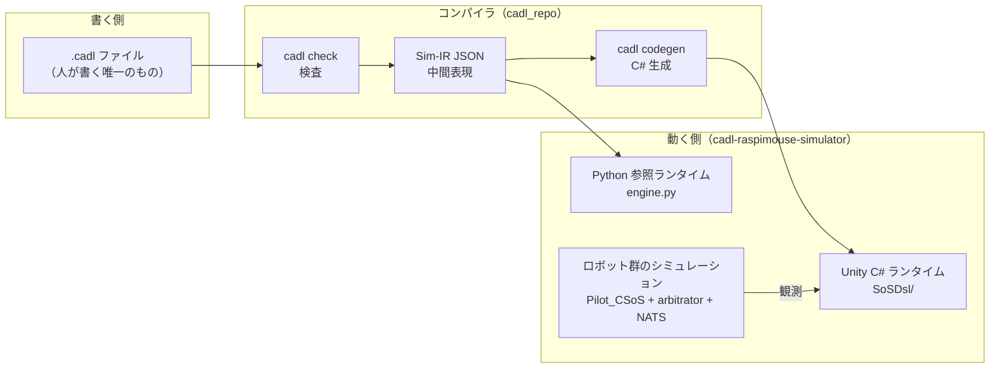

# 第 2 章 — ツールチェインと準備

この章では、CADL のファイルからどのような道筋で図やコードや実行結果が作られるか（ツールチェイン）と、それを構成する 4 つのリポジトリを説明し、手元にツールを準備します（2.4 節）。

## 2.1 全体像

書くのは一番左のボックス（CADL ファイル）だけです。右側はすべて、ツールチェインのコマンドがこのファイルから生成します。

```
   ┌────────────────────────┐
   │  CADL 仕様              │   ← 第 4・5 章で書く
   │  my_delivery.cadl      │
   └──────────┬─────────────┘
              │
              │  cadl check    →  タイポ / 型エラー検出
              │  cadl sim-ir   →  JSON 中間表現 (IR) を出力
              │
              ▼
   ┌────────────────────────┐
   │  Sim-IR JSON           │
   │  (cadl-spec App. E.7)  │
   └─────┬──────────────┬───┘
         │              │
         │              └──────────────┐
         │  cadl-explorer              │  cadl codegen --target unity-csharp
         │  Lifecycle View             │
         ▼                             ▼
   ┌─────────────────┐       ┌─────────────────────────┐
   │  状態機械の図    │       │  Unity C# ツリー         │
   │                  │       │  Runtime/    Generated/ │
   └─────────────────┘       └────────────┬────────────┘
                                          │  Assets/ にコピー
                                          ▼
                             ┌──────────────────────────┐
                             │  Unity シーン + arbitrator │
                             │  → Console にライブで        │
                             │     contract イベント       │
                             └──────────────────────────┘
```

登場するのは「仕様を書く側」と「仕様が動く側」の 2 つの世界と、その間をつなぐコンパイラです。



押さえておく点は 3 つです。

1. **契約のロジックとして人が書くのは `.cadl` ファイルだけ**です。IR、C# の契約クラス、図は、ツールチェインのコマンドがそこから生成します。
2. **同じ IR を 2 つのランタイムが同じ意味で実行**します。C# の契約コードは IR から生成されます。一方、Python 参照ランタイムは IR を直接読み込む手書きのインタプリタで、答え合わせに使います。
3. **ロボットの制御コードと契約のコードは分かれています。** 契約はロボットを観測するだけです。ロボットの制御コード `Pilot_CSoS.cs` には契約のロジックは入っておらず、手で書くのは、ロボットの状態の変化を契約のイベントに変換する薄い橋渡し（`PilotContractBridge.cs`）だけです。

本書で使うツールと、それを使う章は次のとおりです。

| ツール | すること | 使う章 |
| --- | --- | --- |
| `cadl check` | 構文、型、SoS-DSL の静的な規則を検査する | 第 4・5 章 |
| `cadl verify` | `cadl check` に加え、SMT ソルバ（Z3 [[8]](appendix-d-references.md)）で前提と保証の矛盾や、プロトコルのデッドロックを検査する | 第 3 章で紹介 |
| `cadl sim-ir` | ファイルを 3 層の中間表現（IR）の JSON に変換する | 第 5〜7 章 |
| cadl-explorer | IR から状態機械の図（Lifecycle View）を描く | 第 6 章 |
| `cadl codegen --target unity-csharp` | IR から Unity の C# コードを生成する | 第 7 章 |
| Python 参照ランタイム | IR を読み込んで、契約の状態の移り変わりを再現する | 第 7・9 章 |
| Unity と arbitrator | ロボット群のシミュレーションの中で、生成した契約コードを動かす | 第 8 章 |

---

## 2.2 4 つのリポジトリ

CADL のツールチェインは、各部分が独立して開発を進められるよう、4 つのリポジトリに分かれています。どれも公開しており、本書はすべて公開リポジトリだけで進められます。

| リポジトリ | 役割 | 使うブランチ | 本書での使い方 |
| --- | --- | --- | --- |
| `cadl-spec` | 言語仕様書と、本書を含む教材サイト（Docusaurus） | `main`（既定） | 読むだけ（手元で表示するのは任意） |
| `cadl`（`cadl_repo` としてクローン） | コンパイラ（パーサ、検査、IR、コード生成） | `master`（既定） | コマンドとして使う |
| `cadl-explorer` | CADL の編集と検査、状態機械の図の描画、ガバナンス設計の比較をする Streamlit アプリ | `main`（既定） | Web アプリとして使う（第 6 章） |
| `cadl-raspimouse-simulator` | Unity プロジェクト、Go の arbitrator、Python 参照ランタイムをまとめたシミュレータ | `main`（既定） | 第 7〜9 章で主に触る |

シミュレータは、Unity プロジェクト（`unity/`）、Go の arbitrator（`arbitrator/`）、Python 参照ランタイム（`cadl/runtime/`）を 1 つのリポジトリにまとめています。

名前について補足します。Unity のシーン（`C-SoS.unity`）、ロボットの制御コード（`Pilot_CSoS`）、arbitrator のディレクトリ（`C-SoS/`）に付いている「C-SoS」は、シミュレータの側では Collaborative SoS の略で（設定ファイルでは `sosType: collaborative`）、本書で使う動作モードの名前です。このモードでは、ロボットが配送を申し出て、`arbitrator/C-SoS` の arbitrator がどのロボットに任せるかを決めます。リポジトリには参考用に `D-SoS.unity` シーンも入っていますが、その arbitrator は含まれていません。このラベルはシミュレータの側で決まるもので、CADL ファイルの `type:` とは関係しません。本書の CADL ファイルは `type: Acknowledged` と宣言しており、本書がロボット配送 SoS の類型を述べるときは、この宣言を指しています（第 1 章 1.4 節）。

---

## 2.3 準備するもの

| ツール | バージョン | 用途 |
| --- | --- | --- |
| Python | 3.9 以上 | `cadl` CLI を実行 |
| Unity | 6000.2.9f1 (Unity 6.2) | シミュレーションを実行 |
| Go | 1.23 以上 | arbitrator をビルド |
| NATS Server | 最新版 | ロボットと arbitrator のメッセージバス |
| Node.js | 20 以上 | 仕様サイトを表示（任意） |

```bash
# macOS / Homebrew
brew install python@3.11 go nats-server node
# Unity は Unity Hub からインストール
```

---

## 2.4 セットアップ (5 分)

### 学ぶこと
- ツールチェインを構成するリポジトリと、それぞれで使うブランチ。

### 背景

2.2 節の 4 つのリポジトリを `~/program` の下にクローンし、`cadl` コマンドを使えるようにします。

### 手順

```bash
mkdir -p ~/program && cd ~/program

# 1) リポジトリをクローンします。
#    cadl-spec・cadl・cadl-raspimouse-simulator は既定ブランチ
#    （main / master / main）のまま使います。
git clone https://github.com/ertlnagoya/cadl-spec
git clone https://github.com/ertlnagoya/cadl                         cadl_repo
git clone https://github.com/ertlnagoya/cadl-explorer
git clone https://github.com/ertlnagoya/cadl-raspimouse-simulator

# 2) 編集モードで cadl CLI を install。変更が即反映されます。
cd ~/program/cadl_repo
python3 -m venv .venv && source .venv/bin/activate
python3 -m pip install --upgrade pip   # 編集モードの install には pip 21.3 以上が必要
pip install -e .
cd ~/program
```

### 期待される出力

```
$ cadl --help
usage: cadl [-h] [--version]
            {parse,check,verify,codegen,regime-map,iec62853,sim-validate,sim-ir,sim-gen,ai}
            ...

CADL: Contract Architecture Description Language toolchain

positional arguments:
  {parse,check,verify,codegen,regime-map,iec62853,sim-validate,sim-ir,sim-gen,ai}
                        Available commands
    parse               Parse a CADL file and report errors
    check               Parse and type-check a CADL file
    verify              Parse, type-check, and verify a CADL file
    codegen             Generate runtime code from a CADL file
    ...
```

### チェック

`cadl codegen --help` の `--target` の選択肢に `unity-csharp` が含まれていれば（`{python,solidity,opa,unity-csharp}`）、install は正しく完了しています。

### おさらい

セットアップを終えて分かるのは、CADL が「仕様サイト・コンパイラ・可視化・シミュレータ」という 4 つのリポジトリが噛み合って動く仕組みだ、ということです。そして以降のすべては、**各リポジトリが 2.2 節の表のブランチになっている**（すべて `main`。`cadl_repo` だけは `master`）、という前提の上に成り立ちます。この段階でのつまずきの大半は、ブランチ違いです。

### セットアップのトラブルシューティング

**ブランチを確認する（最頻のつまずき）。** 4 つのリポジトリは、すべて既定ブランチ（`main`。`cadl_repo` だけは `master`）のまま使います。ここで説明しているページやコマンドが見つからない場合は、まず古いブランチに切り替えていないかを確認してください。次のコマンドで確認できます。

```bash
cd ~/program
echo "cadl-spec:     $(git -C cadl-spec branch --show-current)"       # main
echo "cadl_repo:     $(git -C cadl_repo branch --show-current)"       # master
echo "cadl-explorer: $(git -C cadl-explorer branch --show-current)"   # main
echo "simulator:     $(git -C cadl-raspimouse-simulator branch --show-current)"   # main
```

ブランチが違うリポジトリがあれば、`git -C ~/program/<repo> checkout <branch>` で切り替えます。

**`pip install -e .` が `File "setup.py" or "setup.cfg" not found` で失敗する。** 仮想環境の pip が古いことが原因です。macOS の `/usr/bin/python3`（Command Line Tools 付属の Python 3.9）で作った仮想環境には pip 21.2.4 が入り、このバージョンは `cadl` のように `pyproject.toml` だけを持つプロジェクトを編集モードで install できません。仮想環境の中で pip を更新してから、もう一度 install します。

```bash
cd ~/program/cadl_repo
source .venv/bin/activate
python3 -m pip install --upgrade pip
pip install -e .
```

**`cadl` が `bad interpreter` を出す、または `cadl --help` のコマンド一覧が古い。** シェルが `cadl_repo/.venv` 以外の `cadl` を見つけています。`which cadl` で確認します。`~/program/cadl_repo/.venv/bin/cadl` と表示されれば正しい状態です。新しいターミナルでは、最初に `source ~/program/cadl_repo/.venv/bin/activate` を実行します。仮想環境そのものが `bad interpreter` を出す場合（作成に使った Python が削除された場合）は、`.venv` を削除して手順 2) をやり直します。
