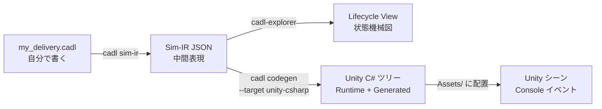

# 第 2 章 — ツールチェインと準備

## 全体像

書くのは一番左のボックス（CADL ファイル）だけです。右側はすべて、ツールチェインのコマンドがこのファイルから生成します。

```
   ┌────────────────────────┐
   │  CADL 仕様              │   ← Step 2 と 3 で書く
   │  my_delivery.cadl      │
   └──────────┬─────────────┘
              │
              │  cadl check    →  タイポ / 型エラー検出
              │  cadl sim-ir   →  JSON 中間表現 (IR) を出力
              │
              ▼
   ┌────────────────────────┐
   │  Sim-IR JSON           │
   │  (cadl-spec App. E.7)  │
   └─────┬──────────────┬───┘
         │              │
         │              └──────────────┐
         │  cadl-explorer              │  cadl codegen --target unity-csharp
         │  Lifecycle View             │
         ▼                             ▼
   ┌─────────────────┐       ┌─────────────────────────┐
   │  状態機械の図    │       │  Unity C# ツリー         │
   │                  │       │  Runtime/    Generated/ │
   └─────────────────┘       └────────────┬────────────┘
                                          │  Assets/ にコピー
                                          ▼
                             ┌──────────────────────────┐
                             │  Unity シーン + arbitrator │
                             │  → Console にライブで        │
                             │     contract イベント       │
                             └──────────────────────────┘
```



---

## 準備するもの

| ツール | バージョン | 用途 |
| --- | --- | --- |
| Python | 3.9 以上 | `cadl` CLI を実行 |
| Unity | 6000.2.9f1 (Unity 6.2) | シミュレーションを実行 |
| Go | 1.23 以上 | arbitrator をビルド |
| NATS Server | 最新版 | ロボットと arbitrator のメッセージバス |
| Node.js | 20 以上 | 仕様サイトを表示（任意） |

```bash
# macOS / Homebrew
brew install python@3.11 go nats-server node
# Unity は Unity Hub からインストール
```

---

## Step 0 — セットアップ (5 分)

### 学ぶこと
- ツールチェインを構成するリポジトリと、それぞれで使うブランチ。

### 背景

CADL ツールチェインは、各部分が独立して進化できるよう 4 つのリポジトリに分かれています。

| リポジトリ | 役割 | 使うブランチ |
| --- | --- | --- |
| `cadl-spec`            | 言語仕様書とこのハンズオンサイト（Docusaurus） | `main`（既定） |
| `cadl`（`cadl_repo` としてクローン） | コンパイラ本体（パーサ・IR・コード生成器） | `master`（既定） |
| `cadl-explorer`        | CADL を可視化・編集する Streamlit アプリ | `main`（既定） |
| `cadl-raspimouse-simulator` | Step 5〜6 で使うシミュレータ。Unity プロジェクト・Go arbitrator・Python 参照ランタイムを 1 つのリポジトリにまとめたもの | `main`（既定） |

:::info[リポジトリの公開状況]
`cadl-spec`（本仕様・ハンズオンサイト）、`cadl`（コンパイラ / CLI）、`cadl-explorer`（可視化）、`cadl-raspimouse-simulator`（シミュレータ）は公開しています。コース A はすべての Step を公開リポジトリだけで進められます。コース B で使う `mobility-sos-exercise` は**現時点では非公開**です。
:::

### 手順

```bash
mkdir -p ~/program && cd ~/program

# 1) リポジトリをクローンします。
#    cadl-spec・cadl・cadl-raspimouse-simulator は既定ブランチ
#    （main / master / main）のまま使います。
git clone https://github.com/ertlnagoya/cadl-spec
git clone https://github.com/ertlnagoya/cadl                         cadl_repo
git clone https://github.com/ertlnagoya/cadl-explorer
git clone https://github.com/ertlnagoya/cadl-raspimouse-simulator

# 2) 編集モードで cadl CLI を install。変更が即反映されます。
cd ~/program/cadl_repo
python3 -m venv .venv && source .venv/bin/activate
python3 -m pip install --upgrade pip   # 編集モードの install には pip 21.3 以上が必要
pip install -e .
cd ~/program
```

### 期待される出力

```
$ cadl --help
usage: cadl [-h] [--version]
            {parse,check,verify,codegen,regime-map,iec62853,sim-validate,sim-ir,sim-gen,ai}
            ...

CADL: Contract Architecture Description Language toolchain

positional arguments:
  {parse,check,verify,codegen,regime-map,iec62853,sim-validate,sim-ir,sim-gen,ai}
                        Available commands
    parse               Parse a CADL file and report errors
    check               Parse and type-check a CADL file
    verify              Parse, type-check, and verify a CADL file
    codegen             Generate runtime code from a CADL file
    ...
```

### チェック 0

`cadl codegen --help` の `--target` の選択肢に `unity-csharp` が含まれていれば（`{python,solidity,opa,unity-csharp}`）、install は正しく完了しています。

### おさらい

セットアップを終えて分かるのは、CADL が「仕様サイト・コンパイラ・可視化・シミュレータ」という 4 つのリポジトリが噛み合って動く仕組みだ、ということです。そして以降のすべては、**各リポジトリが上の表のブランチになっている**（すべて `main`。`cadl_repo` だけは `master`）、という前提の上に成り立ちます。この段階でのつまずきの大半は、ブランチ違いです。

### 🛠 セットアップのトラブルシューティング

**ブランチを確認する（最頻のつまずき）。** 4 つのリポジトリは、すべて既定ブランチ（`main`。`cadl_repo` だけは `master`）のまま使います。ここで説明しているページやコマンドが見つからない場合は、まず古いブランチに切り替えていないかを確認してください。次のコマンドで確認できます。

```bash
cd ~/program
echo "cadl-spec:     $(git -C cadl-spec branch --show-current)"       # main
echo "cadl_repo:     $(git -C cadl_repo branch --show-current)"       # master
echo "cadl-explorer: $(git -C cadl-explorer branch --show-current)"   # main
echo "simulator:     $(git -C cadl-raspimouse-simulator branch --show-current)"   # main
```

ブランチが違うリポジトリがあれば、`git -C ~/program/<repo> checkout <branch>` で切り替えます。

**`pip install -e .` が `File "setup.py" or "setup.cfg" not found` で失敗する。** 仮想環境の pip が古いことが原因です。macOS の `/usr/bin/python3`（Command Line Tools 付属の Python 3.9）で作った仮想環境には pip 21.2.4 が入り、このバージョンは `cadl` のように `pyproject.toml` だけを持つプロジェクトを編集モードで install できません。仮想環境の中で pip を更新してから、もう一度 install します。

```bash
cd ~/program/cadl_repo
source .venv/bin/activate
python3 -m pip install --upgrade pip
pip install -e .
```

**`cadl` が `bad interpreter` を出す、または `cadl --help` のコマンド一覧が古い。** シェルが `cadl_repo/.venv` 以外の `cadl` を見つけています。`which cadl` で確認します。`~/program/cadl_repo/.venv/bin/cadl` と表示されれば正しい状態です。新しいターミナルでは、最初に `source ~/program/cadl_repo/.venv/bin/activate` を実行します。仮想環境そのものが `bad interpreter` を出す場合（作成に使った Python が削除された場合）は、`.venv` を削除して手順 2) をやり直します。
