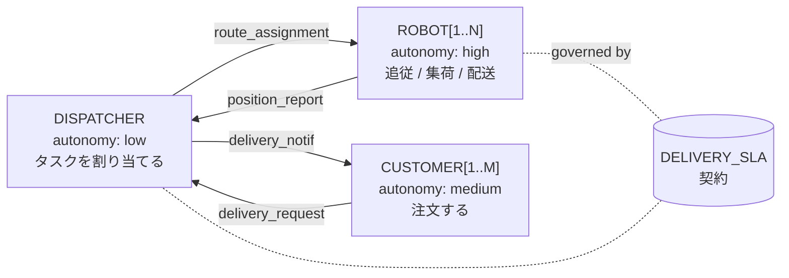
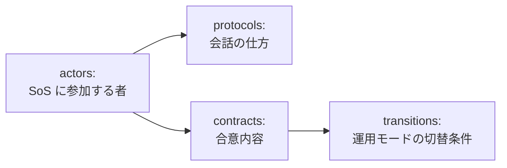

# 第 4 章 — 構造を書く

この章では、ロボット配送 SoS の構造（アクター、契約、プロトコル）を CADL で書き、`cadl check` と `cadl sim-ir` で確かめます（約 15 分）。章の終わりの演習では、アクターを足し、プロトコルに条件を加え、知らないドメインの構造を書きます。

## 4.1 学ぶこと

**手順で：**

- アクターを `id`, `role`, `autonomy`, `interface` で宣言する方法。
- 契約の parties, A/G clauses (`assume` / `guarantee`), incentives の宣言方法。
- プロトコルの宣言方法。1 件の注文で交わすメッセージを、`送信者 -> 受信者 : メッセージ` のステップの列として書く。

**演習で：**

- SoS のアクターを同定し、自分で宣言できる（知らないドメインを含む）。
- `cadl check` を実行し、その診断メッセージを説明できる。

## 4.2 背景

CADL の `actors:` ブロックは SoS の UML クラス図のようなものです。各アクター型はポート（`interface.input` / `interface.output`）と自律度（`autonomy: low | medium | high`）を持ちます。`contracts:` ブロックは、指定したアクターサブセットの間の *合意* です。



### 構造を組み立てる部品

CADL ファイルは「**誰が**参加し、**お互いに何を期待しているか**」を、「いつ」「どれくらいの頻度で」よりも先に述べます。構造を組み立てる部品は次のとおりです。



この章では **actors** と **contracts**、それにプロトコルを 1 つ（**protocols**）書きます。`transitions` は発展課題に回します。

## 4.3 手順

`cadl_repo` の直下に `my_delivery.cadl` を新規作成し（`~/program/cadl_repo/my_delivery.cadl`。手本になる同梱の例は `examples/sos_dsl_robot_delivery.cadl` です）、下の骨組みを貼り付けます。第 4〜6 章のコマンドは `~/program/cadl_repo` で実行します。コメントを読みながら、各ブロックが何をしているかを確かめてください。

```yaml
# my_delivery.cadl ─── 私の最初の SoS 仕様
# (このファイルは構造のみを記述します。規範は第 5 章で追加します)

sos:
  name: "MyDelivery"
  type: Acknowledged           # 中央権威 + 自律エージェント
  version: "0.1.0"

  context:
    environment:
      grid_size:    30                         # 抽象的な環境パラメータ（Unity の経路グラフとは別）
      num_robots:    3
      time_step_ms: 100

  # ── SoS に存在する者たち ──────────────────────────────────────
  actors:
    - id: DISPATCHER
      role: "central_coordinator"
      autonomy: low                            # 方針に従う、自由行動なし
      capabilities: [assign_tasks]
      interface:
        input:  [delivery_request, position_report, task_completion, ack]
        output: [route_assignment, delivery_notification]

    - id: "ROBOT[1..N]"                        # パラメトリック: N コピー
      role: "delivery_agent"
      autonomy: high
      capabilities: [follow_path, pick_up, deliver]
      interface:
        input:  [route_assignment]
        output: [position_report, task_completion, ack]

    - id: "CUSTOMER[1..M]"
      role: "service_requester"
      autonomy: medium
      capabilities: [submit_order]
      interface:
        input:  [delivery_notification]
        output: [delivery_request]

  # ── 当事者間の合意 ───────────────────────────────────────────
  contracts:
    - id: DELIVERY_SLA
      parties: [DISPATCHER, "ROBOT[*]", "CUSTOMER[*]"]
      assume:
        - "ROBOT[i].battery > 20"              # 入力前提条件
      guarantee:
        - "delivery_time <= 300s"              # 出力事後条件
      incentives:
        type: task_completion
        lambda: 0.5
        rules:
          - "reward(ROBOT[i], 10) when on_time_delivery"

  # ── 会話の仕方：1 件の注文で交わすメッセージ ───────────────
  protocols:
    - id: DeliveryOrder
      trigger: "new_delivery_request(CUSTOMER[j])"
      steps:                                   # "送信者 -> 受信者 : メッセージ"
        - "CUSTOMER[j] -> DISPATCHER : delivery_request"
        - "DISPATCHER -> ROBOT[i] : route_assignment"
        - "ROBOT[i] -> DISPATCHER : ack"
        - "ROBOT[i] -> DISPATCHER : task_completion"
        - "DISPATCHER -> CUSTOMER[j] : delivery_notification"
```

型チェッカを実行：

```bash
cd ~/program/cadl_repo
cadl check my_delivery.cadl
```

## 4.4 期待される出力

```
$ cadl check my_delivery.cadl
Type check passed: my_delivery.cadl
```

IR JSON に変換します。出力は 150 行ほどあります。下の表示は、ここで見るべき部分だけを抜粋したものです：

```bash
cadl sim-ir my_delivery.cadl --format json
```

```jsonc
{
  "name": "MyDelivery",
  "sos_type": "Acknowledged",
  "description": "",
  "environment": {
    "grid_size":    30,
    "num_robots":    3,
    "time_step_ms": 100
  },
  "institution": {
    "actors": [ ... ],
    "contracts": [
      {
        "id": "DELIVERY_SLA",
        "parties": ["DISPATCHER", "ROBOT[*]", "CUSTOMER[*]"],
        "assume":   ["ROBOT[i].battery > 20"],
        "guarantee":["delivery_time <= 300s"],
        ...
        "lifecycle": null,           ← まだ書いていない
        "monitors":  []
      }
    ]
  },
```

## 4.5 チェック

両方とも確認：

1. `cadl check my_delivery.cadl` が `Type check passed: my_delivery.cadl` と表示され、`[ERROR]` の行がない。
2. IR JSON で `"lifecycle": null` と `"monitors": []` になっている。この 2 行は契約の末尾（出力の 90 行目あたり）にある。この 2 行だけを表示するには：

   ```bash
   cadl sim-ir my_delivery.cadl --format json | grep -n -A1 '"lifecycle"'
   ```

   ```
   90:        "lifecycle": null,
   91-        "monitors": []
   ```

この `null` と `[]` こそが **第 5 章で埋めるギャップ** です。構造だけの仕様では「ロボットは 5 秒以内に ack せよ」と言えない理由がこれです。

## 4.6 よくある間違い

| 症状 | 原因 |
| --- | --- |
| `YAML parse error: while parsing a flow sequence` | `[ROBOT[i].battery, ...]` のように subscript 付きをクオートなしで書いた。`["ROBOT[i].battery", ...]` のように quote する。 |
| `Parse error: Invalid SoS type: 'Centralized'. Must be one of: Directed, Acknowledged, Collaborative, Virtual` | `type:` に書けるのはこの 4 つだけ。 |
| `[ERROR]: Undefined actor 'CUSTMER' referenced in contract 'DELIVERY_SLA' parties` | `parties:`（または述語の中。例：`CUSTMER[i].x`）に書いた名前が `actors:` で宣言されていない。多くは打ち間違い。`CUSTOMER[1..M]` と宣言したアクターは，`"CUSTOMER[*]"`（全員）または `CUSTOMER[i]`（1 人）で参照する。 |

## 4.7 おさらい

SoS の **構造** を記述する CADL ファイルが完成しました。コンパイルでき、IR に変換でき、IR の中に契約 `DELIVERY_SLA` とプロトコル `DeliveryOrder` が 1 つずつあることも確認できました。次は、ランタイムがこの契約への違反を検出できるように、規範を書き加えます。

## 4.8 演習

### 演習 4.1 (★) — 構造モデルのベースラインを作る

**目的**: 4.3 節のアクター、契約、プロトコルを、ゼロから書き起こした新ファイル `my_delivery_v1.cadl` に再現する。

**手順**:

1. `cadl_repo` の直下に `my_delivery_v1.cadl` を作成し（見比べる同梱の例は `examples/sos_dsl_robot_delivery.cadl`）、以下のコマンドはそのディレクトリで実行する。
2. 3 つのアクターを宣言：`DISPATCHER`、`ROBOT[1..N]`、`CUSTOMER[1..M]`。それぞれに妥当な `autonomy` レベルを選ぶ。
3. 1 つの契約 `DELIVERY_SLA` を宣言：`parties: [DISPATCHER, "ROBOT[*]", "CUSTOMER[*]"]`、`assume: ["ROBOT[i].battery > 20"]`、`guarantee: ["delivery_time <= 300s"]`。
4. プロトコル `DeliveryOrder` を 4.3 節の 5 ステップで宣言し、各メッセージを送信者の `interface` の `output` と受信者の `input` に書く。
5. `cadl check my_delivery_v1.cadl` を実行し、`Type check passed: my_delivery_v1.cadl` と表示されることを確認。

**確認**: ファイルが型検査を通り、IR JSON にアクター 3 つ、契約 1 つ、プロトコル 1 つが見える。

### 演習 4.2 (★★) — 4 番目のアクターを追加する

**目的**: 定期的にロボットを点検する `MAINTENANCE` アクターを追加し、`MAINTENANCE` と `ROBOT[*]` の間に別の契約 `MAINTENANCE_SLA` を宣言する。

**手順**:

1. `MAINTENANCE` を追加（単一、低自律度、capabilities `[inspect, repair]`）。
2. 契約 `MAINTENANCE_SLA` を宣言：`parties: [MAINTENANCE, "ROBOT[*]"]`。
3. `assume` に `ROBOT[i].battery > 0` を含めるか、もっと強い条件にするか判断する。
4. `cadl check` を再実行。

**振り返り**: 同じアクターに *2 つの* 契約があるとき、`assume` 節はどう作用しますか？（ヒント：両方が同時に成り立つ必要がある — これがまさに Dahmann (2014) [[9]](appendix-d-references.md) が SoS pain point #5 として挙げた *相互依存* の問題です。）

### 演習 4.3 (★★) — プロトコルに条件を加える

**目的**: `my_delivery_v1.cadl` のプロトコル `DeliveryOrder` に、始まる前に成り立つべき条件と、終わったときに成り立つ条件を加え、両方が IR に入ったことを確かめる。

**手順**:

1. `protocols:` の下の `DeliveryOrder` を見つける。プロトコルに参加者の一覧を書くキーはない。誰が参加するかは `steps` に書いた送信者と受信者で決まる。
2. `steps:` の上に `precondition: "ROBOT[i].battery > 20"` を、下に `postcondition: "ROBOT[i].status == Delivered"` を加える（ほかに任意のキーとして `safety_invariant` と `timing` がある）。
3. `cadl check my_delivery_v1.cadl` を実行し、続けて 2 つの条件が IR に入ったことを確認：`cadl sim-ir my_delivery_v1.cadl --format json | grep -n -E '"(precondition|postcondition)"'` が 2 行を表示する。ここでは `cadl check` だけに頼らないこと。`cadl check` は知らないキーを黙って無視するので、キー名を間違えても（`pre:`、`post_condition:` など）検査は通ってしまう。

```yaml
  protocols:
    - id: DeliveryOrder
      trigger: "new_delivery_request(CUSTOMER[j])"
      precondition: "ROBOT[i].battery > 20"
      steps:
        - "CUSTOMER[j] -> DISPATCHER : delivery_request"
        - "DISPATCHER -> ROBOT[i] : route_assignment"
        - "ROBOT[i] -> DISPATCHER : ack"
        - "ROBOT[i] -> DISPATCHER : task_completion"
        - "DISPATCHER -> CUSTOMER[j] : delivery_notification"
      postcondition: "ROBOT[i].status == Delivered"
```

**振り返り**: なぜプロトコルは *メッセージ* の列として書かれ、コードとして書かれないのでしょうか？ Python 関数では得られないどんな利点があるでしょうか？（ヒント：各ステップを *誰が実装するか* を考える。）

### 演習 4.4 (★★★) — 知らないドメインを書いてみる

**目的**: 既存ファイルを一切コピーせず、**配送ドローンの群**（地上ロボットではなく）の CADL 骨格をゼロから書く。ドメインの形は同じだが、アクターと capabilities は異なる。

**手順**:

1. `my_drone_delivery.cadl` を白紙から作成。
2. アクターを決める。ヒント：*DRONE* は *ROBOT* と違う `capabilities` を必要とする（高度、飛行禁止区域、天候を考慮）。
3. `cadl check` を実行。

**振り返り**: 自分のファイルのうち、ロボット配送と *同じ* 部分はどれくらいで、本当に違う部分はどれくらいですか？ 同じライフサイクルが小修正で再利用できる — これがまさに SoS-DSL の設計意図です。

### 授業で使う場合

**授業の前に。**

- 第 2 章を完了（リポジトリのクローンと `cadl` のインストール）。
- 事前読書 30 分：本書の第 3 章。

**まとめと宿題。**

**次の授業（第 5 章）に持参**:

- `my_delivery_v1.cadl`（クリーンにコンパイルされる）
- v1 で表現できないものを 3〜5 行のメモで列挙（ヒント：タイミング、何を違反とみなすか、その帰結）。
