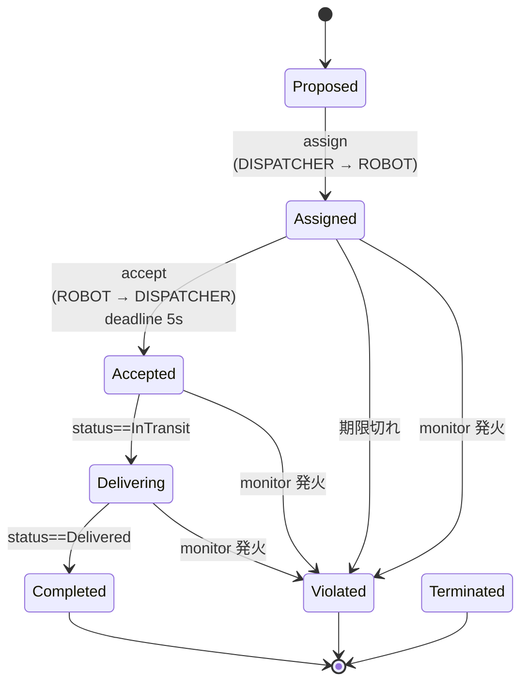
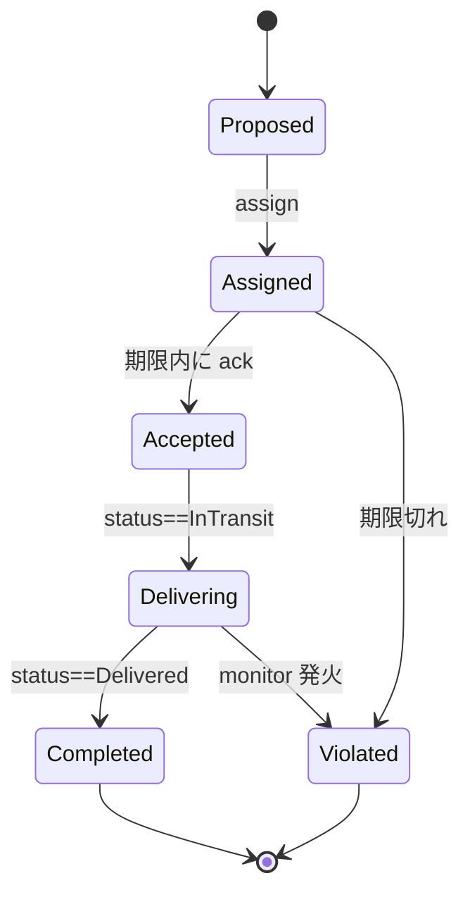

# 第 5 章 — 規範を書く

この章では、第 4 章で書いた契約に、SoS-DSL 拡張のライフサイクルと監視ルールを加えます（約 15 分）。演習では、状態や監視ルールを足し、2 つの契約を共存させます。

## 5.1 学ぶこと

**手順で：**

- 契約インスタンスが取りうる **7 つのライフサイクル状態**。
- 遷移に期限を付け、期限切れのときにインスタンスをどの状態へ移すかを指定する `deadline` + `on_violation` の書き方。
- ワールドスナップショットの述語で動く周期的 `monitor` の書き方。

**演習で：**

- 構造的な契約に、インスタンスごとの `lifecycle:` を追加できる。
- 述語とサンプリング指定を持つ宣言的 `monitors:` を追加できる。
- `cadl sim-ir` の JSON 出力を読み、自分が追加した部分を特定できる。

## 5.2 背景

クラスレベルの契約仕様（第 4 章）は **合意** を記述しますが、実際の SoS では同じ合意の **複数の同時インスタンス** が存在します — 配送要求 1 件につき 1 インスタンス。各インスタンスは独自の状態を持ち、時間とともに進行します。



**同じライフサイクル** が全配送要求に再利用され、データ（どのロボット、どの顧客）だけが異なります。

### クラスとインスタンス

クラスレベルの契約仕様は「私たちが結ぶ合意の*種類*」を語ります。しかし、各具体的な配送はその合意の **インスタンス** であり、次のように進行します：



これを明示的に書けるようにするキーが 2 つあります。

- `lifecycle:` — 状態、初期 / 終端マーカー、`deadline` + `on_violation` 付き遷移
- `monitors:` — 周期的またはイベント駆動で評価される宣言的な観測者。`rule` が成立すると、違反を記録する（`on_match.violation`）、契約インスタンスを指定した状態（`on_match.transition`、例：`Violated`）へ移す、またはその両方を行う

## 5.3 手順

まず `my_delivery.cadl` の先頭付近で、このファイルが SoS-DSL 拡張を使うことを宣言します。[Appendix E](../spec/appendix-e-sos-dsl.md) はこの宣言を求めており（SHOULD）、同梱の例にも入っています。

```yaml
sos:
  name: "MyDelivery"
  type: Acknowledged           # 中央権威 + 自律エージェント
  version: "0.1.0"
  extensions:                  # ← 追加: SoS-DSL 拡張を使うことの宣言
    - sos-dsl: 0.1
```

続いて、`DELIVERY_SLA` 契約に、以下のハイライトされた 2 ブロックを追加します。インデントが重要です（YAML）。

```yaml
  contracts:
    - id: DELIVERY_SLA
      parties: [DISPATCHER, "ROBOT[*]", "CUSTOMER[*]"]
      assume:
        - "ROBOT[i].battery > 20"
      guarantee:
        - "delivery_time <= 300s"
      incentives:
        type: task_completion
        lambda: 0.5
        rules:
          - "reward(ROBOT[i], 10) when on_time_delivery"

      # ╔═══════════════════════════════════════════════════════════════╗
      # ║  新ブロック 1: インスタンスごとのライフサイクル                  ║
      # ╚═══════════════════════════════════════════════════════════════╝
      lifecycle:
        states:
          - Proposed
          - Assigned
          - Accepted
          - Delivering
          - Completed
          - Violated
          - Terminated
        initial: Proposed
        terminal: [Completed, Violated, Terminated]
        transitions:
          - id: assign
            from: Proposed
            to:   Assigned
            on:   "DISPATCHER -> ROBOT[i] : route_assignment"

          - id: accept
            from: Assigned
            to:   Accepted
            on:   "ROBOT[i] -> DISPATCHER : ack(accepted)"
            deadline: 5s                           # ⏱ 5 秒以内に来なければ
            on_violation:                          # → Violated に飛ばす
              transition: Violated
              severity:   Major

          - id: start_delivery
            from: Accepted
            to:   Delivering
            on:   "ROBOT[i].status == InTransit"

          - id: complete
            from: Delivering
            to:   Completed
            on:   "ROBOT[i].status == Delivered"

      # ╔═══════════════════════════════════════════════════════════════╗
      # ║  新ブロック 2: 宣言的モニター                                  ║
      # ╚═══════════════════════════════════════════════════════════════╝
      monitors:
        - id: battery_guard
          observe: "ROBOT[i].battery"
          sampling: periodic(500ms)                # 評価周期
          rule: "ROBOT[i].battery < 20 AND state == Assigned"
          on_match:
            transition: Violated
            severity:   Major
```

型チェッカを再実行：

```bash
cadl check my_delivery.cadl
```

## 5.4 期待される出力

```
$ cadl check my_delivery.cadl
Type check passed: my_delivery.cadl
```

IR に変換して新フィールドが入ったか確認：

```bash
cadl sim-ir my_delivery.cadl --format json \
  | python3 -c "
import json, sys
d = json.load(sys.stdin)
c = d['institution']['contracts'][0]
print(f'lifecycle.initial : {c[\"lifecycle\"][\"initial\"]}')
print(f'lifecycle.states  : {c[\"lifecycle\"][\"states\"]}')
print(f'monitors[0].id    : {c[\"monitors\"][0][\"id\"]}')
print(f'  rule            : {c[\"monitors\"][0][\"rule\"]}')
"
```

```
lifecycle.initial : Proposed
lifecycle.states  : ['Proposed', 'Assigned', 'Accepted', 'Delivering', 'Completed', 'Violated', 'Terminated']
monitors[0].id    : battery_guard
  rule            : ROBOT[i].battery < 20 AND state == Assigned
```

## 5.5 チェック

1. 第 4 章と第 5 章の差分は **`extensions:` の宣言と新ブロック 2 つだけ**。アクターは変更なし。
2. IR の `"lifecycle": null` がオブジェクトになり、`"monitors": []` が要素 1 のリストになった。

## 5.6 よくある間違い

| 症状 | 原因 |
| --- | --- |
| `cadl check` は通るが、IR が `"lifecycle": null` になり、第 6 章で状態が表示されない | `lifecycle:` ブロックのインデントが違い、契約の一部として読まれていない。`lifecycle:` は `assume:` / `guarantee:` と同じレベルに置き、`states:` はその 1 段下に書く。チェッカはインデントの誤りそのものは報告しない。モニターがライフサイクルの状態を名指ししているときに限り、契約にライフサイクルがないことが M-3 のエラーとして間接的に報告される。 |
| `on:` がブール値として解釈されてしまう | YAML 1.1 の癖。CADL のパーサは内部に `_yaml_on_key` の回避策を持っているので同梱の例は正しく動く。自分でパーサを書くときは注意。 |
| `monitor.rule` が常に false | `state == Assigned` の右辺は **裸の識別子** で OK（CADL の慣習）。二重引用符で `\"Assigned\"` と書いても意味は同じ。単引用符（`'Assigned'`）はルールの文法にないので、`cadl check` が「is not a valid rule (Appendix E.3) and is kept as text」と警告し、モニターは発火しない。 |

## 5.7 おさらい

同じファイルで構造（第 4 章）と規範（第 5 章）の両方を記述しました。IR はもう「構造のみ」ではなく、ランタイムを構築できる情報を持っています。

## 5.8 演習

### 演習 5.1 (★) — 基本的なライフサイクルを追加

**目的**: `my_delivery_v1.cadl` を `my_delivery_v2.cadl` として保存し、`DELIVERY_SLA` に5.3 節の 7 状態を持つ `lifecycle:` ブロックを追加。

**手順**:

1. `v1` → `v2` をコピー。
2. `lifecycle.states`、`lifecycle.initial`、`lifecycle.terminal` と 4 つの遷移（`assign`、`accept`、`start_delivery`、`complete`）を追加。
3. `accept` に `deadline: 5s` と `on_violation.transition: Violated` を設定（値は移動先の状態名）。あわせて、5.3 節と同じく `sos:` の下に `extensions: [sos-dsl: 0.1]` を宣言し、5.3 節の `monitors:` ブロック（`battery_guard`）も写す。第 7 章はこの演習の v2 を動かし、このモニターがある前提で結果を説明する。
4. `cadl check my_delivery_v2.cadl` を実行し、続けて `cadl sim-ir my_delivery_v2.cadl --format json | grep -n -A3 '"lifecycle"'` を実行（`"lifecycle"` キーは IR のかなり後ろにある。5.3 節のファイルでは 90 行目、第 4 章でアクターや契約を追加していればさらに後ろになるので、`head` では途中で切れて見えない）。
5. 出力で `"lifecycle"` が `null` でなくなったことを確認：行が `"lifecycle": {` になり、続いて `"states": [` と最初の状態名が並ぶ。演習 4.2 で `MAINTENANCE_SLA` を追加している場合、`grep` はその契約の分も出力し、そちらは `"lifecycle": null` のままになる。lifecycle を持つのは `DELIVERY_SLA` だけなので、これで正しい。

### 演習 5.2 (★★) — 過速度モニターを追加

**目的**: 配送中に 1.5 m/s を超えて走るロボットを検出し、severity `Critical` で `Violated` へ強制遷移させる。

**手順**: `monitors:` の下に追加：

```yaml
- id: over_speed
  observe: "ROBOT[i].speed"
  sampling: periodic(200ms)
  rule: "ROBOT[i].speed > 1.5 AND state == Delivering"
  on_match:
    transition: Violated
    severity: Critical
```

**振り返り**: ロボットの制御コード（Unity 側の `Pilot_CSoS.cs`）を 1 行も変えずに *新しい規範ルール* を追加しました。これは構造コードと規範仕様の分離について何を語っていますか？（[Maier 1998] の条件 (4)「創発的振る舞い」と比べてみてください。ここでは規範が、構成要素を再設計することなく創発的振る舞いを *制約* しています）

### 演習 5.3 (★★) — Cancelled 状態を追加

**目的**: ロボットがまだ `Assigned` の段階で顧客が配送をキャンセルできるようにし、新しい `Cancelled` 終端状態にルーティングする。

**手順**:

1. `lifecycle.states` と `lifecycle.terminal` に `Cancelled` を追加。
2. `Assigned` から `Cancelled` への遷移 `customer_cancel` を `"CUSTOMER[i] -> DISPATCHER : cancel_order"` で発火。
3. 判断：`Cancelled` は違反扱いにすべきか？ CADL では終端状態は暗黙に違反ではなく、単に *閉じた* 状態。

**振り返り**: `Cancelled` を追加したとき、既存のシミュレーションは壊れましたか？ なぜですか？ （状態追加は後方互換だが、deadline 追加は違う。）

### 演習 5.4 (★★★) — 2 つの契約を共存させる

**目的**: `DELIVERY_SLA` とは別に `FLEET_SAFETY` 契約を新設する。そのライフサイクルは個別の配送とは独立していて、ロボットが稼働している間はずっと有効な契約。

**手順**:

1. 3 状態のライフサイクルを定義：`Operational → Degraded → OutOfService`。
2. battery < 10% で `Degraded` を発火するモニターを追加（配送状態に関係なく）。
3. `cadl check` を実行。`DELIVERY_SLA` のルールと衝突しますか？

**振り返り**: 同じロボットが *両方の* 契約の当事者になり得ます。一方が「進めてよい」と言い、もう一方が「停止せよ」と言うとき、どんな意味論を望みますか？

### 授業で使う場合

**授業の前に。**

- 第 4 章の `my_delivery_v1.cadl`
- 事前読書 30 分：本書の 3.7〜3.9 節（さらに詳しくは仕様書の [付録 E](../spec/appendix-e-sos-dsl.md)）。

**まとめと宿題。**

**次の授業（第 6 章）に持参**:

- `my_delivery_v2.cadl`（最低限 演習 5.1〜5.3 を完了）
- IR JSON スナップショット `my_delivery_v2.ir.json`（`cadl sim-ir … --format json > my_delivery_v2.ir.json`）
- （任意）演習 5.4 に取り組んだなら `my_delivery_v2_with_safety.cadl`
