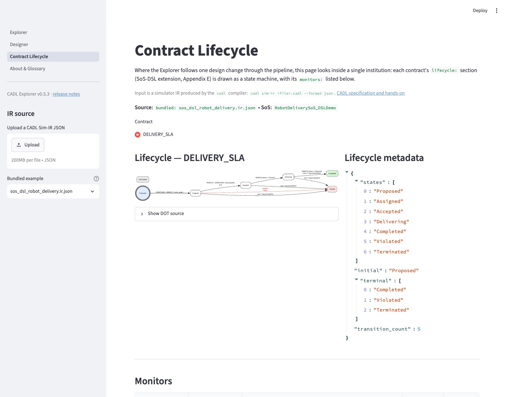
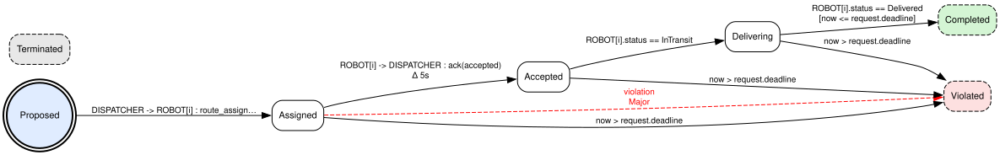
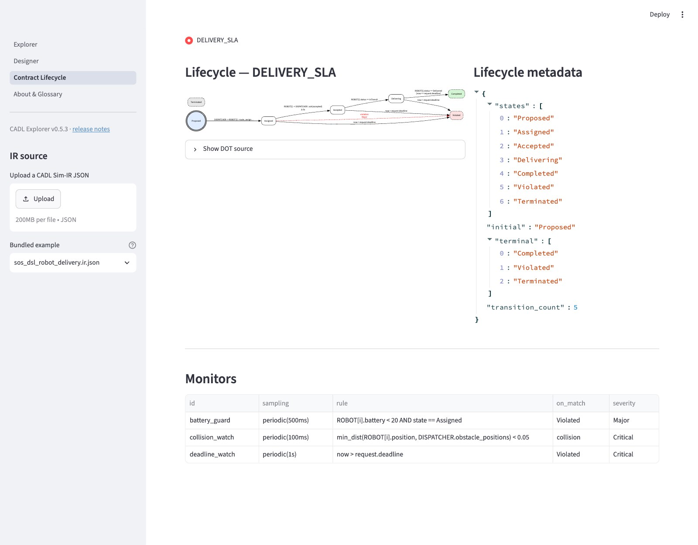

# 第 6 章 — ライフサイクルを可視化する

この章では、cadl-explorer で契約のライフサイクルを図にして読みます（約 15 分）。演習では、規範を加える前と後の仕様を図で比べ、違反を時系列で表示するページを作ります。

## 6.1 学ぶこと

**手順で：**

- cadl-explorer の **Contract Lifecycle** ページの読み方（本書では、このページに表示される図を Lifecycle View と呼びます）。
- 図の表記（二重円、破線枠、赤エッジ）が仕様のどこに対応するか。

**演習で：**

- 図の表記を、CADL を知らない人に説明できる。
- 2 つの仕様（v1 と v2）を図で比較できる。

## 6.2 背景

### Lifecycle View の読み方

SoS は分散したシステムなので、デバッガで 1 ステップずつ実行して調べることができません。その代わりに、仕様から描いた図を見て誤りを探します。Lifecycle View はそのための図です。

| 視覚要素 | 意味 |
| --- | --- |
| 二重円 | `lifecycle.initial` |
| 破線枠 + 緑塗り | terminal state `Completed` |
| 破線枠 + 赤塗り | terminal state `Violated` |
| 破線枠 + 灰塗り | その他の terminal state（`Terminated`, `Cancelled`） |
| 実線エッジ + `Δ 5s` | `deadline` を持つ遷移 |
| 赤い破線エッジ | `on_violation` による強制遷移 |

## 6.3 手順

第 2 章で有効にした仮想環境（`cadl_repo/.venv`）にインストールします。`requirements.txt` が求める `cadl-lang` は、第 2 章でクローンからインストールしたものと同じパッケージなので、置き換えは起きません。

```bash
cd ~/program/cadl-explorer
pip install -r requirements.txt
streamlit run app.py
# ブラウザで http://localhost:8501 が開く
```

サイドバーの一番上にあるページの一覧で、既定のページ（**Explorer**）から **Contract Lifecycle** に切り替えます（v0.4.0 より前は **SoS DSL Lifecycle** という名前でした。どちらも無い場合は、`cadl-explorer` のチェックアウトが古くなっています。`main` で `git pull` してください）。

IR JSON を読み込む方法は 2 通りあります。

- **(a) アップロード**：自分のファイルの IR を読み込みます。先に `~/program/cadl_repo` で `cadl sim-ir my_delivery.cadl --format json > my_delivery.ir.json` を実行して保存し、その `my_delivery.ir.json` を File uploader にドラッグ & ドロップします。
- **(b) 同梱例**：`sos_dsl_robot_delivery.ir.json` を使います。ページを開くと最初から表示されています。ドロップダウン（**Bundled example**）は、アップロードしたファイルを取り除いたあとで同梱例に戻るためのものです。

> **別の方法。** **Designer** ページは、`cadl sim-ir` を経ずに `.cadl` ファイルから同じ図を描きます。**Open an existing CADL file** でファイルを開き、ビューを **Lifecycle** に切り替えます。契約のインスタンスを 1 ステップずつたどることもできます。この章で IR を使うのは、シミュレータと生成されたランタイムが読むのが IR だからです。

## 6.4 表示されるもの

次のスクリーンショットは、(b) の同梱例を読み込んだ画面です。左のサイドバーにアップローダと同梱例の選択欄、中央にライフサイクル図、右にライフサイクルのメタデータが表示されます。



図の部分を拡大したものです（同梱例なので遷移は 5 本。赤い破線は、`accept` の期限切れで `Violated` へ強制的に移る辺です）。



図の下には、契約のモニター一覧が表示されます。



以下の模式図は (a) の `my_delivery.cadl`（4 遷移・モニター 1 個）を読み込んだ場合です。(b) の同梱例 `sos_dsl_robot_delivery.cadl` を読み込むと遷移は 5（`late_failure` を追加）、モニターは 3 個（`battery_guard` / `collision_watch` / `deadline_watch`）になります。

ページは 2 列に分かれます。下の図は模式図です。実際のページでは、図は左から右へ描かれ、各エッジには遷移の id ではなくトリガ（`on:` の文。たとえば `ROBOT[i] -> DISPATCHER : ack(accepted)`。続けて `Δ 5s` と、あれば `[when]` の条件）が書かれ、メタデータには状態の名前が並び、Monitors テーブルには `rule` の列もあります：

```
┌──────────────────────────────────┬──────────────────────────────┐
│ Lifecycle — DELIVERY_SLA          │  Lifecycle metadata          │
│                                   │                               │
│   ┏━━━━━━━━━━┓                    │  states          : 7         │
│   ┃ Proposed ┃ ←initial (二重円)  │  initial         : Proposed  │
│   ┗━━━━┳━━━━━┛                    │  terminal        : 3         │
│        │ assign                   │  transition_count: 4         │
│        ▼                          │                               │
│   ┌──Assigned──┐                  │                               │
│   │            │ accept Δ 5s      │                               │
│   │            ▼                  │                               │
│   │       ┌Accepted┐              │                               │
│   │       └────┬───┘              │                               │
│   │ violation  │                  │                               │
│   │ (赤・破線)  │ start_delivery   │                               │
│   ▼            ▼                  │                               │
│ ╔Violated╗ ┌Delivering┐           │                               │
│ ╚════════╝ └────┬─────┘           │                               │
│ (赤・破線)       │ complete         │                               │
│                 ▼                  │                               │
│             ╔Completed╗            │                               │
│             ╚═════════╝            │                               │
│             (緑・破線)              │                               │
└──────────────────────────────────┴──────────────────────────────┘

┌─────────────────────────────────────────────────────────────────┐
│ Monitors                                                          │
├──────────────┬──────────────────────┬─────────────┬──────────────┤
│ id           │ sampling             │ on_match    │ severity     │
├──────────────┼──────────────────────┼─────────────┼──────────────┤
│ battery_guard│ periodic(500ms)      │ Violated    │ Major        │
└──────────────┴──────────────────────┴─────────────┴──────────────┘
```

図の表記：

| 要素 | 意味 |
| --- | --- |
| 二重円 | `lifecycle.initial` |
| 破線枠 + 緑塗り | terminal state `Completed` |
| 破線枠 + 赤塗り | terminal state `Violated` |
| 破線枠 + 灰塗り | terminal state `Terminated` |
| 実線エッジ + ラベル `Δ 5s` | `deadline_ms = 5000` を持つ遷移 |
| 赤い破線エッジ + `violation Major` | `on_violation` による強制遷移 |

図の中で `Terminated` はどこともつながっていません。(a) も (b) も `Terminated` を終端状態として宣言していますが、そこへ入る遷移を書いていないためです。どちらかのファイルを **Designer** ページで開くと、同じことが Lifecycle の警告（`State 'Terminated' cannot be reached from the initial state 'Proposed'.`）として表示されます。これはエラーではなく警告です。ライフサイクルには到達できる終端状態が 1 つあればよいので、`cadl check` は通ります。

## 6.5 チェック

ライフサイクルの図を見て（またはスクリーンショットを撮って）、次の点を確認します。

- 二重円のノードは `Proposed` だけ。
- `Assigned` から `Violated` への赤い破線エッジが 1 本ある（これが期限切れによる強制遷移）。同梱例では、このほかに `now > request.deadline` と書かれた実線のエッジが 3 本、`Violated` に入ります（`late_failure` 遷移が出ていく状態ごとに 1 本）。
- Monitors テーブルに `battery_guard` が `periodic(500ms)` / `Major` で表示されている。

## 6.6 おさらい

この図は IR JSON から生成されたもので、手で描いた部分はありません。CADL の `deadline: 5s` を `10s` に変えて IR を再生成し、画面をリロードすれば、エッジのラベルが `Δ 10s` に変わります。

## 6.7 演習

### 演習 6.1 (★) — v1 と v2 の両方を可視化

**目的**: cadl-explorer を起動し、v1 と v2 の IR ファイルを両方ロードする。Lifecycle View で、v1 と v2 の違いを正確に挙げる。

**手順**:

1. `cadl-explorer` を起動（`streamlit run app.py`）。
2. v1 用にも IR を生成：`cadl sim-ir my_delivery_v1.cadl --format json > my_delivery_v1.ir.json`。
3. **Contract Lifecycle** ページを開く（サイドバー上部のページ一覧にある）。v1 を先にアップロード、次に v2。
4. スクリーンショットを取る。

**確認**: v1 では「契約にライフサイクルが無い」旨の警告が表示される。v2 では 8 状態の状態機械が描画される（`Cancelled` を追加する演習 5.3 を飛ばした場合は 7 状態）。

### 演習 6.2 (★★) — A/B 比較レポート

**目的**: 同じ契約について、第 5 章で規範を加える前と後を比べる 1 ページのレポートを書く。

**手順**: 1 ページの Markdown 文書に、以下を含める。

- v1 の可視化のスクリーンショット（「ライフサイクルが無い」という警告が表示されているはず）
- v2 のライフサイクルのスクリーンショット
- 状態数、deadline 付き遷移数、monitor 数、terminal state 数を列挙する表
- v1 では検出されず、v2 では検出される失敗の種類を 3 文で説明

**提出**: `session3_comparison.md` + 2 枚のスクリーンショット。

### 演習 6.3 (★★★) — Violation Trace View を作る

**目的**: cadl-explorer に新しい Streamlit ページを追加。`multi_robot_demo --log <path>` の NDJSON ログ（第 7 章で生成）を取り込み、Gantt 風のタイムラインで表示する。

**手順**:

1. 開発用のログを作る（シミュレータのリポジトリで実行）：

   ```bash
   cd ~/program/cadl-raspimouse-simulator
   python3 -m cadl.runtime.multi_robot_demo --log session4_baseline.ndjson
   ```

   1 行が 1 つの JSON レコードです。使うフィールドは `instance_id`、`kind`（`lifecycle` または `violation`）、`to_state`、`t_ms`、違反レコードの `detected_by` です。
2. `cadl-explorer/cadl_sim/sos_dsl/violation_trace_view.py` を作成。NDJSON 各行をパースし `instance_id` でグループ化する。状態区間は、ある `lifecycle` レコードの `t_ms` から、同じインスタンスの次の `lifecycle` レコードの `t_ms` まで。ログには実行終了のレコードがないので、各インスタンスの最後の状態はログ中の最大の `t_ms` で閉じる（そうしないと、`Proposed` から動かないインスタンスにバーが出ない）。
3. Plotly で描く（新しい依存パッケージは要らない）。状態区間は `go.Bar(orientation="h", base=start, x=duration)`、違反は `go.Scatter(mode="markers", marker=dict(symbol="x", color="red"))` を使う（`Bar` だけではマーカーを描けない）。
4. ページとして登録する。cadl-explorer に `pages/` ディレクトリはない。ページは `views/` に置き、`app.py` で明示的に登録する。`cadl-explorer/views/violation_trace.py` を作成し（`views/lifecycle.py` を手本にする）、ログは `st.file_uploader(..., type=["ndjson"])` で読み込む（リポジトリにサンプルのログは同梱されていない）。そのうえで `app.py` の `st.navigation([...])` のリストに 1 行追加：

   ```python
   st.Page("views/violation_trace.py", title="Violation Trace", url_path="violation-trace"),
   ```

ベースラインのログでは、`robot-0-1`〜`robot-4-1` の 5 行と、赤いマーカー 3 個が表示されます。

このページは、第 7 章でシミュレーションを動かすときにすぐ使えるように、先に作っておくものです。

### 授業で使う場合

**授業の前に。**

- 第 5 章の `my_delivery_v2.cadl`
- `my_delivery_v2.ir.json`
- （任意）まだ cadl-explorer を開いていなければ 6.1〜6.6 節

**まとめと宿題。**

**次の授業（第 7 章）に持参**:

- `session3_comparison.md` + 2 枚のスクリーンショット
- （任意）演習 6.3 で書いた `violation_trace_view.py`

**事前ディスカッション**: シミュレーションの結果がどうなっていたら驚くかを、1 文で書いてくる。
